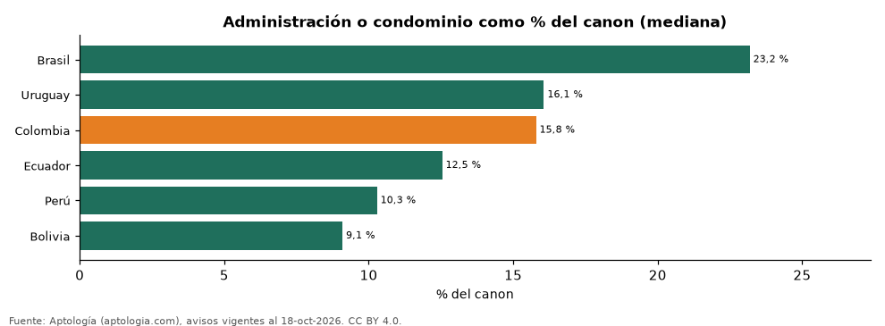

# Cuánto pesa la administración (condominio o mantenimiento) sobre el arriendo en Latinoamérica (octubre 2026)

**La cuota de administración o condominio equivale en la mediana al 23,2 % del canon en Brasil, la más alta de la región, frente al 9,1 % en Bolivia.** En Colombia es el 15,8 % del arriendo.

*Resumen: analizamos 27.639 apartamentos en arriendo que declaran la cuota.*

**Actualizado:** 18 de octubre de 2026 (datos del 18 de octubre de 2026) · **Próxima actualización:** mensual.

## Resumen

| Indicador | Valor |
|---|---|
| Mayor peso | Brasil: 23,2 % |
| Menor peso | Bolivia: 9,1 % |
| Colombia | 15,8 % |

## Por país

| País | Cuota sobre el canon (mediana) | Avisos con la cuota |
|---|---|---|
| Brasil | 23,2 % | 10.491 |
| Uruguay | 16,1 % | 2.878 |
| Colombia | 15,8 % | 12.969 |
| Ecuador | 12,5 % | 52 |
| Perú | 10,3 % | 833 |
| Bolivia | 9,1 % | 416 |

Cuota mensual de administración, condominio, gastos comunes o mantenimiento dividida por el canon, aviso por aviso.

## Por ciudad (100 avisos o más)

| Ciudad | Cuota sobre el canon | Avisos |
|---|---|---|
| Punta del Este (Uruguay) | 25,0 % | 219 |
| São Paulo (Brasil) | 23,2 % | 10.491 |
| Cúcuta (Colombia) | 22,0 % | 180 |
| Ibagué (Colombia) | 18,6 % | 115 |
| Bucaramanga (Colombia) | 18,0 % | 276 |
| Floridablanca (Colombia) | 17,9 % | 265 |
| Cali (Colombia) | 17,3 % | 180 |
| Santa Marta (Colombia) | 17,0 % | 244 |
| Barranquilla (Colombia) | 16,7 % | 1.565 |
| Cartagena (Colombia) | 16,2 % | 801 |
| Chía (Colombia) | 16,2 % | 206 |
| Bogotá (Colombia) | 16,1 % | 6.456 |
| Montevideo (Uruguay) | 15,7 % | 2.654 |
| Pereira (Colombia) | 15,2 % | 878 |
| Cajicá (Colombia) | 14,3 % | 128 |
| Armenia (Colombia) | 14,0 % | 114 |
| Santa Cruz de la Sierra (Bolivia) | 12,4 % | 212 |
| Medellín (Colombia) | 11,2 % | 707 |
| Envigado (Colombia) | 11,1 % | 127 |
| Lima (Perú) | 10,3 % | 821 |
| La Paz (Bolivia) | 7,5 % | 191 |

## Preguntas frecuentes

**¿Cuánto es la administración frente al arriendo en Colombia?**
La mediana es el 15,8 % del canon mensual, en apartamentos que declaran la cuota.

**¿Dónde es más alta la cuota de condominio?**
En Brasil: 23,2 % del alquiler en la mediana.

## Metodología

- **Fuente:** exportes nocturnos de la base de datos de Aptología (aptologia.com) del 18 de octubre de 2026: avisos vigentes de vivienda en portales inmobiliarios de 13 países, recogidos por Aptología y vistos en línea entre el 11 y el 18 de octubre de 2026. Corte: 18 de octubre de 2026.
- **Depuración:** se eliminan duplicados exactos (misma ciudad, zona, tipo, precio, moneda, área, habitaciones y baños) y los precios fuera del percentil 1–99 de cada país, operación, moneda y tipo; el precio por m² usa solo avisos con área declarada entre 12 y 2.000 m² y también se recorta al P1–P99.
- **Qué se mide:** precios pedidos (publicados), no precios de cierre. En arriendo, el canon mensual sin administración, gastos comunes ni condominio.
- **Muestra mínima:** cada cifra publicada se apoya en al menos 30 avisos; las celdas con menos se omiten.
- **Cuota:** administración (Colombia), condominio (Brasil), gastos comunes o mantenimiento según el país, tal como la declara el aviso; solo avisos que la declaran. Es un porcentaje del canon aviso por aviso, sin conversión de moneda.
- **Limitaciones:** la cobertura depende de los portales que recorre Aptología en cada país y es mayor en las ciudades grandes y en los segmentos medio-alto y alto; el área es la que declara el aviso, sin verificar; los nombres de zona vienen de los portales.
- **Privacidad:** solo se publican agregados; no se publica ningún dato personal, enlace a avisos ni nombre de anunciante.
- **Datos abiertos:** [datos.csv](datos.csv), licencia CC BY 4.0.

## Cómo citar

Pinzón Pineda, D. M. (2026). *Cuánto pesa la administración (condominio o mantenimiento) sobre el arriendo en Latinoamérica (octubre 2026)*. Aptología (aptologia.com). https://github.com/elbroker/aptologia-datos/tree/main/estudios/administracion-condominio-porcentaje-del-arriendo-latinoamerica-2026. Datos: datos.csv, licencia CC BY 4.0.
