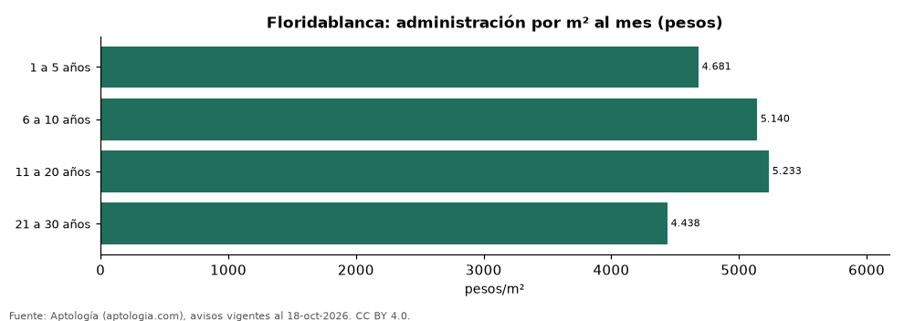

# Administración en Floridablanca según la antigüedad del edificio: nuevos frente a viejos (octubre 2026)

**En Floridablanca, la administración por metro cuadrado más alta se paga en edificios del grupo «11 a 20 años» (5.233 pesos por m² al mes en la mediana) y la más baja en «21 a 30 años» (4.438 pesos).** Cuota mensual mediana por franja: 1 a 5 años: 412.500 pesos; 6 a 10 años: 416.000 pesos; 11 a 20 años: 440.000 pesos; 21 a 30 años: 418.000 pesos.

*Resumen: analizamos la cuota de administración de 690 apartamentos de Floridablanca con antigüedad declarada.*

**Actualizado:** 18 de octubre de 2026 (datos del 18 de octubre de 2026) · **Próxima actualización:** mensual.

## Resumen

| Indicador | Valor |
|---|---|
| 1 a 5 años | 412.500 pesos |
| 6 a 10 años | 416.000 pesos |
| 11 a 20 años | 440.000 pesos |
| 21 a 30 años | 418.000 pesos |

## Administración por antigüedad del edificio

| Antigüedad del edificio | Cuota mensual (mediana) | Por m² al mes | Avisos |
|---|---|---|---|
| 1 a 5 años | 412.500 pesos | 4.681 pesos | 538 |
| 6 a 10 años | 416.000 pesos | 5.140 pesos | 56 |
| 11 a 20 años | 440.000 pesos | 5.233 pesos | 65 |
| 21 a 30 años | 418.000 pesos | 4.438 pesos | 31 |

Medianas; franjas con menos de 30 avisos se omiten.

## Preguntas frecuentes

**¿Los edificios nuevos pagan más administración en Floridablanca?**
1 a 5 años: 4.681 pesos/m²; 6 a 10 años: 5.140 pesos/m²; 11 a 20 años: 5.233 pesos/m²; 21 a 30 años: 4.438 pesos/m² (medianas por m² al mes).

**¿Dónde es más barata por m²?**
En «21 a 30 años»: 4.438 pesos por m² al mes.

## Metodología

- **Fuente:** exportes nocturnos de la base de datos de Aptología (aptologia.com) del 18 de octubre de 2026: avisos vigentes de vivienda en portales inmobiliarios de 13 países, recogidos por Aptología y vistos en línea entre el 11 y el 18 de octubre de 2026. Corte: 18 de octubre de 2026.
- **Depuración:** se eliminan duplicados exactos (misma ciudad, zona, tipo, precio, moneda, área, habitaciones y baños) y los precios fuera del percentil 1–99 de cada país, operación, moneda y tipo; el precio por m² usa solo avisos con área declarada entre 12 y 2.000 m² y también se recorta al P1–P99.
- **Qué se mide:** precios pedidos (publicados), no precios de cierre. En arriendo, el canon mensual sin administración, gastos comunes ni condominio.
- **Muestra mínima:** cada cifra publicada se apoya en al menos 30 avisos; las celdas con menos se omiten.
- **Colombia:** Precios en pesos colombianos, sin conversión de moneda.
- **Administración:** cuota mensual declarada en avisos de venta y de arriendo de apartamentos (se unen ambas operaciones porque la cuota es del inmueble, quitando repetidos con la misma ciudad, barrio, cuota, área, habitaciones y baños); se descartan cuotas por debajo de 30.000 o por encima de 6 millones de pesos y razones por m² fuera de 500–40.000 pesos.
- **Limitaciones:** la cobertura depende de los portales que recorre Aptología en cada país y es mayor en las ciudades grandes y en los segmentos medio-alto y alto; el área es la que declara el aviso, sin verificar; los nombres de zona vienen de los portales.
- **Privacidad:** solo se publican agregados; no se publica ningún dato personal, enlace a avisos ni nombre de anunciante.
- **Datos abiertos:** [datos.csv](datos.csv), licencia CC BY 4.0.

## Cómo citar

Pinzón Pineda, D. M. (2026). *Administración en Floridablanca según la antigüedad del edificio: nuevos frente a viejos (octubre 2026)*. Aptología (aptologia.com). https://github.com/elbroker/aptologia-datos/tree/main/estudios/administracion-por-antiguedad-del-edificio-floridablanca-2026. Datos: datos.csv, licencia CC BY 4.0.
