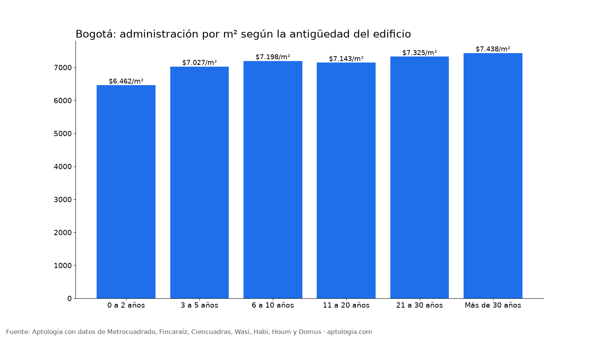
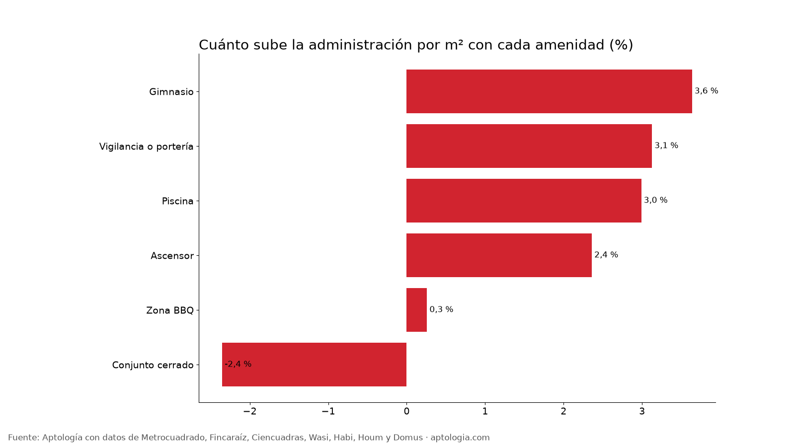

# Cuota de administración en Bogotá según la antigüedad del edificio y sus amenidades (octubre 2026)

**Dentro del mismo estrato, los edificios nuevos de Bogotá cobran más administración por metro cuadrado: en estrato 6, $10.181 por m² al mes en edificios de 0 a 2 años frente a $8.299 en los de 21 a 30 años.** La amenidad que más encarece la cuota es gimnasio: 3,6 % más por m² que en edificios comparables sin ella. En toda la ciudad, la mediana simple es $6.462 por m² en edificios nuevos y $7.438 en los de más de 30 años, porque los nuevos se concentran en estratos más bajos.

*Resumen: analizamos la cuota de administración de 37.133 apartamentos únicos en venta y arriendo en Bogotá.*

**Actualizado:** 18 de octubre de 2026 (datos del 18 de octubre de 2026) · **Próxima actualización:** mensual.

## Administración según la antigüedad

| Antigüedad | Administración por m² | Administración mediana | Avisos |
|---|---|---|---|
| 0 a 2 años | $6.462 | $380.000 | 5.062 |
| 3 a 5 años | $7.027 | $716.000 | 15.174 |
| 6 a 10 años | $7.198 | $750.000 | 3.384 |
| 11 a 20 años | $7.143 | $903.000 | 5.145 |
| 21 a 30 años | $7.325 | $1.076.000 | 6.350 |
| Más de 30 años | $7.438 | $871.000 | 315 |

## Administración por m² según antigüedad y estrato

| Antigüedad | Estrato 3 | Estrato 4 | Estrato 5 | Estrato 6 |
|---|---|---|---|---|
| 0 a 2 años | $4.384 | $6.214 | $8.333 | $10.181 |
| 3 a 5 años | $4.231 | $6.042 | $7.476 | $8.929 |
| 6 a 10 años | $4.111 | $6.557 | $7.463 | $9.091 |
| 11 a 20 años | $3.912 | $6.000 | $7.089 | $8.805 |
| 21 a 30 años | $4.105 | $6.155 | $6.925 | $8.299 |
| Más de 30 años | $3.427 | $6.004 | $7.418 | $8.580 |

## Cuánto sube la cuota cada amenidad

| Amenidad | Aumento de la administración por m² (emparejado) | Grupos comparables | Avisos con la amenidad |
|---|---|---|---|
| Gimnasio | +3,6 % | 296 | 15.307 |
| Vigilancia o portería | +3,1 % | 317 | 22.802 |
| Piscina | +3,0 % | 115 | 3.297 |
| Ascensor | +2,4 % | 306 | 21.474 |
| Zona BBQ | +0,3 % | 183 | 6.033 |
| Conjunto cerrado | -2,4 % | 301 | 13.241 |

**Cómo usarlo para decidir:** multiplica el valor por m² de tu tramo por el área del apartamento para estimar la cuota si el aviso no la trae. Cada amenidad cuesta todos los meses: si no vas a usar la piscina, un edificio sin ella puede ahorrarte una suma importante al año.

## Preguntas frecuentes

**¿Cuánto cuesta la administración por metro cuadrado en Bogotá?**
Depende sobre todo del estrato y de la edad: en estrato 3 va de $4.105 (21 a 30 años) a $4.384 por m² (0 a 2 años); en estrato 6, de $8.299 a $10.181 (medianas, datos del 18 de octubre de 2026).

**¿La piscina sube la administración?**
Sí: gimnasio +3,6 % por m²; piscina +3,0 % por m² frente a edificios comparables sin ella.

**¿Por qué la administración es más cara en edificios nuevos?**
Dentro del mismo estrato, los edificios nuevos suelen tener más zonas comunes, ascensores, vigilancia 24 horas y equipos que mantener; los edificios viejos tienen menos servicios, aunque pueden cobrar cuotas extraordinarias por reparaciones.

## Metodología

- **Fuente:** avisos vivos de vivienda recogidos por la ingesta de Aptología en Metrocuadrado, Fincaraíz, Ciencuadras, Wasi, Habi, Houm y Domus, del 11 al 18 de octubre de 2026. Corte: 18 de octubre de 2026.
- **Depuración:** un mismo inmueble publicado varias veces se cuenta una sola vez (agrupación por portal y, entre portales, por precio, área, habitaciones y coordenadas). Se descartan precios y áreas fuera de rango y, en arriendo, se resta la administración cuando el portal la incluye en el canon.
- **Qué se mide:** precios pedidos (publicados), no precios de cierre.
- **Administración por m²:** cuota mensual informada ÷ área del aviso. Se excluyen cuotas en cero o desproporcionadas frente al precio. Aumento por amenidad: mediana ponderada de las diferencias de administración por m² dentro de grupos del mismo estrato, localidad, habitaciones y rango de área.
- **Limitaciones:** son precios pedidos en portales, que pueden diferir del valor final de arriendo o venta. La cobertura es mayor en el norte de Bogotá y en estratos 4 a 6, porque ahí se concentra la oferta publicada. Los barrios y la localidad vienen de lo que escribe cada portal; cuando falta la localidad se asigna por los avisos vecinos más cercanos.
- **Datos abiertos:** [datos.csv](datos.csv), licencia CC BY 4.0.

## Cómo citar

Pinzón Pineda, D. M. (2026). *Cuota de administración en Bogotá según la antigüedad del edificio y sus amenidades (octubre 2026)*. Aptología. https://www.aptologia.com/estudios/administracion-por-antiguedad-y-amenidades-bogota-2026. Datos: datos.csv, licencia CC BY 4.0.
