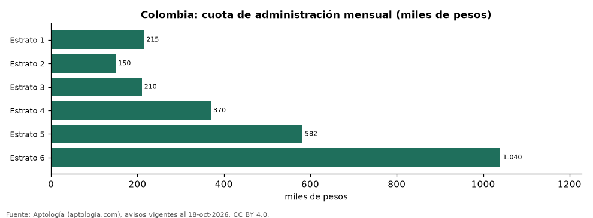

# Cuánto cuesta la administración según el estrato en Colombia: cuota mensual y por m² (octubre 2026)

**La cuota de administración de un apartamento en Colombia es en la mediana 1.040.000 pesos al mes en estrato 6 y 210.000 pesos en estrato 3, 5,0 veces más.** Por metro cuadrado va de 2.953 pesos a 7.231 pesos al mes según el estrato.

*Resumen: analizamos la administración declarada de 100.384 apartamentos en venta y arriendo con estrato y área.*

**Actualizado:** 18 de octubre de 2026 (datos del 18 de octubre de 2026) · **Próxima actualización:** mensual.

## Resumen

| Indicador | Valor |
|---|---|
| Estrato 1 | 215.000 pesos (4.130 pesos/m²) |
| Estrato 2 | 150.000 pesos (2.953 pesos/m²) |
| Estrato 3 | 210.000 pesos (3.859 pesos/m²) |
| Estrato 4 | 370.000 pesos (5.000 pesos/m²) |
| Estrato 5 | 582.000 pesos (5.752 pesos/m²) |
| Estrato 6 | 1.040.000 pesos (7.231 pesos/m²) |

## Colombia: administración por estrato

| Estrato | Cuota mensual (mediana) | Por m² | Avisos |
|---|---|---|---|
| 1 | 215.000 pesos | 4.130 pesos | 505 |
| 2 | 150.000 pesos | 2.953 pesos | 1.943 |
| 3 | 210.000 pesos | 3.859 pesos | 14.704 |
| 4 | 370.000 pesos | 5.000 pesos | 26.839 |
| 5 | 582.000 pesos | 5.752 pesos | 23.107 |
| 6 | 1.040.000 pesos | 7.231 pesos | 33.286 |

Medianas de la cuota declarada en el aviso; se excluyen cuotas por m² por fuera de 500 a 40.000 pesos.

## Cuota mensual por ciudad y estrato

| Ciudad | Estrato 1 | Estrato 2 | Estrato 3 | Estrato 4 | Estrato 5 | Estrato 6 |
|---|---|---|---|---|---|---|
| Bogotá | 248.607 pesos | 127.050 pesos | 201.132 pesos | 453.400 pesos | 808.500 pesos | 1.500.000 pesos |
| Medellín | — | 160.000 pesos | 216.293 pesos | 379.000 pesos | 531.500 pesos | 912.000 pesos |
| Cali | — | 206.000 pesos | 240.000 pesos | 295.000 pesos | 540.000 pesos | 1.024.000 pesos |
| Barranquilla | — | 160.504 pesos | 210.000 pesos | 390.000 pesos | 556.752 pesos | 930.000 pesos |
| Cartagena | — | — | 250.000 pesos | 400.000 pesos | 700.000 pesos | 980.000 pesos |

— indica menos de 30 avisos.

## Preguntas frecuentes

**¿Cuánto se paga de administración en estrato 4?**
370.000 pesos al mes en la mediana nacional (5.000 pesos por m²).

**¿Cuánto se paga de administración en estrato 6?**
1.040.000 pesos al mes en la mediana.

## Metodología

- **Fuente:** exportes nocturnos de la base de datos de Aptología (aptologia.com) del 18 de octubre de 2026: avisos vigentes de vivienda en portales inmobiliarios de 13 países, recogidos por Aptología y vistos en línea entre el 11 y el 18 de octubre de 2026. Corte: 18 de octubre de 2026.
- **Depuración:** se eliminan duplicados exactos (misma ciudad, zona, tipo, precio, moneda, área, habitaciones y baños) y los precios fuera del percentil 1–99 de cada país, operación, moneda y tipo; el precio por m² usa solo avisos con área declarada entre 12 y 2.000 m² y también se recorta al P1–P99.
- **Qué se mide:** precios pedidos (publicados), no precios de cierre. En arriendo, el canon mensual sin administración, gastos comunes ni condominio.
- **Muestra mínima:** cada cifra publicada se apoya en al menos 30 avisos; las celdas con menos se omiten.
- **Colombia:** Precios en pesos colombianos, sin conversión de moneda.
- **Limitaciones:** la cobertura depende de los portales que recorre Aptología en cada país y es mayor en las ciudades grandes y en los segmentos medio-alto y alto; el área es la que declara el aviso, sin verificar; los nombres de zona vienen de los portales.
- **Privacidad:** solo se publican agregados; no se publica ningún dato personal, enlace a avisos ni nombre de anunciante.
- **Datos abiertos:** [datos.csv](datos.csv), licencia CC BY 4.0.

## Cómo citar

Pinzón Pineda, D. M. (2026). *Cuánto cuesta la administración según el estrato en Colombia: cuota mensual y por m² (octubre 2026)*. Aptología (aptologia.com). https://github.com/elbroker/aptologia-datos/tree/main/estudios/administracion-por-estrato-colombia-2026. Datos: datos.csv, licencia CC BY 4.0.
