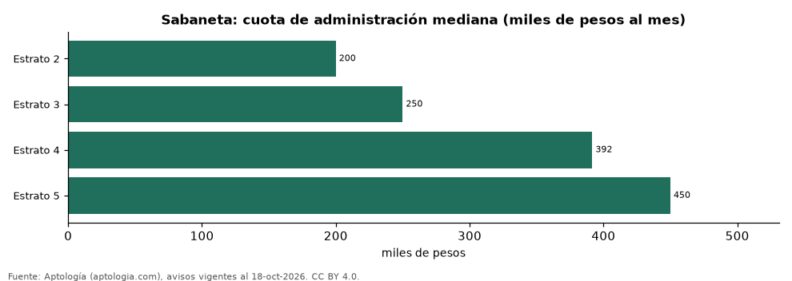

# Cuota de administración en Sabaneta por estrato: cuánto se paga al mes y por m² (octubre 2026)

**En Sabaneta, la cuota de administración mediana de un apartamento pasa de 200.000 pesos al mes en estrato 2 a 450.000 pesos en estrato 5, 2,2 veces más.** Por metro cuadrado, va de 3.630 pesos a 4.962 pesos al mes.

*Resumen: analizamos la cuota de administración de 2.519 apartamentos de Sabaneta con estrato declarado.*

**Actualizado:** 18 de octubre de 2026 (datos del 18 de octubre de 2026) · **Próxima actualización:** mensual.

## Resumen

| Indicador | Valor |
|---|---|
| Estrato 2 | 200.000 pesos |
| Estrato 3 | 250.000 pesos |
| Estrato 4 | 391.681 pesos |
| Estrato 5 | 450.000 pesos |
| Avisos | 2.519 |

## Administración por estrato

| Estrato | Cuota mensual (mediana) | Por m² al mes | Avisos |
|---|---|---|---|
| 2 | 200.000 pesos | 3.630 pesos | 88 |
| 3 | 250.000 pesos | 4.261 pesos | 419 |
| 4 | 391.681 pesos | 5.060 pesos | 1.857 |
| 5 | 450.000 pesos | 4.962 pesos | 140 |

Medianas; estratos con menos de 30 avisos se omiten.

## Preguntas frecuentes

**¿Cuánto se paga de administración en estrato 5 en Sabaneta?**
450.000 pesos al mes en la mediana (4.962 pesos por m²), octubre de 2026.

**¿Y en estrato 2?**
200.000 pesos al mes.

## Metodología

- **Fuente:** exportes nocturnos de la base de datos de Aptología (aptologia.com) del 18 de octubre de 2026: avisos vigentes de vivienda en portales inmobiliarios de 13 países, recogidos por Aptología y vistos en línea entre el 11 y el 18 de octubre de 2026. Corte: 18 de octubre de 2026.
- **Depuración:** se eliminan duplicados exactos (misma ciudad, zona, tipo, precio, moneda, área, habitaciones y baños) y los precios fuera del percentil 1–99 de cada país, operación, moneda y tipo; el precio por m² usa solo avisos con área declarada entre 12 y 2.000 m² y también se recorta al P1–P99.
- **Qué se mide:** precios pedidos (publicados), no precios de cierre. En arriendo, el canon mensual sin administración, gastos comunes ni condominio.
- **Muestra mínima:** cada cifra publicada se apoya en al menos 30 avisos; las celdas con menos se omiten.
- **Colombia:** Precios en pesos colombianos, sin conversión de moneda.
- **Administración:** cuota mensual declarada en avisos de venta y de arriendo de apartamentos (se unen ambas operaciones porque la cuota es del inmueble, quitando repetidos con la misma ciudad, barrio, cuota, área, habitaciones y baños); se descartan cuotas por debajo de 30.000 o por encima de 6 millones de pesos y razones por m² fuera de 500–40.000 pesos.
- **Cordura:** solo se publica si la cuota mediana no baja al subir el estrato.
- **Limitaciones:** la cobertura depende de los portales que recorre Aptología en cada país y es mayor en las ciudades grandes y en los segmentos medio-alto y alto; el área es la que declara el aviso, sin verificar; los nombres de zona vienen de los portales.
- **Privacidad:** solo se publican agregados; no se publica ningún dato personal, enlace a avisos ni nombre de anunciante.
- **Datos abiertos:** [datos.csv](datos.csv), licencia CC BY 4.0.

## Cómo citar

Pinzón Pineda, D. M. (2026). *Cuota de administración en Sabaneta por estrato: cuánto se paga al mes y por m² (octubre 2026)*. Aptología (aptologia.com). https://github.com/elbroker/aptologia-datos/tree/main/estudios/administracion-por-estrato-sabaneta-2026. Datos: datos.csv, licencia CC BY 4.0.
