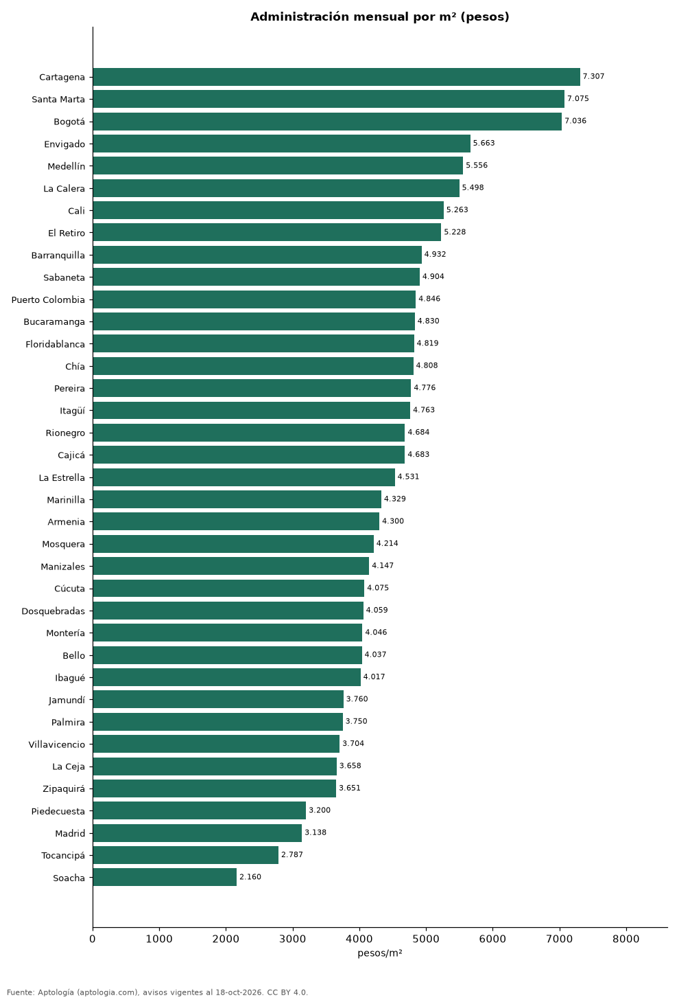

# Cuánto cuesta la administración por metro cuadrado en las ciudades de Colombia (octubre 2026)

**La cuota de administración más alta por metro cuadrado se paga en Cartagena: 7.307 pesos por m² al mes en la mediana; la más baja, en Soacha, con 2.160 pesos.** En Bogotá son 7.036 pesos por m² (492.536 pesos al mes por un apartamento de 70 m²). Por estrato va de 4.130 pesos en estrato 1 a 7.231 pesos en estrato 6.

*Resumen: analizamos 102.572 avisos de apartamentos (venta y arriendo) que informan administración y área.*

**Actualizado:** 18 de octubre de 2026 (datos del 18 de octubre de 2026) · **Próxima actualización:** mensual.

## Resumen

| Indicador | Valor |
|---|---|
| Más alta | Cartagena: 7.307 pesos/m² |
| Más baja | Soacha: 2.160 pesos/m² |
| Bogotá | 7.036 pesos/m² |

## Ciudades

| Ciudad | Administración por m² al mes | Para 70 m² | Avisos |
|---|---|---|---|
| Cartagena | 7.307 pesos | 511.513 pesos | 5.282 |
| Santa Marta | 7.075 pesos | 495.224 pesos | 3.281 |
| Bogotá | 7.036 pesos | 492.536 pesos | 33.229 |
| Envigado | 5.663 pesos | 396.386 pesos | 3.795 |
| Medellín | 5.556 pesos | 388.889 pesos | 13.845 |
| La Calera | 5.498 pesos | 384.842 pesos | 125 |
| Cali | 5.263 pesos | 368.421 pesos | 7.608 |
| El Retiro | 5.228 pesos | 365.975 pesos | 320 |
| Barranquilla | 4.932 pesos | 345.269 pesos | 7.470 |
| Sabaneta | 4.904 pesos | 343.298 pesos | 2.964 |
| Puerto Colombia | 4.846 pesos | 339.231 pesos | 147 |
| Bucaramanga | 4.830 pesos | 338.132 pesos | 2.306 |
| Floridablanca | 4.819 pesos | 337.311 pesos | 1.038 |
| Chía | 4.808 pesos | 336.566 pesos | 1.485 |
| Pereira | 4.776 pesos | 334.289 pesos | 3.876 |
| Itagüí | 4.763 pesos | 333.397 pesos | 1.247 |
| Rionegro | 4.684 pesos | 327.848 pesos | 1.727 |
| Cajicá | 4.683 pesos | 327.778 pesos | 1.357 |
| La Estrella | 4.531 pesos | 317.158 pesos | 335 |
| Marinilla | 4.329 pesos | 303.018 pesos | 78 |
| Armenia | 4.300 pesos | 301.000 pesos | 1.669 |
| Mosquera | 4.214 pesos | 295.000 pesos | 711 |
| Manizales | 4.147 pesos | 290.284 pesos | 1.992 |
| Cúcuta | 4.075 pesos | 285.223 pesos | 603 |
| Dosquebradas | 4.059 pesos | 284.105 pesos | 358 |
| Montería | 4.046 pesos | 283.231 pesos | 103 |
| Bello | 4.037 pesos | 282.603 pesos | 1.432 |
| Ibagué | 4.017 pesos | 281.207 pesos | 1.124 |
| Jamundí | 3.760 pesos | 263.200 pesos | 367 |
| Palmira | 3.750 pesos | 262.500 pesos | 68 |
| Villavicencio | 3.704 pesos | 259.259 pesos | 253 |
| La Ceja | 3.658 pesos | 256.062 pesos | 158 |
| Zipaquirá | 3.651 pesos | 255.578 pesos | 716 |
| Piedecuesta | 3.200 pesos | 224.000 pesos | 212 |
| Madrid | 3.138 pesos | 219.655 pesos | 485 |
| Tocancipá | 2.787 pesos | 195.082 pesos | 259 |
| Soacha | 2.160 pesos | 151.231 pesos | 509 |

Mediana de administración mensual ÷ área; se descartan valores menores de 500 o mayores de 40.000 pesos por m².

## Por estrato (Colombia)

| Estrato | Administración por m² | Avisos |
|---|---|---|
| 1 | 4.130 pesos | 505 |
| 2 | 2.953 pesos | 1.943 |
| 3 | 3.859 pesos | 14.704 |
| 4 | 5.000 pesos | 26.839 |
| 5 | 5.752 pesos | 23.107 |
| 6 | 7.231 pesos | 33.286 |

## Preguntas frecuentes

**¿Cuánto se paga de administración por metro cuadrado en Bogotá?**
7.036 pesos por m² al mes en la mediana.

**¿Dónde es más cara la administración?**
En Cartagena: 7.307 pesos por m² al mes.

## Metodología

- **Fuente:** exportes nocturnos de la base de datos de Aptología (aptologia.com) del 18 de octubre de 2026: avisos vigentes de vivienda en portales inmobiliarios de 13 países, recogidos por Aptología y vistos en línea entre el 11 y el 18 de octubre de 2026. Corte: 18 de octubre de 2026.
- **Depuración:** se eliminan duplicados exactos (misma ciudad, zona, tipo, precio, moneda, área, habitaciones y baños) y los precios fuera del percentil 1–99 de cada país, operación, moneda y tipo; el precio por m² usa solo avisos con área declarada entre 12 y 2.000 m² y también se recorta al P1–P99.
- **Qué se mide:** precios pedidos (publicados), no precios de cierre. En arriendo, el canon mensual sin administración, gastos comunes ni condominio.
- **Muestra mínima:** cada cifra publicada se apoya en al menos 30 avisos; las celdas con menos se omiten.
- **Colombia:** Precios en pesos colombianos, sin conversión de moneda.
- **Limitaciones:** la cobertura depende de los portales que recorre Aptología en cada país y es mayor en las ciudades grandes y en los segmentos medio-alto y alto; el área es la que declara el aviso, sin verificar; los nombres de zona vienen de los portales.
- **Privacidad:** solo se publican agregados; no se publica ningún dato personal, enlace a avisos ni nombre de anunciante.
- **Datos abiertos:** [datos.csv](datos.csv), licencia CC BY 4.0.

## Cómo citar

Pinzón Pineda, D. M. (2026). *Cuánto cuesta la administración por metro cuadrado en las ciudades de Colombia (octubre 2026)*. Aptología (aptologia.com). https://github.com/elbroker/aptologia-datos/tree/main/estudios/administracion-por-metro-cuadrado-ciudades-colombia-2026. Datos: datos.csv, licencia CC BY 4.0.
