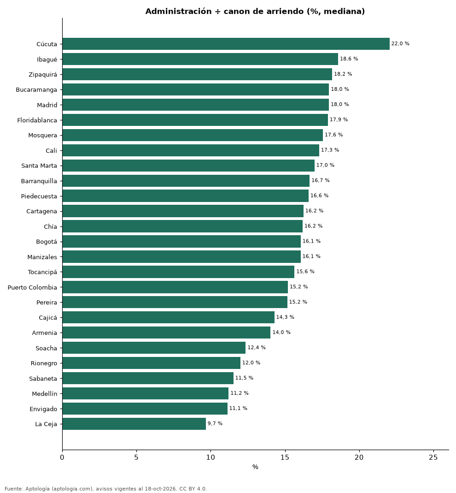
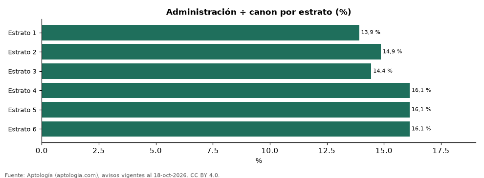

# Cuánto pesa la administración sobre el arriendo en Colombia, por ciudad y estrato (octubre 2026)

**La cuota de administración equivale en la mediana al 15,8 % del canon de arriendo de un apartamento en Colombia; pesa más en Cúcuta (22,0 %) y menos en La Ceja (9,7 %).** En Bogotá es el 16,1 %. Por estrato, va del 13,9 % en estrato 1 al 16,1 % en estrato 6.

*Resumen: analizamos 12.969 apartamentos en arriendo que informan canon y administración.*

**Actualizado:** 18 de octubre de 2026 (datos del 18 de octubre de 2026) · **Próxima actualización:** mensual.

## Resumen

| Indicador | Valor |
|---|---|
| Colombia (mediana) | 15,8 % |
| Mayor | Cúcuta: 22,0 % |
| Menor | La Ceja: 9,7 % |
| Bogotá | 16,1 % |

## Por ciudad (30 avisos o más)

| Ciudad | Administración / canon | Avisos |
|---|---|---|
| Cúcuta | 22,0 % | 180 |
| Ibagué | 18,6 % | 115 |
| Zipaquirá | 18,2 % | 70 |
| Bucaramanga | 18,0 % | 276 |
| Madrid | 18,0 % | 86 |
| Floridablanca | 17,9 % | 265 |
| Mosquera | 17,6 % | 50 |
| Cali | 17,3 % | 180 |
| Santa Marta | 17,0 % | 244 |
| Barranquilla | 16,7 % | 1.565 |
| Piedecuesta | 16,6 % | 35 |
| Cartagena | 16,2 % | 801 |
| Chía | 16,2 % | 206 |
| Bogotá | 16,1 % | 6.456 |
| Manizales | 16,1 % | 71 |
| Tocancipá | 15,6 % | 46 |
| Puerto Colombia | 15,2 % | 41 |
| Pereira | 15,2 % | 878 |
| Cajicá | 14,3 % | 128 |
| Armenia | 14,0 % | 114 |
| Soacha | 12,4 % | 61 |
| Rionegro | 12,0 % | 87 |
| Sabaneta | 11,5 % | 42 |
| Medellín | 11,2 % | 707 |
| Envigado | 11,1 % | 127 |
| La Ceja | 9,7 % | 43 |

## Por estrato

| Estrato | Administración / canon | Administración mensual (mediana) | Avisos |
|---|---|---|---|
| 1 | 13,9 % | 440.000 pesos | 73 |
| 2 | 14,9 % | 178.000 pesos | 202 |
| 3 | 14,4 % | 200.000 pesos | 1.928 |
| 4 | 16,1 % | 371.400 pesos | 2.883 |
| 5 | 16,1 % | 565.442 pesos | 2.616 |
| 6 | 16,1 % | 1.050.000 pesos | 5.160 |

Mediana de la razón administración ÷ canon de cada aviso.

## Preguntas frecuentes

**¿Cuánto es la administración de un apartamento en arriendo en Colombia?**
En la mediana, el 15,8 % del canon mensual.

**¿En qué estrato pesa más la administración?**
En estrato 4, con 16,1 % del canon.

## Metodología

- **Fuente:** exportes nocturnos de la base de datos de Aptología (aptologia.com) del 18 de octubre de 2026: avisos vigentes de vivienda en portales inmobiliarios de 13 países, recogidos por Aptología y vistos en línea entre el 11 y el 18 de octubre de 2026. Corte: 18 de octubre de 2026.
- **Depuración:** se eliminan duplicados exactos (misma ciudad, zona, tipo, precio, moneda, área, habitaciones y baños) y los precios fuera del percentil 1–99 de cada país, operación, moneda y tipo; el precio por m² usa solo avisos con área declarada entre 12 y 2.000 m² y también se recorta al P1–P99.
- **Qué se mide:** precios pedidos (publicados), no precios de cierre. En arriendo, el canon mensual sin administración, gastos comunes ni condominio.
- **Muestra mínima:** cada cifra publicada se apoya en al menos 30 avisos; las celdas con menos se omiten.
- **Colombia:** Precios en pesos colombianos, sin conversión de moneda. Los indicadores de amoblado, mascotas, conjunto cerrado, balcón y aviso directo del dueño solo existen en arriendo y vienen de los portales.
- **Razón:** administración mensual ÷ canon mensual de cada aviso; se descartan razones menores de 1 % o mayores de 80 % (errores de digitación).
- **Limitaciones:** la cobertura depende de los portales que recorre Aptología en cada país y es mayor en las ciudades grandes y en los segmentos medio-alto y alto; el área es la que declara el aviso, sin verificar; los nombres de zona vienen de los portales.
- **Privacidad:** solo se publican agregados; no se publica ningún dato personal, enlace a avisos ni nombre de anunciante.
- **Datos abiertos:** [datos.csv](datos.csv), licencia CC BY 4.0.

## Cómo citar

Pinzón Pineda, D. M. (2026). *Cuánto pesa la administración sobre el arriendo en Colombia, por ciudad y estrato (octubre 2026)*. Aptología (aptologia.com). https://github.com/elbroker/aptologia-datos/tree/main/estudios/administracion-porcentaje-del-arriendo-colombia-2026. Datos: datos.csv, licencia CC BY 4.0.
