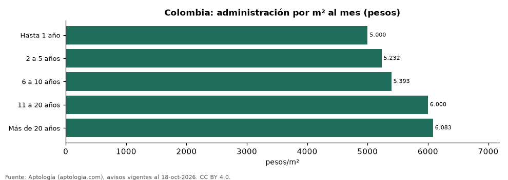

# Administración según la antigüedad del edificio: cuota por m² en edificios nuevos y viejos de Colombia (octubre 2026)

**En Colombia la administración de un apartamento en un edificio de hasta 1 año cuesta en la mediana 5.000 pesos por m² al mes, frente a 6.083 pesos en uno de más de 20 años (-17,8 %).** La cuota mensual mediana pasa de 800.000 pesos en los edificios de más de 20 años a 400.000 pesos en los nuevos.

*Resumen: analizamos 87.123 apartamentos en venta con administración, área y antigüedad declaradas.*

**Actualizado:** 18 de octubre de 2026 (datos del 18 de octubre de 2026) · **Próxima actualización:** mensual.

## Resumen

| Indicador | Valor |
|---|---|
| Hasta 1 año | 5.000 pesos/m² |
| 2 a 5 años | 5.232 pesos/m² |
| 6 a 10 años | 5.393 pesos/m² |
| 11 a 20 años | 6.000 pesos/m² |
| Más de 20 años | 6.083 pesos/m² |

## Colombia: administración por m² según antigüedad

| Antigüedad | Administración por m² | Cuota mensual | Avisos |
|---|---|---|---|
| Hasta 1 año | 5.000 pesos | 400.000 pesos | 5.570 |
| 2 a 5 años | 5.232 pesos | 445.270 pesos | 47.583 |
| 6 a 10 años | 5.393 pesos | 480.000 pesos | 10.702 |
| 11 a 20 años | 6.000 pesos | 650.000 pesos | 9.887 |
| Más de 20 años | 6.083 pesos | 800.000 pesos | 13.381 |

Medianas; antigüedad declarada por el portal (solo venta), agrupada en tramos. Los edificios nuevos suelen tener más amenidades (piscina, gimnasio, ascensores).

## Las cinco ciudades más grandes (pesos por m² al mes)

| Ciudad | Hasta 1 año | 2 a 5 años | 6 a 10 años | 11 a 20 años | Más de 20 años |
|---|---|---|---|---|---|
| Bogotá | 6.129 pesos | 6.470 pesos | 6.944 pesos | 6.992 pesos | 7.105 pesos |
| Medellín | 5.682 pesos | 5.714 pesos | 5.238 pesos | 5.634 pesos | 5.112 pesos |
| Cali | 5.106 pesos | 5.140 pesos | 5.100 pesos | 5.890 pesos | 5.898 pesos |
| Barranquilla | 4.444 pesos | 4.841 pesos | 5.090 pesos | 5.217 pesos | 4.667 pesos |
| Cartagena | 7.067 pesos | 7.347 pesos | 7.109 pesos | 7.919 pesos | 6.332 pesos |

— indica menos de 30 avisos.

## Preguntas frecuentes

**¿Los edificios nuevos tienen administración más cara?**
No por m²: 5.000 pesos por m² al mes en los de hasta 1 año frente a 6.083 pesos en los de más de 20 años; la cuota mensual total es de 400.000 pesos frente a 800.000 pesos.

**¿Cuánto cuesta la administración por m² en Colombia?**
Entre 5.000 pesos y 6.083 pesos al mes según la antigüedad del edificio.

## Metodología

- **Fuente:** exportes nocturnos de la base de datos de Aptología (aptologia.com) del 18 de octubre de 2026: avisos vigentes de vivienda en portales inmobiliarios de 13 países, recogidos por Aptología y vistos en línea entre el 11 y el 18 de octubre de 2026. Corte: 18 de octubre de 2026.
- **Depuración:** se eliminan duplicados exactos (misma ciudad, zona, tipo, precio, moneda, área, habitaciones y baños) y los precios fuera del percentil 1–99 de cada país, operación, moneda y tipo; el precio por m² usa solo avisos con área declarada entre 12 y 2.000 m² y también se recorta al P1–P99.
- **Qué se mide:** precios pedidos (publicados), no precios de cierre. En arriendo, el canon mensual sin administración, gastos comunes ni condominio.
- **Muestra mínima:** cada cifra publicada se apoya en al menos 30 avisos; las celdas con menos se omiten.
- **Colombia:** Precios en pesos colombianos, sin conversión de moneda.
- **Antigüedad:** campo `antig` (solo venta), informado por los portales.
- **Limitaciones:** la cobertura depende de los portales que recorre Aptología en cada país y es mayor en las ciudades grandes y en los segmentos medio-alto y alto; el área es la que declara el aviso, sin verificar; los nombres de zona vienen de los portales.
- **Privacidad:** solo se publican agregados; no se publica ningún dato personal, enlace a avisos ni nombre de anunciante.
- **Datos abiertos:** [datos.csv](datos.csv), licencia CC BY 4.0.

## Cómo citar

Pinzón Pineda, D. M. (2026). *Administración según la antigüedad del edificio: cuota por m² en edificios nuevos y viejos de Colombia (octubre 2026)*. Aptología (aptologia.com). https://github.com/elbroker/aptologia-datos/tree/main/estudios/administracion-segun-antiguedad-del-edificio-colombia-2026. Datos: datos.csv, licencia CC BY 4.0.
