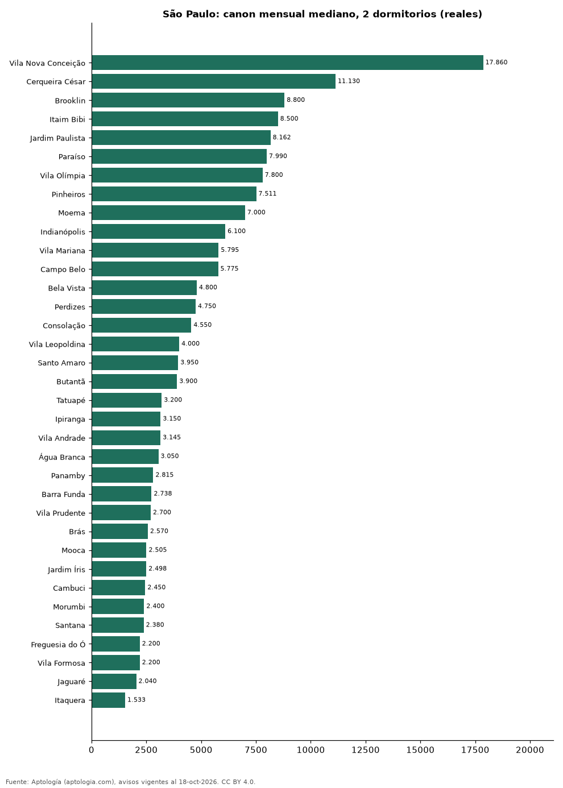

# Dónde es más caro y más barato alquilar un apartamento de 2 dormitorios en São Paulo: ranking de bairros (octubre 2026)

**En São Paulo, un apartamento de 2 dormitorios se alquila por 17.860 reales (USD 3.510) al mes en la mediana en Vila Nova Conceição, el bairro más caro, y 1.533 reales (USD 301) al mes en Itaquera, el más barato: 11,7 veces menos.** Comparamos 35 bairros con al menos 30 avisos de 2 dormitorios.

*Resumen: analizamos 2.142 apartamentos en alquiler de 2 dormitorios en 35 bairros de São Paulo.*

**Actualizado:** 18 de octubre de 2026 (datos del 18 de octubre de 2026) · **Próxima actualización:** mensual.

## Resumen

| Indicador | Valor |
|---|---|
| Más caro | Vila Nova Conceição: 17.860 reales (USD 3.510) |
| Más barato | Itaquera: 1.533 reales (USD 301) |
| Diferencia | 11,7 veces |
| Bairros | 35 |

## Canon mensual de un apartamento de 2 dormitorios por bairro

| Bairro | Canon mensual (mediana) | Rango típico (P25–P75) | Área mediana (m²) | Avisos |
|---|---|---|---|---|
| Vila Nova Conceição | 17.860 reales (USD 3.510) | 10.820 reales (USD 2.126) – 22.000 reales (USD 4.323) | 134 | 50 |
| Cerqueira César | 11.130 reales (USD 2.187) | 7.700 reales (USD 1.513) – 14.450 reales (USD 2.840) | 100 | 55 |
| Brooklin | 8.800 reales (USD 1.729) | 6.450 reales (USD 1.268) – 11.680 reales (USD 2.295) | 80 | 123 |
| Itaim Bibi | 8.500 reales (USD 1.670) | 7.000 reales (USD 1.376) – 13.950 reales (USD 2.741) | 93 | 87 |
| Jardim Paulista | 8.162 reales (USD 1.604) | 5.625 reales (USD 1.105) – 12.000 reales (USD 2.358) | 92 | 82 |
| Paraíso | 7.990 reales (USD 1.570) | 6.500 reales (USD 1.277) – 10.848 reales (USD 2.132) | 88 | 52 |
| Vila Olímpia | 7.800 reales (USD 1.533) | 5.688 reales (USD 1.118) – 13.108 reales (USD 2.576) | 72 | 140 |
| Pinheiros | 7.511 reales (USD 1.476) | 5.669 reales (USD 1.114) – 11.000 reales (USD 2.162) | 77 | 186 |
| Moema | 7.000 reales (USD 1.376) | 5.200 reales (USD 1.022) – 10.580 reales (USD 2.079) | 82 | 87 |
| Indianópolis | 6.100 reales (USD 1.199) | 5.200 reales (USD 1.022) – 10.500 reales (USD 2.063) | 80 | 41 |
| Vila Mariana | 5.795 reales (USD 1.139) | 3.500 reales (USD 688) – 7.925 reales (USD 1.557) | 70 | 84 |
| Campo Belo | 5.775 reales (USD 1.135) | 3.400 reales (USD 668) – 7.800 reales (USD 1.533) | 66 | 34 |
| Bela Vista | 4.800 reales (USD 943) | 3.500 reales (USD 688) – 6.380 reales (USD 1.254) | 62 | 51 |
| Perdizes | 4.750 reales (USD 933) | 3.500 reales (USD 688) – 6.150 reales (USD 1.209) | 74 | 50 |
| Consolação | 4.550 reales (USD 894) | 3.215 reales (USD 632) – 6.875 reales (USD 1.351) | 71 | 42 |
| Vila Leopoldina | 4.000 reales (USD 786) | 3.090 reales (USD 607) – 5.950 reales (USD 1.169) | 62 | 35 |
| Santo Amaro | 3.950 reales (USD 776) | 2.700 reales (USD 531) – 5.570 reales (USD 1.095) | 56 | 61 |
| Butantã | 3.900 reales (USD 766) | 3.330 reales (USD 654) – 5.492 reales (USD 1.079) | 44 | 36 |
| Tatuapé | 3.200 reales (USD 629) | 2.600 reales (USD 511) – 4.260 reales (USD 837) | 54 | 82 |
| Ipiranga | 3.150 reales (USD 619) | 2.600 reales (USD 511) – 4.210 reales (USD 827) | 59 | 46 |
| Vila Andrade | 3.145 reales (USD 618) | 2.500 reales (USD 491) – 4.200 reales (USD 825) | 58 | 102 |
| Água Branca | 3.050 reales (USD 599) | 2.188 reales (USD 430) – 6.038 reales (USD 1.186) | 46 | 48 |
| Panamby | 2.815 reales (USD 553) | 2.030 reales (USD 399) – 3.462 reales (USD 680) | 42 | 30 |
| Barra Funda | 2.738 reales (USD 538) | 2.215 reales (USD 435) – 3.632 reales (USD 714) | 42 | 64 |
| Vila Prudente | 2.700 reales (USD 531) | 2.185 reales (USD 429) – 3.232 reales (USD 635) | 45 | 35 |
| Brás | 2.570 reales (USD 505) | 2.300 reales (USD 452) – 3.200 reales (USD 629) | 50 | 31 |
| Mooca | 2.505 reales (USD 492) | 2.160 reales (USD 424) – 3.200 reales (USD 629) | 44 | 82 |
| Jardim Íris | 2.498 reales (USD 491) | 2.200 reales (USD 432) – 2.780 reales (USD 546) | 44 | 32 |
| Cambuci | 2.450 reales (USD 481) | 1.945 reales (USD 382) – 2.955 reales (USD 581) | 42 | 44 |
| Morumbi | 2.400 reales (USD 472) | 1.850 reales (USD 364) – 2.990 reales (USD 588) | 56 | 33 |
| Santana | 2.380 reales (USD 468) | 2.000 reales (USD 393) – 3.225 reales (USD 634) | 60 | 52 |
| Freguesia do Ó | 2.200 reales (USD 432) | 1.910 reales (USD 375) – 2.350 reales (USD 462) | 47 | 31 |
| Vila Formosa | 2.200 reales (USD 432) | 1.912 reales (USD 376) – 2.975 reales (USD 585) | 45 | 46 |
| Jaguaré | 2.040 reales (USD 401) | 1.640 reales (USD 322) – 2.605 reales (USD 512) | 42 | 37 |
| Itaquera | 1.533 reales (USD 301) | 1.295 reales (USD 254) – 1.848 reales (USD 363) | 42 | 51 |

Medianas del canon pedido, sin administración ni gastos comunes; solo bairros con 30 avisos o más.

## Preguntas frecuentes

**¿Cuánto cuesta alquilar un apartamento de 2 dormitorios en Vila Nova Conceição?**
17.860 reales (USD 3.510) al mes en la mediana (octubre de 2026); la mitad central entre 10.820 reales (USD 2.126) y 22.000 reales (USD 4.323).

**¿Dónde es más barato alquilar un apartamento de 2 dormitorios en São Paulo?**
En Itaquera: 1.533 reales (USD 301) al mes en la mediana.

## Metodología

- **Fuente:** exportes nocturnos de la base de datos de Aptología (aptologia.com) del 18 de octubre de 2026: avisos vigentes de vivienda en portales inmobiliarios de 13 países, recogidos por Aptología y vistos en línea entre el 11 y el 18 de octubre de 2026. Corte: 18 de octubre de 2026.
- **Depuración:** se eliminan duplicados exactos (misma ciudad, zona, tipo, precio, moneda, área, habitaciones y baños) y los precios fuera del percentil 1–99 de cada país, operación, moneda y tipo; el precio por m² usa solo avisos con área declarada entre 12 y 2.000 m² y también se recorta al P1–P99.
- **Qué se mide:** precios pedidos (publicados), no precios de cierre. En arriendo, el canon mensual sin administración, gastos comunes ni condominio.
- **Muestra mínima:** cada cifra publicada se apoya en al menos 30 avisos; las celdas con menos se omiten.
- **Monedas:** nunca se mezclan avisos de monedas distintas sin convertirlos. Conversión a dólares con la tasa de mercado de ExchangeRate-API (open.er-api.com, actualización del 18 Oct 2026): 1 USD = 3.182,80 COP, 1 USD = 18,47 M.N, 1 USD = 5,09 BRL, 1 USD = 3,44 PEN, 1 USD = 982,44 CLP, 1 USD = 1.514,57 ARS, 1 USD = 40,20 UYU, 1 USD = 5.705,37 PYG, 1 USD = 61,27 DOP, 1 USD = 0,89 EUR, 1 USD = 11,72 BOB; la UF chilena a 41.178,64 CLP (mindicador,cl. 18-oct-2026). Los avisos publicados en dólares se usan tal cual.
- **Monedas:** en cada ciudad y operación se usa solo la moneda mayoritaria de los avisos (los avisos en otra moneda se excluyen) y la mediana se convierte a dólares con la tasa citada; nunca se promedian avisos de monedas distintas.
- **Limitaciones:** la cobertura depende de los portales que recorre Aptología en cada país y es mayor en las ciudades grandes y en los segmentos medio-alto y alto; el área es la que declara el aviso, sin verificar; los nombres de zona vienen de los portales.
- **Privacidad:** solo se publican agregados; no se publica ningún dato personal, enlace a avisos ni nombre de anunciante.
- **Datos abiertos:** [datos.csv](datos.csv), licencia CC BY 4.0.

## Cómo citar

Pinzón Pineda, D. M. (2026). *Dónde es más caro y más barato alquilar un apartamento de 2 dormitorios en São Paulo: ranking de bairros (octubre 2026)*. Aptología (aptologia.com). https://github.com/elbroker/aptologia-datos/tree/main/estudios/alquiler-apartamentos-de-2-dormitorios-por-bairro-sao-paulo-2026. Datos: datos.csv, licencia CC BY 4.0.
