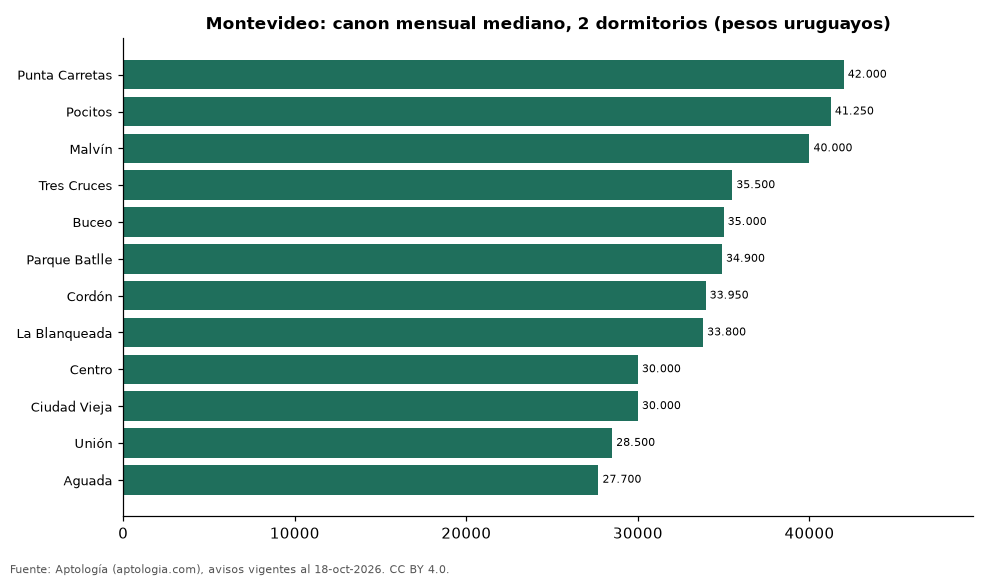

# Dónde es más caro y más barato alquilar un apartamento de 2 dormitorios en Montevideo: ranking de barrios (octubre 2026)

**En Montevideo, un apartamento de 2 dormitorios se alquila por 42.000 pesos uruguayos (USD 1.045) al mes en la mediana en Punta Carretas, el barrio más caro, y 27.700 pesos uruguayos (USD 689) al mes en Aguada, el más barato: 1,5 veces menos.** Comparamos 12 barrios con al menos 30 avisos de 2 dormitorios.

*Resumen: analizamos 816 apartamentos en alquiler de 2 dormitorios en 12 barrios de Montevideo.*

**Actualizado:** 18 de octubre de 2026 (datos del 18 de octubre de 2026) · **Próxima actualización:** mensual.

## Resumen

| Indicador | Valor |
|---|---|
| Más caro | Punta Carretas: 42.000 pesos uruguayos (USD 1.045) |
| Más barato | Aguada: 27.700 pesos uruguayos (USD 689) |
| Diferencia | 1,5 veces |
| Barrios | 12 |

## Canon mensual de un apartamento de 2 dormitorios por barrio

| Barrio | Canon mensual (mediana) | Rango típico (P25–P75) | Área mediana (m²) | Avisos |
|---|---|---|---|---|
| Punta Carretas | 42.000 pesos uruguayos (USD 1.045) | 35.000 pesos uruguayos (USD 871) – 54.000 pesos uruguayos (USD 1.343) | 63 | 41 |
| Pocitos | 41.250 pesos uruguayos (USD 1.026) | 34.250 pesos uruguayos (USD 852) – 45.000 pesos uruguayos (USD 1.119) | 65 | 130 |
| Malvín | 40.000 pesos uruguayos (USD 995) | 36.125 pesos uruguayos (USD 899) – 48.000 pesos uruguayos (USD 1.194) | 69 | 58 |
| Tres Cruces | 35.500 pesos uruguayos (USD 883) | 32.000 pesos uruguayos (USD 796) – 38.000 pesos uruguayos (USD 945) | 60 | 86 |
| Buceo | 35.000 pesos uruguayos (USD 871) | 29.100 pesos uruguayos (USD 724) – 37.700 pesos uruguayos (USD 938) | 56 | 30 |
| Parque Batlle | 34.900 pesos uruguayos (USD 868) | 29.900 pesos uruguayos (USD 744) – 38.200 pesos uruguayos (USD 950) | 60 | 37 |
| Cordón | 33.950 pesos uruguayos (USD 845) | 30.000 pesos uruguayos (USD 746) – 38.000 pesos uruguayos (USD 945) | 60 | 118 |
| La Blanqueada | 33.800 pesos uruguayos (USD 841) | 30.975 pesos uruguayos (USD 771) – 37.225 pesos uruguayos (USD 926) | 55 | 92 |
| Centro | 30.000 pesos uruguayos (USD 746) | 27.250 pesos uruguayos (USD 678) – 36.000 pesos uruguayos (USD 895) | 60 | 103 |
| Ciudad Vieja | 30.000 pesos uruguayos (USD 746) | 26.750 pesos uruguayos (USD 665) – 35.000 pesos uruguayos (USD 871) | 67 | 39 |
| Unión | 28.500 pesos uruguayos (USD 709) | 23.500 pesos uruguayos (USD 585) – 33.000 pesos uruguayos (USD 821) | 60 | 41 |
| Aguada | 27.700 pesos uruguayos (USD 689) | 25.000 pesos uruguayos (USD 622) – 30.000 pesos uruguayos (USD 746) | 55 | 41 |

Medianas del canon pedido, sin administración ni gastos comunes; solo barrios con 30 avisos o más.

## Preguntas frecuentes

**¿Cuánto cuesta alquilar un apartamento de 2 dormitorios en Punta Carretas?**
42.000 pesos uruguayos (USD 1.045) al mes en la mediana (octubre de 2026); la mitad central entre 35.000 pesos uruguayos (USD 871) y 54.000 pesos uruguayos (USD 1.343).

**¿Dónde es más barato alquilar un apartamento de 2 dormitorios en Montevideo?**
En Aguada: 27.700 pesos uruguayos (USD 689) al mes en la mediana.

## Metodología

- **Fuente:** exportes nocturnos de la base de datos de Aptología (aptologia.com) del 18 de octubre de 2026: avisos vigentes de vivienda en portales inmobiliarios de 13 países, recogidos por Aptología y vistos en línea entre el 11 y el 18 de octubre de 2026. Corte: 18 de octubre de 2026.
- **Depuración:** se eliminan duplicados exactos (misma ciudad, zona, tipo, precio, moneda, área, habitaciones y baños) y los precios fuera del percentil 1–99 de cada país, operación, moneda y tipo; el precio por m² usa solo avisos con área declarada entre 12 y 2.000 m² y también se recorta al P1–P99.
- **Qué se mide:** precios pedidos (publicados), no precios de cierre. En arriendo, el canon mensual sin administración, gastos comunes ni condominio.
- **Muestra mínima:** cada cifra publicada se apoya en al menos 30 avisos; las celdas con menos se omiten.
- **Monedas:** nunca se mezclan avisos de monedas distintas sin convertirlos. Conversión a dólares con la tasa de mercado de ExchangeRate-API (open.er-api.com, actualización del 18 Oct 2026): 1 USD = 3.182,80 COP, 1 USD = 18,47 M.N, 1 USD = 5,09 BRL, 1 USD = 3,44 PEN, 1 USD = 982,44 CLP, 1 USD = 1.514,57 ARS, 1 USD = 40,20 UYU, 1 USD = 5.705,37 PYG, 1 USD = 61,27 DOP, 1 USD = 0,89 EUR, 1 USD = 11,72 BOB; la UF chilena a 41.178,64 CLP (mindicador,cl. 18-oct-2026). Los avisos publicados en dólares se usan tal cual.
- **Monedas:** en cada ciudad y operación se usa solo la moneda mayoritaria de los avisos (los avisos en otra moneda se excluyen) y la mediana se convierte a dólares con la tasa citada; nunca se promedian avisos de monedas distintas.
- **Limitaciones:** la cobertura depende de los portales que recorre Aptología en cada país y es mayor en las ciudades grandes y en los segmentos medio-alto y alto; el área es la que declara el aviso, sin verificar; los nombres de zona vienen de los portales.
- **Privacidad:** solo se publican agregados; no se publica ningún dato personal, enlace a avisos ni nombre de anunciante.
- **Datos abiertos:** [datos.csv](datos.csv), licencia CC BY 4.0.

## Cómo citar

Pinzón Pineda, D. M. (2026). *Dónde es más caro y más barato alquilar un apartamento de 2 dormitorios en Montevideo: ranking de barrios (octubre 2026)*. Aptología (aptologia.com). https://github.com/elbroker/aptologia-datos/tree/main/estudios/alquiler-apartamentos-de-2-dormitorios-por-barrio-montevideo-2026. Datos: datos.csv, licencia CC BY 4.0.
