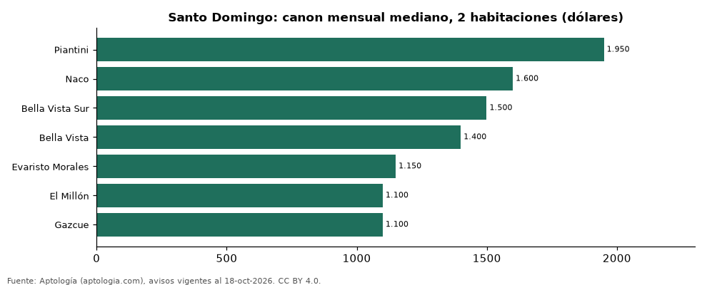

# Dónde es más caro y más barato alquilar un apartamento de 2 habitaciones en Santo Domingo: ranking de sectores (octubre 2026)

**En Santo Domingo, un apartamento de 2 habitaciones se alquila por USD 1.950 al mes en la mediana en Piantini, el sector más caro, y USD 1.100 al mes en Gazcue, el más barato: 1,8 veces menos.** Comparamos 7 sectores con al menos 30 avisos de 2 habitaciones.

*Resumen: analizamos 590 apartamentos en alquiler de 2 habitaciones en 7 sectores de Santo Domingo.*

**Actualizado:** 18 de octubre de 2026 (datos del 18 de octubre de 2026) · **Próxima actualización:** mensual.

## Resumen

| Indicador | Valor |
|---|---|
| Más caro | Piantini: USD 1.950 |
| Más barato | Gazcue: USD 1.100 |
| Diferencia | 1,8 veces |
| Sectores | 7 |

## Canon mensual de un apartamento de 2 habitaciones por sector

| Sector | Canon mensual (mediana) | Rango típico (P25–P75) | Área mediana (m²) | Avisos |
|---|---|---|---|---|
| Piantini | USD 1.950 | USD 1.600 – USD 2.500 | 135 | 169 |
| Naco | USD 1.600 | USD 1.300 – USD 1.900 | 125 | 136 |
| Bella Vista Sur | USD 1.500 | USD 1.312 – USD 1.790 | 116 | 34 |
| Bella Vista | USD 1.400 | USD 1.238 – USD 1.800 | 109 | 120 |
| Evaristo Morales | USD 1.150 | USD 1.000 – USD 1.300 | 110 | 61 |
| El Millón | USD 1.100 | USD 1.000 – USD 1.300 | 120 | 37 |
| Gazcue | USD 1.100 | USD 950 – USD 1.200 | 116 | 33 |

Medianas del canon pedido, sin administración ni gastos comunes; solo sectores con 30 avisos o más.

## Preguntas frecuentes

**¿Cuánto cuesta alquilar un apartamento de 2 habitaciones en Piantini?**
USD 1.950 al mes en la mediana (octubre de 2026); la mitad central entre USD 1.600 y USD 2.500.

**¿Dónde es más barato alquilar un apartamento de 2 habitaciones en Santo Domingo?**
En Gazcue: USD 1.100 al mes en la mediana.

## Metodología

- **Fuente:** exportes nocturnos de la base de datos de Aptología (aptologia.com) del 18 de octubre de 2026: avisos vigentes de vivienda en portales inmobiliarios de 13 países, recogidos por Aptología y vistos en línea entre el 11 y el 18 de octubre de 2026. Corte: 18 de octubre de 2026.
- **Depuración:** se eliminan duplicados exactos (misma ciudad, zona, tipo, precio, moneda, área, habitaciones y baños) y los precios fuera del percentil 1–99 de cada país, operación, moneda y tipo; el precio por m² usa solo avisos con área declarada entre 12 y 2.000 m² y también se recorta al P1–P99.
- **Qué se mide:** precios pedidos (publicados), no precios de cierre. En arriendo, el canon mensual sin administración, gastos comunes ni condominio.
- **Muestra mínima:** cada cifra publicada se apoya en al menos 30 avisos; las celdas con menos se omiten.
- **Monedas:** nunca se mezclan avisos de monedas distintas sin convertirlos. Conversión a dólares con la tasa de mercado de ExchangeRate-API (open.er-api.com, actualización del 18 Oct 2026): 1 USD = 3.182,80 COP, 1 USD = 18,47 M.N, 1 USD = 5,09 BRL, 1 USD = 3,44 PEN, 1 USD = 982,44 CLP, 1 USD = 1.514,57 ARS, 1 USD = 40,20 UYU, 1 USD = 5.705,37 PYG, 1 USD = 61,27 DOP, 1 USD = 0,89 EUR, 1 USD = 11,72 BOB; la UF chilena a 41.178,64 CLP (mindicador,cl. 18-oct-2026). Los avisos publicados en dólares se usan tal cual.
- **Monedas:** en cada ciudad y operación se usa solo la moneda mayoritaria de los avisos (los avisos en otra moneda se excluyen) y la mediana se convierte a dólares con la tasa citada; nunca se promedian avisos de monedas distintas.
- **Limitaciones:** la cobertura depende de los portales que recorre Aptología en cada país y es mayor en las ciudades grandes y en los segmentos medio-alto y alto; el área es la que declara el aviso, sin verificar; los nombres de zona vienen de los portales.
- **Privacidad:** solo se publican agregados; no se publica ningún dato personal, enlace a avisos ni nombre de anunciante.
- **Datos abiertos:** [datos.csv](datos.csv), licencia CC BY 4.0.

## Cómo citar

Pinzón Pineda, D. M. (2026). *Dónde es más caro y más barato alquilar un apartamento de 2 habitaciones en Santo Domingo: ranking de sectores (octubre 2026)*. Aptología (aptologia.com). https://github.com/elbroker/aptologia-datos/tree/main/estudios/alquiler-apartamentos-de-2-habitaciones-por-sector-santo-domingo-2026. Datos: datos.csv, licencia CC BY 4.0.
