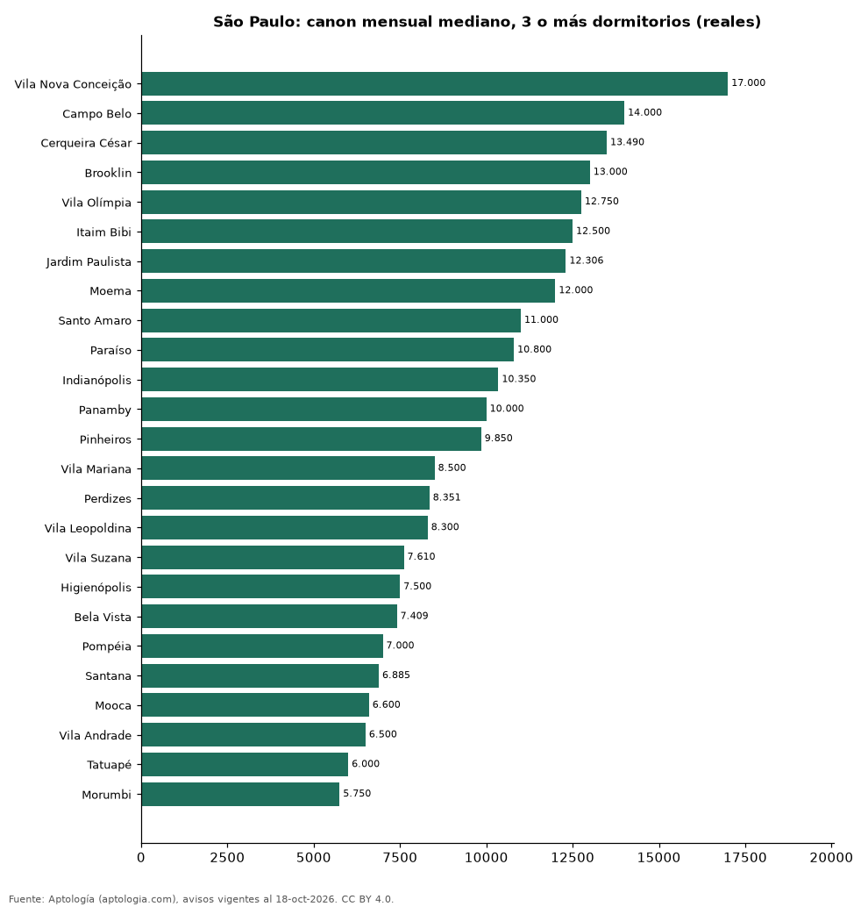

# Dónde es más caro y más barato alquilar un apartamento de 3 o más dormitorios en São Paulo: ranking de bairros (octubre 2026)

**En São Paulo, un apartamento de 3 o más dormitorios se alquila por 17.000 reales (USD 3.341) al mes en la mediana en Vila Nova Conceição, el bairro más caro, y 5.750 reales (USD 1.130) al mes en Morumbi, el más barato: 3,0 veces menos.** Comparamos 25 bairros con al menos 30 avisos de 3 o más dormitorios.

*Resumen: analizamos 1.608 apartamentos en alquiler de 3 o más dormitorios en 25 bairros de São Paulo.*

**Actualizado:** 18 de octubre de 2026 (datos del 18 de octubre de 2026) · **Próxima actualización:** mensual.

## Resumen

| Indicador | Valor |
|---|---|
| Más caro | Vila Nova Conceição: 17.000 reales (USD 3.341) |
| Más barato | Morumbi: 5.750 reales (USD 1.130) |
| Diferencia | 3,0 veces |
| Bairros | 25 |

## Canon mensual de un apartamento de 3 o más dormitorios por bairro

| Bairro | Canon mensual (mediana) | Rango típico (P25–P75) | Área mediana (m²) | Avisos |
|---|---|---|---|---|
| Vila Nova Conceição | 17.000 reales (USD 3.341) | 13.000 reales (USD 2.555) – 23.000 reales (USD 4.520) | 161 | 45 |
| Campo Belo | 14.000 reales (USD 2.751) | 8.985 reales (USD 1.766) – 20.000 reales (USD 3.930) | 198 | 67 |
| Cerqueira César | 13.490 reales (USD 2.651) | 7.714 reales (USD 1.516) – 18.250 reales (USD 3.586) | 154 | 40 |
| Brooklin | 13.000 reales (USD 2.555) | 8.495 reales (USD 1.669) – 17.500 reales (USD 3.439) | 138 | 83 |
| Vila Olímpia | 12.750 reales (USD 2.506) | 6.900 reales (USD 1.356) – 16.000 reales (USD 3.144) | 120 | 93 |
| Itaim Bibi | 12.500 reales (USD 2.457) | 8.700 reales (USD 1.710) – 19.500 reales (USD 3.832) | 146 | 117 |
| Jardim Paulista | 12.306 reales (USD 2.418) | 8.500 reales (USD 1.670) – 17.250 reales (USD 3.390) | 165 | 119 |
| Moema | 12.000 reales (USD 2.358) | 7.700 reales (USD 1.513) – 16.500 reales (USD 3.243) | 156 | 105 |
| Santo Amaro | 11.000 reales (USD 2.162) | 6.215 reales (USD 1.221) – 15.000 reales (USD 2.948) | 150 | 42 |
| Paraíso | 10.800 reales (USD 2.122) | 6.000 reales (USD 1.179) – 14.580 reales (USD 2.865) | 157 | 61 |
| Indianópolis | 10.350 reales (USD 2.034) | 7.556 reales (USD 1.485) – 16.750 reales (USD 3.292) | 126 | 42 |
| Panamby | 10.000 reales (USD 1.965) | 5.043 reales (USD 991) – 12.500 reales (USD 2.457) | 166 | 47 |
| Pinheiros | 9.850 reales (USD 1.936) | 6.500 reales (USD 1.277) – 16.062 reales (USD 3.157) | 129 | 100 |
| Vila Mariana | 8.500 reales (USD 1.670) | 5.400 reales (USD 1.061) – 15.970 reales (USD 3.138) | 119 | 95 |
| Perdizes | 8.351 reales (USD 1.641) | 6.400 reales (USD 1.258) – 13.000 reales (USD 2.555) | 158 | 113 |
| Vila Leopoldina | 8.300 reales (USD 1.631) | 6.578 reales (USD 1.293) – 13.500 reales (USD 2.653) | 141 | 30 |
| Vila Suzana | 7.610 reales (USD 1.496) | 4.988 reales (USD 980) – 10.610 reales (USD 2.085) | 184 | 36 |
| Higienópolis | 7.500 reales (USD 1.474) | 6.500 reales (USD 1.277) – 13.685 reales (USD 2.689) | 170 | 32 |
| Bela Vista | 7.409 reales (USD 1.456) | 5.505 reales (USD 1.082) – 13.118 reales (USD 2.578) | 161 | 30 |
| Pompéia | 7.000 reales (USD 1.376) | 5.200 reales (USD 1.022) – 8.200 reales (USD 1.611) | 120 | 33 |
| Santana | 6.885 reales (USD 1.353) | 3.500 reales (USD 688) – 10.625 reales (USD 2.088) | 138 | 48 |
| Mooca | 6.600 reales (USD 1.297) | 4.435 reales (USD 872) – 8.980 reales (USD 1.765) | 126 | 39 |
| Vila Andrade | 6.500 reales (USD 1.277) | 3.680 reales (USD 723) – 12.258 reales (USD 2.409) | 149 | 99 |
| Tatuapé | 6.000 reales (USD 1.179) | 4.000 reales (USD 786) – 9.690 reales (USD 1.904) | 112 | 57 |
| Morumbi | 5.750 reales (USD 1.130) | 3.515 reales (USD 691) – 8.765 reales (USD 1.723) | 141 | 35 |

Medianas del canon pedido, sin administración ni gastos comunes; solo bairros con 30 avisos o más.

## Preguntas frecuentes

**¿Cuánto cuesta alquilar un apartamento de 3 o más dormitorios en Vila Nova Conceição?**
17.000 reales (USD 3.341) al mes en la mediana (octubre de 2026); la mitad central entre 13.000 reales (USD 2.555) y 23.000 reales (USD 4.520).

**¿Dónde es más barato alquilar un apartamento de 3 o más dormitorios en São Paulo?**
En Morumbi: 5.750 reales (USD 1.130) al mes en la mediana.

## Metodología

- **Fuente:** exportes nocturnos de la base de datos de Aptología (aptologia.com) del 18 de octubre de 2026: avisos vigentes de vivienda en portales inmobiliarios de 13 países, recogidos por Aptología y vistos en línea entre el 11 y el 18 de octubre de 2026. Corte: 18 de octubre de 2026.
- **Depuración:** se eliminan duplicados exactos (misma ciudad, zona, tipo, precio, moneda, área, habitaciones y baños) y los precios fuera del percentil 1–99 de cada país, operación, moneda y tipo; el precio por m² usa solo avisos con área declarada entre 12 y 2.000 m² y también se recorta al P1–P99.
- **Qué se mide:** precios pedidos (publicados), no precios de cierre. En arriendo, el canon mensual sin administración, gastos comunes ni condominio.
- **Muestra mínima:** cada cifra publicada se apoya en al menos 30 avisos; las celdas con menos se omiten.
- **Monedas:** nunca se mezclan avisos de monedas distintas sin convertirlos. Conversión a dólares con la tasa de mercado de ExchangeRate-API (open.er-api.com, actualización del 18 Oct 2026): 1 USD = 3.182,80 COP, 1 USD = 18,47 M.N, 1 USD = 5,09 BRL, 1 USD = 3,44 PEN, 1 USD = 982,44 CLP, 1 USD = 1.514,57 ARS, 1 USD = 40,20 UYU, 1 USD = 5.705,37 PYG, 1 USD = 61,27 DOP, 1 USD = 0,89 EUR, 1 USD = 11,72 BOB; la UF chilena a 41.178,64 CLP (mindicador,cl. 18-oct-2026). Los avisos publicados en dólares se usan tal cual.
- **Monedas:** en cada ciudad y operación se usa solo la moneda mayoritaria de los avisos (los avisos en otra moneda se excluyen) y la mediana se convierte a dólares con la tasa citada; nunca se promedian avisos de monedas distintas.
- **Limitaciones:** la cobertura depende de los portales que recorre Aptología en cada país y es mayor en las ciudades grandes y en los segmentos medio-alto y alto; el área es la que declara el aviso, sin verificar; los nombres de zona vienen de los portales.
- **Privacidad:** solo se publican agregados; no se publica ningún dato personal, enlace a avisos ni nombre de anunciante.
- **Datos abiertos:** [datos.csv](datos.csv), licencia CC BY 4.0.

## Cómo citar

Pinzón Pineda, D. M. (2026). *Dónde es más caro y más barato alquilar un apartamento de 3 o más dormitorios en São Paulo: ranking de bairros (octubre 2026)*. Aptología (aptologia.com). https://github.com/elbroker/aptologia-datos/tree/main/estudios/alquiler-apartamentos-de-3-o-mas-dormitorios-por-bairro-sao-paulo-2026. Datos: datos.csv, licencia CC BY 4.0.
