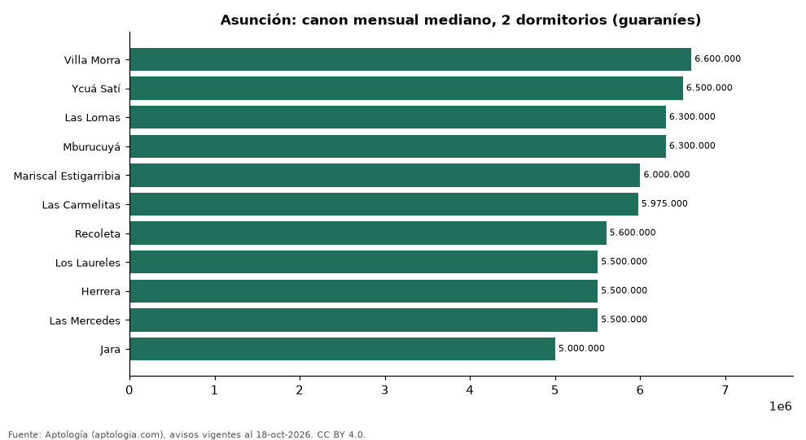

# Dónde es más caro y más barato alquilar un departamento de 2 dormitorios en Asunción: ranking de barrios (octubre 2026)

**En Asunción, un departamento de 2 dormitorios se alquila por 6.600.000 guaraníes (USD 1.157) al mes en la mediana en Villa Morra, el barrio más caro, y 5.000.000 guaraníes (USD 876) al mes en Jara, el más barato: 1,3 veces menos.** Comparamos 11 barrios con al menos 30 avisos de 2 dormitorios.

*Resumen: analizamos 711 departamentos en alquiler de 2 dormitorios en 11 barrios de Asunción.*

**Actualizado:** 18 de octubre de 2026 (datos del 18 de octubre de 2026) · **Próxima actualización:** mensual.

## Resumen

| Indicador | Valor |
|---|---|
| Más caro | Villa Morra: 6.600.000 guaraníes (USD 1.157) |
| Más barato | Jara: 5.000.000 guaraníes (USD 876) |
| Diferencia | 1,3 veces |
| Barrios | 11 |

## Canon mensual de un departamento de 2 dormitorios por barrio

| Barrio | Canon mensual (mediana) | Rango típico (P25–P75) | Área mediana (m²) | Avisos |
|---|---|---|---|---|
| Villa Morra | 6.600.000 guaraníes (USD 1.157) | 6.000.000 guaraníes (USD 1.052) – 7.000.000 guaraníes (USD 1.227) | 90 | 99 |
| Ycuá Satí | 6.500.000 guaraníes (USD 1.139) | 5.500.000 guaraníes (USD 964) – 7.150.000 guaraníes (USD 1.253) | 90 | 47 |
| Las Lomas | 6.300.000 guaraníes (USD 1.104) | 5.500.000 guaraníes (USD 964) – 7.150.000 guaraníes (USD 1.253) | 86 | 74 |
| Mburucuyá | 6.300.000 guaraníes (USD 1.104) | 5.900.000 guaraníes (USD 1.034) – 7.000.000 guaraníes (USD 1.227) | 88 | 94 |
| Mariscal Estigarribia | 6.000.000 guaraníes (USD 1.052) | 5.237.500 guaraníes (USD 918) – 8.250.000 guaraníes (USD 1.446) | 93 | 32 |
| Las Carmelitas | 5.975.000 guaraníes (USD 1.047) | 5.300.000 guaraníes (USD 929) – 6.625.000 guaraníes (USD 1.161) | 77 | 48 |
| Recoleta | 5.600.000 guaraníes (USD 982) | 5.275.000 guaraníes (USD 925) – 6.650.000 guaraníes (USD 1.166) | 80 | 59 |
| Los Laureles | 5.500.000 guaraníes (USD 964) | 5.000.000 guaraníes (USD 876) – 6.200.000 guaraníes (USD 1.087) | 83 | 69 |
| Herrera | 5.500.000 guaraníes (USD 964) | 4.800.000 guaraníes (USD 841) – 6.500.000 guaraníes (USD 1.139) | 84 | 77 |
| Las Mercedes | 5.500.000 guaraníes (USD 964) | 4.550.000 guaraníes (USD 797) – 6.297.864 guaraníes (USD 1.104) | 88 | 67 |
| Jara | 5.000.000 guaraníes (USD 876) | 4.500.000 guaraníes (USD 789) – 5.750.000 guaraníes (USD 1.008) | 83 | 45 |

Medianas del canon pedido, sin administración ni gastos comunes; solo barrios con 30 avisos o más.

## Preguntas frecuentes

**¿Cuánto cuesta alquilar un departamento de 2 dormitorios en Villa Morra?**
6.600.000 guaraníes (USD 1.157) al mes en la mediana (octubre de 2026); la mitad central entre 6.000.000 guaraníes (USD 1.052) y 7.000.000 guaraníes (USD 1.227).

**¿Dónde es más barato alquilar un departamento de 2 dormitorios en Asunción?**
En Jara: 5.000.000 guaraníes (USD 876) al mes en la mediana.

## Metodología

- **Fuente:** exportes nocturnos de la base de datos de Aptología (aptologia.com) del 18 de octubre de 2026: avisos vigentes de vivienda en portales inmobiliarios de 13 países, recogidos por Aptología y vistos en línea entre el 11 y el 18 de octubre de 2026. Corte: 18 de octubre de 2026.
- **Depuración:** se eliminan duplicados exactos (misma ciudad, zona, tipo, precio, moneda, área, habitaciones y baños) y los precios fuera del percentil 1–99 de cada país, operación, moneda y tipo; el precio por m² usa solo avisos con área declarada entre 12 y 2.000 m² y también se recorta al P1–P99.
- **Qué se mide:** precios pedidos (publicados), no precios de cierre. En arriendo, el canon mensual sin administración, gastos comunes ni condominio.
- **Muestra mínima:** cada cifra publicada se apoya en al menos 30 avisos; las celdas con menos se omiten.
- **Monedas:** nunca se mezclan avisos de monedas distintas sin convertirlos. Conversión a dólares con la tasa de mercado de ExchangeRate-API (open.er-api.com, actualización del 18 Oct 2026): 1 USD = 3.182,80 COP, 1 USD = 18,47 M.N, 1 USD = 5,09 BRL, 1 USD = 3,44 PEN, 1 USD = 982,44 CLP, 1 USD = 1.514,57 ARS, 1 USD = 40,20 UYU, 1 USD = 5.705,37 PYG, 1 USD = 61,27 DOP, 1 USD = 0,89 EUR, 1 USD = 11,72 BOB; la UF chilena a 41.178,64 CLP (mindicador,cl. 18-oct-2026). Los avisos publicados en dólares se usan tal cual.
- **Monedas:** en cada ciudad y operación se usa solo la moneda mayoritaria de los avisos (los avisos en otra moneda se excluyen) y la mediana se convierte a dólares con la tasa citada; nunca se promedian avisos de monedas distintas.
- **Limitaciones:** la cobertura depende de los portales que recorre Aptología en cada país y es mayor en las ciudades grandes y en los segmentos medio-alto y alto; el área es la que declara el aviso, sin verificar; los nombres de zona vienen de los portales.
- **Privacidad:** solo se publican agregados; no se publica ningún dato personal, enlace a avisos ni nombre de anunciante.
- **Datos abiertos:** [datos.csv](datos.csv), licencia CC BY 4.0.

## Cómo citar

Pinzón Pineda, D. M. (2026). *Dónde es más caro y más barato alquilar un departamento de 2 dormitorios en Asunción: ranking de barrios (octubre 2026)*. Aptología (aptologia.com). https://github.com/elbroker/aptologia-datos/tree/main/estudios/alquiler-departamentos-de-2-dormitorios-por-barrio-asuncion-2026. Datos: datos.csv, licencia CC BY 4.0.
