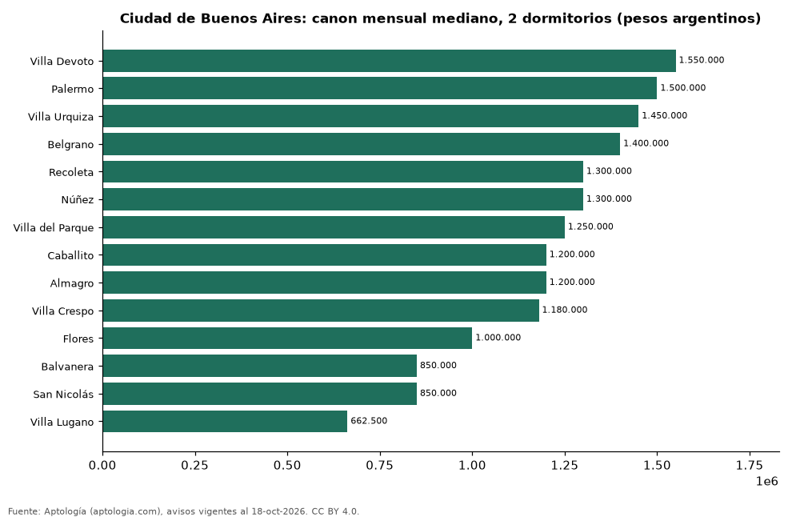

# Dónde es más caro y más barato alquilar un departamento de 2 dormitorios en Ciudad de Buenos Aires: ranking de barrios (octubre 2026)

**En Ciudad de Buenos Aires, un departamento de 2 dormitorios se alquila por 1.550.000 pesos argentinos (USD 1.023) al mes en la mediana en Villa Devoto, el barrio más caro, y 662.500 pesos argentinos (USD 437) al mes en Villa Lugano, el más barato: 2,3 veces menos.** Comparamos 14 barrios con al menos 30 avisos de 2 dormitorios.

*Resumen: analizamos 595 departamentos en alquiler de 2 dormitorios en 14 barrios de Ciudad de Buenos Aires.*

**Actualizado:** 18 de octubre de 2026 (datos del 18 de octubre de 2026) · **Próxima actualización:** mensual.

## Resumen

| Indicador | Valor |
|---|---|
| Más caro | Villa Devoto: 1.550.000 pesos argentinos (USD 1.023) |
| Más barato | Villa Lugano: 662.500 pesos argentinos (USD 437) |
| Diferencia | 2,3 veces |
| Barrios | 14 |

## Canon mensual de un departamento de 2 dormitorios por barrio

| Barrio | Canon mensual (mediana) | Rango típico (P25–P75) | Área mediana (m²) | Avisos |
|---|---|---|---|---|
| Villa Devoto | 1.550.000 pesos argentinos (USD 1.023) | 987.499 pesos argentinos (USD 652) – 1.837.500 pesos argentinos (USD 1.213) | 63 | 32 |
| Palermo | 1.500.000 pesos argentinos (USD 990) | 1.200.000 pesos argentinos (USD 792) – 1.700.000 pesos argentinos (USD 1.122) | 62 | 72 |
| Villa Urquiza | 1.450.000 pesos argentinos (USD 957) | 1.200.000 pesos argentinos (USD 792) – 1.600.000 pesos argentinos (USD 1.056) | 62 | 39 |
| Belgrano | 1.400.000 pesos argentinos (USD 924) | 1.200.000 pesos argentinos (USD 792) – 1.900.000 pesos argentinos (USD 1.254) | 66 | 51 |
| Recoleta | 1.300.000 pesos argentinos (USD 858) | 1.100.000 pesos argentinos (USD 726) – 1.500.000 pesos argentinos (USD 990) | 65 | 59 |
| Núñez | 1.300.000 pesos argentinos (USD 858) | 1.087.500 pesos argentinos (USD 718) – 1.500.000 pesos argentinos (USD 990) | 58 | 32 |
| Villa del Parque | 1.250.000 pesos argentinos (USD 825) | 1.100.000 pesos argentinos (USD 726) – 1.575.000 pesos argentinos (USD 1.040) | 60 | 31 |
| Caballito | 1.200.000 pesos argentinos (USD 792) | 995.000 pesos argentinos (USD 657) – 1.400.000 pesos argentinos (USD 924) | 59 | 48 |
| Almagro | 1.200.000 pesos argentinos (USD 792) | 985.000 pesos argentinos (USD 650) – 1.372.500 pesos argentinos (USD 906) | 60 | 42 |
| Villa Crespo | 1.180.000 pesos argentinos (USD 779) | 965.000 pesos argentinos (USD 637) – 1.350.000 pesos argentinos (USD 891) | 56 | 31 |
| Flores | 1.000.000 pesos argentinos (USD 660) | 900.000 pesos argentinos (USD 594) – 1.295.000 pesos argentinos (USD 855) | 60 | 46 |
| Balvanera | 850.000 pesos argentinos (USD 561) | 800.000 pesos argentinos (USD 528) – 925.000 pesos argentinos (USD 611) | 62 | 51 |
| San Nicolás | 850.000 pesos argentinos (USD 561) | 750.000 pesos argentinos (USD 495) – 1.050.000 pesos argentinos (USD 693) | 59 | 31 |
| Villa Lugano | 662.500 pesos argentinos (USD 437) | 632.500 pesos argentinos (USD 418) – 742.500 pesos argentinos (USD 490) | 52 | 30 |

Medianas del canon pedido, sin administración ni gastos comunes; solo barrios con 30 avisos o más.

## Preguntas frecuentes

**¿Cuánto cuesta alquilar un departamento de 2 dormitorios en Villa Devoto?**
1.550.000 pesos argentinos (USD 1.023) al mes en la mediana (octubre de 2026); la mitad central entre 987.499 pesos argentinos (USD 652) y 1.837.500 pesos argentinos (USD 1.213).

**¿Dónde es más barato alquilar un departamento de 2 dormitorios en Ciudad de Buenos Aires?**
En Villa Lugano: 662.500 pesos argentinos (USD 437) al mes en la mediana.

## Metodología

- **Fuente:** exportes nocturnos de la base de datos de Aptología (aptologia.com) del 18 de octubre de 2026: avisos vigentes de vivienda en portales inmobiliarios de 13 países, recogidos por Aptología y vistos en línea entre el 11 y el 18 de octubre de 2026. Corte: 18 de octubre de 2026.
- **Depuración:** se eliminan duplicados exactos (misma ciudad, zona, tipo, precio, moneda, área, habitaciones y baños) y los precios fuera del percentil 1–99 de cada país, operación, moneda y tipo; el precio por m² usa solo avisos con área declarada entre 12 y 2.000 m² y también se recorta al P1–P99.
- **Qué se mide:** precios pedidos (publicados), no precios de cierre. En arriendo, el canon mensual sin administración, gastos comunes ni condominio.
- **Muestra mínima:** cada cifra publicada se apoya en al menos 30 avisos; las celdas con menos se omiten.
- **Monedas:** nunca se mezclan avisos de monedas distintas sin convertirlos. Conversión a dólares con la tasa de mercado de ExchangeRate-API (open.er-api.com, actualización del 18 Oct 2026): 1 USD = 3.182,80 COP, 1 USD = 18,47 M.N, 1 USD = 5,09 BRL, 1 USD = 3,44 PEN, 1 USD = 982,44 CLP, 1 USD = 1.514,57 ARS, 1 USD = 40,20 UYU, 1 USD = 5.705,37 PYG, 1 USD = 61,27 DOP, 1 USD = 0,89 EUR, 1 USD = 11,72 BOB; la UF chilena a 41.178,64 CLP (mindicador,cl. 18-oct-2026). Los avisos publicados en dólares se usan tal cual.
- **Monedas:** en cada ciudad y operación se usa solo la moneda mayoritaria de los avisos (los avisos en otra moneda se excluyen) y la mediana se convierte a dólares con la tasa citada; nunca se promedian avisos de monedas distintas.
- **Limitaciones:** la cobertura depende de los portales que recorre Aptología en cada país y es mayor en las ciudades grandes y en los segmentos medio-alto y alto; el área es la que declara el aviso, sin verificar; los nombres de zona vienen de los portales.
- **Privacidad:** solo se publican agregados; no se publica ningún dato personal, enlace a avisos ni nombre de anunciante.
- **Datos abiertos:** [datos.csv](datos.csv), licencia CC BY 4.0.

## Cómo citar

Pinzón Pineda, D. M. (2026). *Dónde es más caro y más barato alquilar un departamento de 2 dormitorios en Ciudad de Buenos Aires: ranking de barrios (octubre 2026)*. Aptología (aptologia.com). https://github.com/elbroker/aptologia-datos/tree/main/estudios/alquiler-departamentos-de-2-dormitorios-por-barrio-ciudad-de-buenos-aires-2026. Datos: datos.csv, licencia CC BY 4.0.
