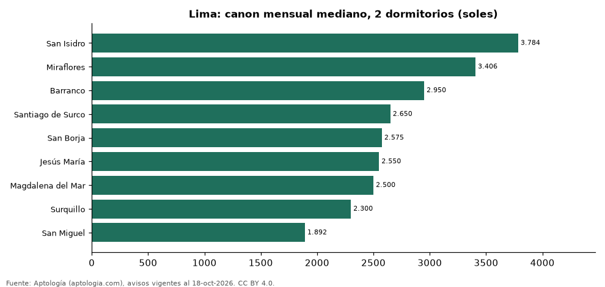

# Dónde es más caro y más barato alquilar un departamento de 2 dormitorios en Lima: ranking de distritos (octubre 2026)

**En Lima, un departamento de 2 dormitorios se alquila por 3.784 soles (USD 1.102) al mes en la mediana en San Isidro, el distrito más caro, y 1.892 soles (USD 551) al mes en San Miguel, el más barato: 2,0 veces menos.** Comparamos 9 distritos con al menos 30 avisos de 2 dormitorios.

*Resumen: analizamos 789 departamentos en alquiler de 2 dormitorios en 9 distritos de Lima.*

**Actualizado:** 18 de octubre de 2026 (datos del 18 de octubre de 2026) · **Próxima actualización:** mensual.

## Resumen

| Indicador | Valor |
|---|---|
| Más caro | San Isidro: 3.784 soles (USD 1.102) |
| Más barato | San Miguel: 1.892 soles (USD 551) |
| Diferencia | 2,0 veces |
| Distritos | 9 |

## Canon mensual de un departamento de 2 dormitorios por distrito

| Distrito | Canon mensual (mediana) | Rango típico (P25–P75) | Área mediana (m²) | Avisos |
|---|---|---|---|---|
| San Isidro | 3.784 soles (USD 1.102) | 3.200 soles (USD 931) – 5.210 soles (USD 1.517) | 104 | 122 |
| Miraflores | 3.406 soles (USD 991) | 2.901 soles (USD 844) – 4.560 soles (USD 1.327) | 98 | 358 |
| Barranco | 2.950 soles (USD 859) | 2.525 soles (USD 735) – 3.460 soles (USD 1.007) | 80 | 50 |
| Santiago de Surco | 2.650 soles (USD 771) | 2.150 soles (USD 626) – 3.200 soles (USD 931) | 82 | 81 |
| San Borja | 2.575 soles (USD 750) | 2.400 soles (USD 699) – 3.126 soles (USD 910) | 90 | 30 |
| Jesús María | 2.550 soles (USD 742) | 2.400 soles (USD 699) – 2.800 soles (USD 815) | 65 | 34 |
| Magdalena del Mar | 2.500 soles (USD 728) | 2.062 soles (USD 600) – 2.786 soles (USD 811) | 72 | 38 |
| Surquillo | 2.300 soles (USD 669) | 2.025 soles (USD 589) – 2.575 soles (USD 750) | 60 | 39 |
| San Miguel | 1.892 soles (USD 551) | 1.600 soles (USD 466) – 2.200 soles (USD 640) | 62 | 37 |

Medianas del canon pedido, sin administración ni gastos comunes; solo distritos con 30 avisos o más.

## Preguntas frecuentes

**¿Cuánto cuesta alquilar un departamento de 2 dormitorios en San Isidro?**
3.784 soles (USD 1.102) al mes en la mediana (octubre de 2026); la mitad central entre 3.200 soles (USD 931) y 5.210 soles (USD 1.517).

**¿Dónde es más barato alquilar un departamento de 2 dormitorios en Lima?**
En San Miguel: 1.892 soles (USD 551) al mes en la mediana.

## Metodología

- **Fuente:** exportes nocturnos de la base de datos de Aptología (aptologia.com) del 18 de octubre de 2026: avisos vigentes de vivienda en portales inmobiliarios de 13 países, recogidos por Aptología y vistos en línea entre el 11 y el 18 de octubre de 2026. Corte: 18 de octubre de 2026.
- **Depuración:** se eliminan duplicados exactos (misma ciudad, zona, tipo, precio, moneda, área, habitaciones y baños) y los precios fuera del percentil 1–99 de cada país, operación, moneda y tipo; el precio por m² usa solo avisos con área declarada entre 12 y 2.000 m² y también se recorta al P1–P99.
- **Qué se mide:** precios pedidos (publicados), no precios de cierre. En arriendo, el canon mensual sin administración, gastos comunes ni condominio.
- **Muestra mínima:** cada cifra publicada se apoya en al menos 30 avisos; las celdas con menos se omiten.
- **Monedas:** nunca se mezclan avisos de monedas distintas sin convertirlos. Conversión a dólares con la tasa de mercado de ExchangeRate-API (open.er-api.com, actualización del 18 Oct 2026): 1 USD = 3.182,80 COP, 1 USD = 18,47 M.N, 1 USD = 5,09 BRL, 1 USD = 3,44 PEN, 1 USD = 982,44 CLP, 1 USD = 1.514,57 ARS, 1 USD = 40,20 UYU, 1 USD = 5.705,37 PYG, 1 USD = 61,27 DOP, 1 USD = 0,89 EUR, 1 USD = 11,72 BOB; la UF chilena a 41.178,64 CLP (mindicador,cl. 18-oct-2026). Los avisos publicados en dólares se usan tal cual.
- **Monedas:** en cada ciudad y operación se usa solo la moneda mayoritaria de los avisos (los avisos en otra moneda se excluyen) y la mediana se convierte a dólares con la tasa citada; nunca se promedian avisos de monedas distintas.
- **Limitaciones:** la cobertura depende de los portales que recorre Aptología en cada país y es mayor en las ciudades grandes y en los segmentos medio-alto y alto; el área es la que declara el aviso, sin verificar; los nombres de zona vienen de los portales.
- **Privacidad:** solo se publican agregados; no se publica ningún dato personal, enlace a avisos ni nombre de anunciante.
- **Datos abiertos:** [datos.csv](datos.csv), licencia CC BY 4.0.

## Cómo citar

Pinzón Pineda, D. M. (2026). *Dónde es más caro y más barato alquilar un departamento de 2 dormitorios en Lima: ranking de distritos (octubre 2026)*. Aptología (aptologia.com). https://github.com/elbroker/aptologia-datos/tree/main/estudios/alquiler-departamentos-de-2-dormitorios-por-distrito-lima-2026. Datos: datos.csv, licencia CC BY 4.0.
