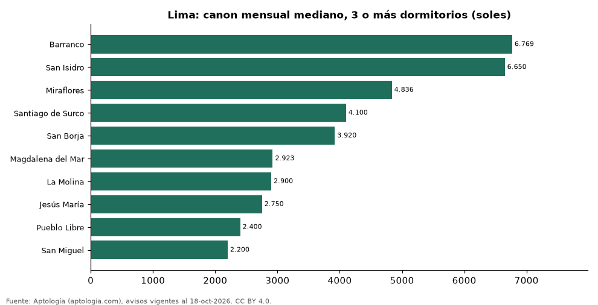

# Dónde es más caro y más barato alquilar un departamento de 3 o más dormitorios en Lima: ranking de distritos (octubre 2026)

**En Lima, un departamento de 3 o más dormitorios se alquila por 6.769 soles (USD 1.970) al mes en la mediana en Barranco, el distrito más caro, y 2.200 soles (USD 640) al mes en San Miguel, el más barato: 3,1 veces menos.** Comparamos 10 distritos con al menos 30 avisos de 3 o más dormitorios.

*Resumen: analizamos 1.298 departamentos en alquiler de 3 o más dormitorios en 10 distritos de Lima.*

**Actualizado:** 18 de octubre de 2026 (datos del 18 de octubre de 2026) · **Próxima actualización:** mensual.

## Resumen

| Indicador | Valor |
|---|---|
| Más caro | Barranco: 6.769 soles (USD 1.970) |
| Más barato | San Miguel: 2.200 soles (USD 640) |
| Diferencia | 3,1 veces |
| Distritos | 10 |

## Canon mensual de un departamento de 3 o más dormitorios por distrito

| Distrito | Canon mensual (mediana) | Rango típico (P25–P75) | Área mediana (m²) | Avisos |
|---|---|---|---|---|
| Barranco | 6.769 soles (USD 1.970) | 3.932 soles (USD 1.145) – 13.562 soles (USD 3.948) | 222 | 34 |
| San Isidro | 6.650 soles (USD 1.936) | 4.880 soles (USD 1.421) – 9.697 soles (USD 2.823) | 200 | 266 |
| Miraflores | 4.836 soles (USD 1.408) | 3.600 soles (USD 1.048) – 7.202 soles (USD 2.096) | 150 | 420 |
| Santiago de Surco | 4.100 soles (USD 1.193) | 2.945 soles (USD 857) – 6.476 soles (USD 1.885) | 158 | 294 |
| San Borja | 3.920 soles (USD 1.141) | 3.120 soles (USD 908) – 4.680 soles (USD 1.362) | 120 | 53 |
| Magdalena del Mar | 2.923 soles (USD 851) | 2.425 soles (USD 706) – 3.222 soles (USD 938) | 92 | 42 |
| La Molina | 2.900 soles (USD 844) | 2.400 soles (USD 699) – 3.652 soles (USD 1.063) | 128 | 37 |
| Jesús María | 2.750 soles (USD 800) | 2.500 soles (USD 728) – 3.088 soles (USD 899) | 90 | 42 |
| Pueblo Libre | 2.400 soles (USD 699) | 2.100 soles (USD 611) – 2.700 soles (USD 786) | 90 | 37 |
| San Miguel | 2.200 soles (USD 640) | 2.000 soles (USD 582) – 2.580 soles (USD 751) | 79 | 73 |

Medianas del canon pedido, sin administración ni gastos comunes; solo distritos con 30 avisos o más.

## Preguntas frecuentes

**¿Cuánto cuesta alquilar un departamento de 3 o más dormitorios en Barranco?**
6.769 soles (USD 1.970) al mes en la mediana (octubre de 2026); la mitad central entre 3.932 soles (USD 1.145) y 13.562 soles (USD 3.948).

**¿Dónde es más barato alquilar un departamento de 3 o más dormitorios en Lima?**
En San Miguel: 2.200 soles (USD 640) al mes en la mediana.

## Metodología

- **Fuente:** exportes nocturnos de la base de datos de Aptología (aptologia.com) del 18 de octubre de 2026: avisos vigentes de vivienda en portales inmobiliarios de 13 países, recogidos por Aptología y vistos en línea entre el 11 y el 18 de octubre de 2026. Corte: 18 de octubre de 2026.
- **Depuración:** se eliminan duplicados exactos (misma ciudad, zona, tipo, precio, moneda, área, habitaciones y baños) y los precios fuera del percentil 1–99 de cada país, operación, moneda y tipo; el precio por m² usa solo avisos con área declarada entre 12 y 2.000 m² y también se recorta al P1–P99.
- **Qué se mide:** precios pedidos (publicados), no precios de cierre. En arriendo, el canon mensual sin administración, gastos comunes ni condominio.
- **Muestra mínima:** cada cifra publicada se apoya en al menos 30 avisos; las celdas con menos se omiten.
- **Monedas:** nunca se mezclan avisos de monedas distintas sin convertirlos. Conversión a dólares con la tasa de mercado de ExchangeRate-API (open.er-api.com, actualización del 18 Oct 2026): 1 USD = 3.182,80 COP, 1 USD = 18,47 M.N, 1 USD = 5,09 BRL, 1 USD = 3,44 PEN, 1 USD = 982,44 CLP, 1 USD = 1.514,57 ARS, 1 USD = 40,20 UYU, 1 USD = 5.705,37 PYG, 1 USD = 61,27 DOP, 1 USD = 0,89 EUR, 1 USD = 11,72 BOB; la UF chilena a 41.178,64 CLP (mindicador,cl. 18-oct-2026). Los avisos publicados en dólares se usan tal cual.
- **Monedas:** en cada ciudad y operación se usa solo la moneda mayoritaria de los avisos (los avisos en otra moneda se excluyen) y la mediana se convierte a dólares con la tasa citada; nunca se promedian avisos de monedas distintas.
- **Limitaciones:** la cobertura depende de los portales que recorre Aptología en cada país y es mayor en las ciudades grandes y en los segmentos medio-alto y alto; el área es la que declara el aviso, sin verificar; los nombres de zona vienen de los portales.
- **Privacidad:** solo se publican agregados; no se publica ningún dato personal, enlace a avisos ni nombre de anunciante.
- **Datos abiertos:** [datos.csv](datos.csv), licencia CC BY 4.0.

## Cómo citar

Pinzón Pineda, D. M. (2026). *Dónde es más caro y más barato alquilar un departamento de 3 o más dormitorios en Lima: ranking de distritos (octubre 2026)*. Aptología (aptologia.com). https://github.com/elbroker/aptologia-datos/tree/main/estudios/alquiler-departamentos-de-3-o-mas-dormitorios-por-distrito-lima-2026. Datos: datos.csv, licencia CC BY 4.0.
