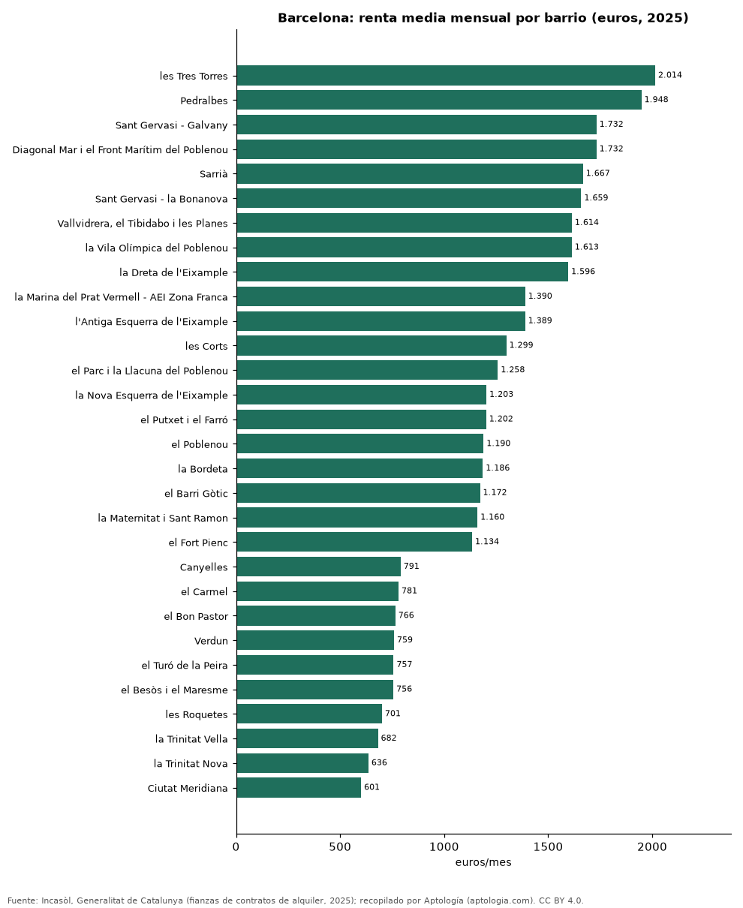

# Alquiler por barrio en Barcelona: renta media de los contratos de 2025 en sus barrios y distritos

**El barrio de Barcelona con el alquiler medio más alto en 2025 fue les Tres Torres, con 2.014 euros al mes, y el más bajo de los 68 barrios con 30 contratos o más fue Ciutat Meridiana, con 601 euros.** Por distritos, Sarrià-Sant Gervasi encabeza con 1.604 euros (19,06 euros por m²) y Nou Barris cierra con 796 euros.

*Resumen: ordenamos 68 barrios y 10 distritos de Barcelona según los contratos de alquiler registrados en 2025.*

**Actualizado:** 18 de octubre de 2026 (datos de contratos de 2025) · **Próxima actualización:** mensual.

## Resumen

| Indicador | Valor |
|---|---|
| Barrio más caro | les Tres Torres: 2.014 euros |
| Barrio más barato | Ciutat Meridiana: 601 euros |
| Distrito más caro | Sarrià-Sant Gervasi: 1.604 euros |

## Distritos

| Distrito | Alquiler medio mensual | Euros por m² | Contratos |
|---|---|---|---|
| Sarrià-Sant Gervasi | 1.604 euros | 19,06 | 3.462 |
| Les Corts | 1.335 euros | 17,66 | 1.499 |
| Eixample | 1.284 euros | 16,84 | 6.036 |
| Sant Martí | 1.094 euros | 16,53 | 3.674 |
| Gràcia | 1.082 euros | 17,73 | 3.021 |
| Ciutat Vella | 1.019 euros | 18,13 | 2.763 |
| Sants-Montjuïc | 1.001 euros | 16,41 | 3.481 |
| Horta-Guinardó | 909 euros | 14,95 | 2.674 |
| Sant Andreu | 904 euros | 14,11 | 2.101 |
| Nou Barris | 796 euros | 13,44 | 1.924 |

Renta media mensual y por m² de los contratos registrados en 2025.

## Barrios de mayor a menor

| Barrio | Alquiler medio mensual | Euros por m² | Contratos |
|---|---|---|---|
| les Tres Torres | 2.014 euros | 19,74 | 258 |
| Pedralbes | 1.948 euros | 18,67 | 167 |
| Sant Gervasi - Galvany | 1.732 euros | 18,84 | 1.231 |
| Diagonal Mar i el Front Marítim del Poblenou | 1.732 euros | 22,39 | 208 |
| Sarrià | 1.667 euros | 20,49 | 520 |
| Sant Gervasi - la Bonanova | 1.659 euros | 19,24 | 587 |
| Vallvidrera, el Tibidabo i les Planes | 1.614 euros | 14,53 | 47 |
| la Vila Olímpica del Poblenou | 1.613 euros | 20,82 | 168 |
| la Dreta de l'Eixample | 1.596 euros | 17,40 | 1.197 |
| la Marina del Prat Vermell - AEI Zona Franca | 1.390 euros | 17,36 | 78 |
| l'Antiga Esquerra de l'Eixample | 1.389 euros | 16,80 | 1.182 |
| les Corts | 1.299 euros | 17,97 | 939 |
| el Parc i la Llacuna del Poblenou | 1.258 euros | 18,21 | 220 |
| la Nova Esquerra de l'Eixample | 1.203 euros | 17,31 | 1.277 |
| el Putxet i el Farró | 1.202 euros | 18,34 | 819 |
| el Poblenou | 1.190 euros | 18,29 | 601 |
| la Bordeta | 1.186 euros | 18,23 | 465 |
| el Barri Gòtic | 1.172 euros | 16,49 | 544 |
| la Maternitat i Sant Ramon | 1.160 euros | 16,51 | 393 |
| el Fort Pienc | 1.134 euros | 15,55 | 638 |
| Sant Antoni | 1.118 euros | 16,26 | 729 |
| Provençals del Poblenou | 1.115 euros | 16,85 | 335 |
| la Sagrada Família | 1.107 euros | 16,89 | 1.013 |
| el Camp d'en Grassot i Gràcia Nova | 1.105 euros | 17,13 | 686 |
| la Vila de Gràcia | 1.090 euros | 18,50 | 1.602 |
| Vallcarca i els Penitents | 1.089 euros | 17,39 | 342 |
| Sant Pere, Santa Caterina i la Ribera | 1.081 euros | 18,61 | 706 |
| la Salut | 1.069 euros | 16,48 | 239 |
| la Font d'en Fargues | 1.044 euros | 14,60 | 84 |
| la Font de la Guatlla | 1.044 euros | 15,94 | 157 |
| Sant Martí de Provençals | 1.011 euros | 13,57 | 304 |
| el Baix Guinardó | 998 euros | 15,93 | 453 |
| Sants | 995 euros | 16,43 | 911 |
| el Camp de l'Arpa del Clot | 982 euros | 15,99 | 751 |
| Navas | 980 euros | 14,69 | 314 |
| la Sagrera | 979 euros | 14,08 | 513 |
| la Vall d'Hebron | 976 euros | 15,34 | 45 |
| el Clot | 966 euros | 15,65 | 407 |
| Hostafrancs | 960 euros | 16,46 | 370 |
| el Guinardó | 959 euros | 15,44 | 681 |
| el Raval | 957 euros | 16,61 | 1.065 |
| Sants - Badal | 943 euros | 15,93 | 484 |
| el Poble Sec - AEI Parc Montjuïc | 943 euros | 16,73 | 765 |
| la Verneda i la Pau | 924 euros | 14,17 | 423 |
| el Coll | 906 euros | 15,24 | 152 |
| la Guineueta | 902 euros | 12,47 | 156 |
| el Congrés i els Indians | 898 euros | 14,20 | 223 |
| Horta | 897 euros | 14,31 | 420 |
| Vilapicina i la Torre Llobeta | 888 euros | 14,59 | 346 |
| la Marina de Port | 885 euros | 13,13 | 251 |
| la Barceloneta | 881 euros | 22,70 | 448 |
| Sant Andreu | 880 euros | 14,62 | 810 |
| Montbau | 870 euros | 15,47 | 80 |
| la Teixonera | 865 euros | 14,96 | 200 |
| Can Baró | 847 euros | 16,03 | 158 |
| Sant Genís dels Agudells | 831 euros | 12,25 | 123 |
| Porta | 819 euros | 13,32 | 331 |
| la Prosperitat | 819 euros | 14,42 | 332 |
| Canyelles | 791 euros | 9,98 | 36 |
| el Carmel | 781 euros | 13,97 | 418 |
| el Bon Pastor | 766 euros | 11,36 | 151 |
| Verdun | 759 euros | 14,21 | 161 |
| el Turó de la Peira | 757 euros | 13,03 | 243 |
| el Besòs i el Maresme | 756 euros | 13,16 | 257 |
| les Roquetes | 701 euros | 13,62 | 155 |
| la Trinitat Vella | 682 euros | 12,91 | 75 |
| la Trinitat Nova | 636 euros | 12,45 | 52 |
| Ciutat Meridiana | 601 euros | 10,20 | 71 |

## Preguntas frecuentes

**¿Cuál es el barrio más caro para alquilar en Barcelona?**
les Tres Torres, con 2.014 euros al mes de renta media en 2025.

**¿Dónde es más barato alquilar en Barcelona?**
En Ciutat Meridiana: 601 euros al mes.

## Metodología

- **Fuente:** Incasòl, Generalitat de Catalunya (fianzas de contratos de alquiler, 2025). Las tablas oficiales se tomaron de los exportes nocturnos de Aptología del 18 de octubre de 2026 (es_alquiler_municipio, es_alquiler_barrio, es_compra_municipio), que las recopilan sin modificarlas.
- **Estadístico:** renta media mensual y por m²; año 2025.
- **Qué se mide:** rentas de contratos registrados (fianzas) o valores de tasación oficiales, no precios pedidos en portales.
- **Muestra mínima:** solo se publican filas con 30 contratos o tasaciones o más.
- **Limitaciones:** cada fuente usa su propia metodología (media en Cataluña, mediana en la Comunitat Valenciana), por lo que no deben compararse entre sí sin cautela.
- **Datos abiertos:** [datos.csv](datos.csv), licencia CC BY 4.0.

## Cómo citar

Pinzón Pineda, D. M. (2026). *Alquiler por barrio en Barcelona: renta media de los contratos de 2025 en sus barrios y distritos*. Aptología (aptologia.com). https://github.com/elbroker/aptologia-datos/tree/main/estudios/alquiler-por-barrio-barcelona-2025. Datos: datos.csv, licencia CC BY 4.0.
