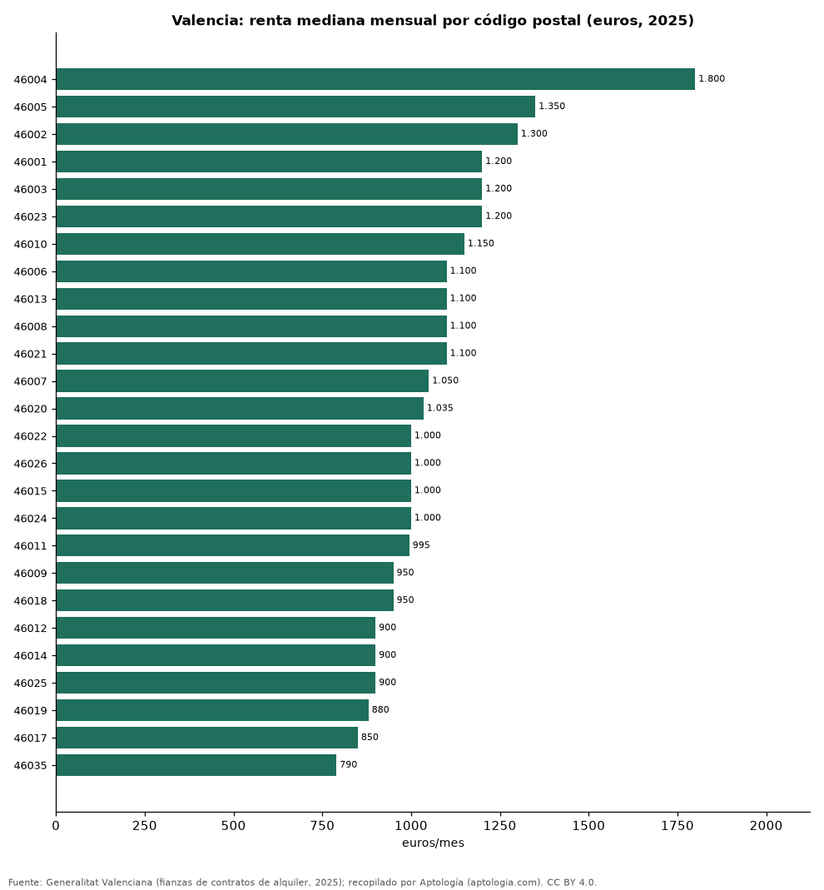

# Alquiler por código postal en la ciudad de Valencia: renta mediana de los contratos de 2025

**El código postal de la ciudad de Valencia con el alquiler mediano más alto en 2025 fue el 46004, con 1.800 euros al mes, y el más bajo de los 26 con 30 contratos o más fue el 46035, con 790 euros.** La mitad central de los contratos del 46004 pagó entre 1.300 euros y 2.500 euros.

*Resumen: ordenamos 26 códigos postales de Valencia según 11.245 contratos de alquiler registrados en 2025.*

**Actualizado:** 18 de octubre de 2026 (datos de contratos de 2025) · **Próxima actualización:** mensual.

## Resumen

| Indicador | Valor |
|---|---|
| Más caro | 46004: 1.800 euros |
| Más barato | 46035: 790 euros |
| Códigos postales | 26 |

## Códigos postales de mayor a menor

| Código postal | Alquiler mediano mensual | P25–P75 | Contratos |
|---|---|---|---|
| 46004 | 1.800 euros | 1.300 euros – 2.500 euros | 121 |
| 46005 | 1.350 euros | 1.000 euros – 1.800 euros | 311 |
| 46002 | 1.300 euros | 900 euros – 1.700 euros | 83 |
| 46001 | 1.200 euros | 950 euros – 1.500 euros | 284 |
| 46003 | 1.200 euros | 900 euros – 1.500 euros | 279 |
| 46023 | 1.200 euros | 950 euros – 1.625 euros | 417 |
| 46010 | 1.150 euros | 850 euros – 1.500 euros | 467 |
| 46006 | 1.100 euros | 850 euros – 1.300 euros | 715 |
| 46013 | 1.100 euros | 850 euros – 1.500 euros | 280 |
| 46008 | 1.100 euros | 870 euros – 1.350 euros | 502 |
| 46021 | 1.100 euros | 800 euros – 1.400 euros | 790 |
| 46007 | 1.050 euros | 844 euros – 1.300 euros | 674 |
| 46020 | 1.035 euros | 850 euros – 1.250 euros | 736 |
| 46022 | 1.000 euros | 705 euros – 1.200 euros | 881 |
| 46026 | 1.000 euros | 800 euros – 1.250 euros | 202 |
| 46015 | 1.000 euros | 750 euros – 1.400 euros | 578 |
| 46024 | 1.000 euros | 750 euros – 1.300 euros | 132 |
| 46011 | 995 euros | 800 euros – 1.200 euros | 561 |
| 46009 | 950 euros | 750 euros – 1.200 euros | 734 |
| 46018 | 950 euros | 706 euros – 1.185 euros | 619 |
| 46012 | 900 euros | 695 euros – 1.100 euros | 78 |
| 46014 | 900 euros | 425 euros – 1.100 euros | 465 |
| 46025 | 900 euros | 660 euros – 1.050 euros | 292 |
| 46019 | 880 euros | 675 euros – 1.050 euros | 452 |
| 46017 | 850 euros | 675 euros – 1.000 euros | 462 |
| 46035 | 790 euros | 600 euros – 900 euros | 130 |

Renta mediana mensual y percentiles 25 y 75 de los contratos de 2025.

## Preguntas frecuentes

**¿Dónde es más caro alquilar en Valencia?**
En el código postal 46004: 1.800 euros al mes de renta mediana en 2025.

**¿Dónde es más barato alquilar en Valencia?**
En el 46035: 790 euros al mes.

## Metodología

- **Fuente:** Generalitat Valenciana (fianzas de contratos de alquiler, 2025). Las tablas oficiales se tomaron de los exportes nocturnos de Aptología del 18 de octubre de 2026 (es_alquiler_municipio, es_alquiler_barrio, es_compra_municipio), que las recopilan sin modificarlas.
- **Estadístico:** renta mediana mensual con P25 y P75; año 2025.
- **Qué se mide:** rentas de contratos registrados (fianzas) o valores de tasación oficiales, no precios pedidos en portales.
- **Muestra mínima:** solo se publican filas con 30 contratos o tasaciones o más.
- **Limitaciones:** cada fuente usa su propia metodología (media en Cataluña, mediana en la Comunitat Valenciana), por lo que no deben compararse entre sí sin cautela.
- **Datos abiertos:** [datos.csv](datos.csv), licencia CC BY 4.0.

## Cómo citar

Pinzón Pineda, D. M. (2026). *Alquiler por código postal en la ciudad de Valencia: renta mediana de los contratos de 2025*. Aptología (aptologia.com). https://github.com/elbroker/aptologia-datos/tree/main/estudios/alquiler-por-codigo-postal-valencia-2025. Datos: datos.csv, licencia CC BY 4.0.
