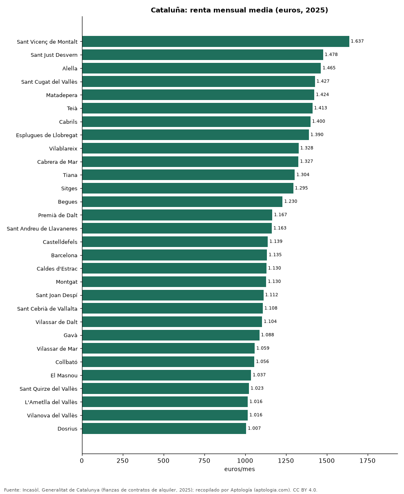

# Alquiler por municipio en Cataluña: los más caros y los más baratos según los contratos de 2025

**La renta media de alquiler más alta de Cataluña en 2025 se pagó en Sant Vicenç de Montalt (Barcelona), con 1.637 euros al mes, y la más baja de los 289 municipios con 30 contratos o más en La Sénia (Tarragona), con 345 euros.** En Barcelona, el municipio con más contratos (30.789), la renta media fue de 1.135 euros al mes.

*Resumen: ordenamos 289 municipios de Cataluña con 30 contratos de alquiler o más registrados en 2025 (103.729 contratos).*

**Actualizado:** 18 de octubre de 2026 (datos de contratos de 2025) · **Próxima actualización:** mensual.

## Resumen

| Indicador | Valor |
|---|---|
| Más caro | Sant Vicenç de Montalt: 1.637 euros |
| Más barato | La Sénia: 345 euros |
| Barcelona | 1.135 euros |
| Municipios | 289 |

## Los 40 municipios más caros

| Municipio | Provincia | Alquiler mensual (media) | Contratos |
|---|---|---|---|
| Sant Vicenç de Montalt | Barcelona | 1.637 euros | 79 |
| Sant Just Desvern | Barcelona | 1.478 euros | 299 |
| Alella | Barcelona | 1.465 euros | 94 |
| Sant Cugat del Vallès | Barcelona | 1.427 euros | 1.318 |
| Matadepera | Barcelona | 1.424 euros | 82 |
| Teià | Barcelona | 1.413 euros | 70 |
| Cabrils | Barcelona | 1.400 euros | 67 |
| Esplugues de Llobregat | Barcelona | 1.390 euros | 614 |
| Vilablareix | Girona | 1.328 euros | 42 |
| Cabrera de Mar | Barcelona | 1.327 euros | 78 |
| Tiana | Barcelona | 1.304 euros | 95 |
| Sitges | Barcelona | 1.295 euros | 554 |
| Begues | Barcelona | 1.230 euros | 75 |
| Premià de Dalt | Barcelona | 1.167 euros | 86 |
| Sant Andreu de Llavaneres | Barcelona | 1.163 euros | 173 |
| Castelldefels | Barcelona | 1.139 euros | 952 |
| Barcelona | Barcelona | 1.135 euros | 30.789 |
| Caldes d'Estrac | Barcelona | 1.130 euros | 41 |
| Montgat | Barcelona | 1.130 euros | 127 |
| Sant Joan Despí | Barcelona | 1.112 euros | 434 |
| Sant Cebrià de Vallalta | Barcelona | 1.108 euros | 34 |
| Vilassar de Dalt | Barcelona | 1.104 euros | 83 |
| Gavà | Barcelona | 1.088 euros | 458 |
| Vilassar de Mar | Barcelona | 1.059 euros | 319 |
| Collbató | Barcelona | 1.056 euros | 30 |
| El Masnou | Barcelona | 1.037 euros | 364 |
| Sant Quirze del Vallès | Barcelona | 1.023 euros | 156 |
| L'Ametlla del Vallès | Barcelona | 1.016 euros | 56 |
| Vilanova del Vallès | Barcelona | 1.016 euros | 38 |
| Dosrius | Barcelona | 1.007 euros | 49 |
| Lliçà de Vall | Barcelona | 999 euros | 31 |
| Santa Susanna | Barcelona | 980 euros | 42 |
| Badalona | Barcelona | 965 euros | 2.577 |
| Sant Climent de Llobregat | Barcelona | 954 euros | 49 |
| Viladecavalls | Barcelona | 950 euros | 41 |
| Sant Feliu de Llobregat | Barcelona | 946 euros | 481 |
| Sant Gregori | Girona | 945 euros | 33 |
| Sant Fost de Campsentelles | Barcelona | 943 euros | 46 |
| Cervelló | Barcelona | 941 euros | 64 |
| Quart | Girona | 940 euros | 32 |

Renta mensual media de los contratos de alquiler de vivienda registrados en 2025.

## Los 15 municipios más baratos

| Municipio | Provincia | Alquiler mensual (media) | Contratos |
|---|---|---|---|
| La Sénia | Tarragona | 345 euros | 35 |
| Artesa de Segre | Lleida | 375 euros | 85 |
| Santa Bàrbara | Tarragona | 377 euros | 40 |
| Ulldecona | Tarragona | 378 euros | 52 |
| La Pobla de Segur | Lleida | 379 euros | 121 |
| Gandesa | Tarragona | 381 euros | 32 |
| Cardona | Barcelona | 397 euros | 62 |
| Ponts | Lleida | 398 euros | 37 |
| Tremp | Lleida | 412 euros | 119 |
| Solsona | Lleida | 412 euros | 178 |
| Cervera | Lleida | 412 euros | 137 |
| Móra d'Ebre | Tarragona | 415 euros | 89 |
| Badia del Vallès | Barcelona | 415 euros | 47 |
| Linyola | Lleida | 418 euros | 34 |
| Amposta | Tarragona | 424 euros | 250 |

## Preguntas frecuentes

**¿Cuál es el municipio con el alquiler más caro de Cataluña?**
Sant Vicenç de Montalt, con 1.637 euros al mes de renta media en 2025.

**¿Cuánto cuesta alquilar en Barcelona?**
1.135 euros al mes de renta media en los contratos de 2025.

## Metodología

- **Fuente:** Incasòl, Generalitat de Catalunya (fianzas de contratos de alquiler, 2025). Las tablas oficiales se tomaron de los exportes nocturnos de Aptología del 18 de octubre de 2026 (es_alquiler_municipio, es_alquiler_barrio, es_compra_municipio), que las recopilan sin modificarlas.
- **Estadístico:** renta media mensual por contrato; año 2025 completo.
- **Qué se mide:** rentas de contratos registrados (fianzas) o valores de tasación oficiales, no precios pedidos en portales.
- **Muestra mínima:** solo se publican filas con 30 contratos o tasaciones o más.
- **Limitaciones:** cada fuente usa su propia metodología (media en Cataluña, mediana en la Comunitat Valenciana), por lo que no deben compararse entre sí sin cautela.
- **Datos abiertos:** [datos.csv](datos.csv), licencia CC BY 4.0.

## Cómo citar

Pinzón Pineda, D. M. (2026). *Alquiler por municipio en Cataluña: los más caros y los más baratos según los contratos de 2025*. Aptología (aptologia.com). https://github.com/elbroker/aptologia-datos/tree/main/estudios/alquiler-por-municipio-cataluna-2025. Datos: datos.csv, licencia CC BY 4.0.
