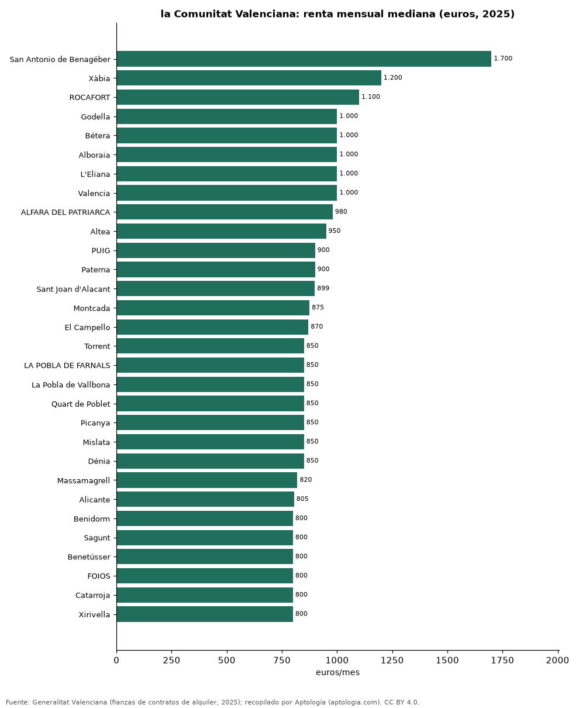

# Alquiler por municipio en la Comunitat Valenciana: los más caros y los más baratos según los contratos de 2025

**La renta mediana de alquiler más alta de la Comunitat Valenciana en 2025 se pagó en San Antonio de Benagéber (Valencia), con 1.700 euros al mes, y la más baja de los 119 municipios con 30 contratos o más en Utiel (Valencia), con 460 euros.** En Valencia, el municipio con más contratos (11.322), la renta mediana fue de 1.000 euros al mes.

*Resumen: ordenamos 119 municipios de la Comunitat Valenciana con 30 contratos de alquiler o más registrados en 2025 (33.611 contratos).*

**Actualizado:** 18 de octubre de 2026 (datos de contratos de 2025) · **Próxima actualización:** mensual.

## Resumen

| Indicador | Valor |
|---|---|
| Más caro | San Antonio de Benagéber: 1.700 euros |
| Más barato | Utiel: 460 euros |
| Valencia | 1.000 euros |
| Municipios | 119 |

## Los 40 municipios más caros

| Municipio | Provincia | Alquiler mensual (mediana) | Contratos |
|---|---|---|---|
| San Antonio de Benagéber | Valencia | 1.700 euros | 37 |
| Xàbia | Alicante | 1.200 euros | 86 |
| ROCAFORT | Valencia | 1.100 euros | 58 |
| Godella | Valencia | 1.000 euros | 106 |
| Bétera | Valencia | 1.000 euros | 174 |
| Alboraia | Valencia | 1.000 euros | 298 |
| L'Eliana | Valencia | 1.000 euros | 109 |
| Valencia | Valencia | 1.000 euros | 11.322 |
| ALFARA DEL PATRIARCA | Valencia | 980 euros | 72 |
| Altea | Alicante | 950 euros | 57 |
| PUIG | Valencia | 900 euros | 102 |
| Paterna | Valencia | 900 euros | 584 |
| Sant Joan d'Alacant | Alicante | 899 euros | 141 |
| Montcada | Valencia | 875 euros | 245 |
| El Campello | Alicante | 870 euros | 151 |
| Torrent | Valencia | 850 euros | 725 |
| LA POBLA DE FARNALS | Valencia | 850 euros | 154 |
| La Pobla de Vallbona | Valencia | 850 euros | 150 |
| Quart de Poblet | Valencia | 850 euros | 253 |
| Picanya | Valencia | 850 euros | 98 |
| Mislata | Valencia | 850 euros | 361 |
| Dénia | Alicante | 850 euros | 156 |
| Massamagrell | Valencia | 820 euros | 135 |
| Alicante | Alicante | 805 euros | 2.086 |
| Benidorm | Alicante | 800 euros | 240 |
| Sagunt | Valencia | 800 euros | 644 |
| Benetússer | Valencia | 800 euros | 160 |
| FOIOS | Valencia | 800 euros | 67 |
| Catarroja | Valencia | 800 euros | 287 |
| Xirivella | Valencia | 800 euros | 201 |
| CANET D'EN BERENGUER | Valencia | 800 euros | 134 |
| Burjassot | Valencia | 800 euros | 504 |
| Sedaví | Valencia | 800 euros | 88 |
| RAFELBUÑOL | Valencia | 800 euros | 83 |
| TAVERNES BLANQUES | Valencia | 800 euros | 69 |
| Puçol | Valencia | 800 euros | 228 |
| Manises | Valencia | 800 euros | 219 |
| Paiporta | Valencia | 800 euros | 313 |
| Silla | Valencia | 795 euros | 158 |
| Riba-roja de Túria | Valencia | 790 euros | 118 |

Renta mensual mediana de los contratos de alquiler de vivienda registrados en 2025.

## Los 15 municipios más baratos

| Municipio | Provincia | Alquiler mensual (mediana) | Contratos |
|---|---|---|---|
| Utiel | Valencia | 460 euros | 62 |
| L'Alcora | Castellón | 465 euros | 91 |
| CABANES | Castellón | 480 euros | 33 |
| Benicarló | Castellón | 500 euros | 178 |
| ALCALA DE CHIVERT | Castellón | 500 euros | 47 |
| Villena | Alicante | 500 euros | 52 |
| TORREBLANCA | Castellón | 500 euros | 34 |
| ONIL | Alicante | 500 euros | 30 |
| Requena | Valencia | 500 euros | 143 |
| Onda | Castellón | 500 euros | 228 |
| SEGORBE | Castellón | 500 euros | 55 |
| Ibi | Alicante | 520 euros | 35 |
| Alcoy | Alicante | 525 euros | 429 |
| Ontinyent | Valencia | 550 euros | 221 |
| BORRIOL | Castellón | 550 euros | 48 |

## Preguntas frecuentes

**¿Cuál es el municipio con el alquiler más caro de la Comunitat Valenciana?**
San Antonio de Benagéber, con 1.700 euros al mes de renta mediana en 2025.

**¿Cuánto cuesta alquilar en Valencia?**
1.000 euros al mes de renta mediana en los contratos de 2025.

## Metodología

- **Fuente:** Generalitat Valenciana (fianzas de contratos de alquiler, 2025). Las tablas oficiales se tomaron de los exportes nocturnos de Aptología del 18 de octubre de 2026 (es_alquiler_municipio, es_alquiler_barrio, es_compra_municipio), que las recopilan sin modificarlas.
- **Estadístico:** renta mediana mensual por contrato; año 2025 completo.
- **Qué se mide:** rentas de contratos registrados (fianzas) o valores de tasación oficiales, no precios pedidos en portales.
- **Muestra mínima:** solo se publican filas con 30 contratos o tasaciones o más.
- **Limitaciones:** cada fuente usa su propia metodología (media en Cataluña, mediana en la Comunitat Valenciana), por lo que no deben compararse entre sí sin cautela.
- **Datos abiertos:** [datos.csv](datos.csv), licencia CC BY 4.0.

## Cómo citar

Pinzón Pineda, D. M. (2026). *Alquiler por municipio en la Comunitat Valenciana: los más caros y los más baratos según los contratos de 2025*. Aptología (aptologia.com). https://github.com/elbroker/aptologia-datos/tree/main/estudios/alquiler-por-municipio-comunitat-valenciana-2025. Datos: datos.csv, licencia CC BY 4.0.
