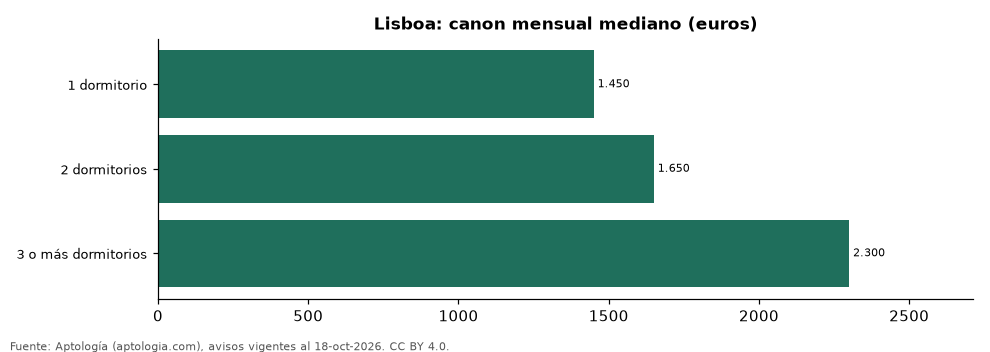

# Alquiler en Lisboa por número de dormitorios: cuánto cuesta cada tipo de apartamento (octubre 2026)

**En Lisboa, alquilar un apartamento de 1 dormitorio cuesta en la mediana 1.450 euros (USD 1.630) al mes y uno de 2 dormitorios, 1.650 euros (USD 1.855) (+13,8 %).** Uno de 3 o más dormitorios se pide en 2.300 euros (USD 2.585).

*Resumen: analizamos 500 avisos de apartamentos en alquiler en Lisboa con número de dormitorios declarado.*

**Actualizado:** 18 de octubre de 2026 (datos del 18 de octubre de 2026) · **Próxima actualización:** mensual.

## Resumen

| Indicador | Valor |
|---|---|
| 1 dormitorio | 1.450 euros (USD 1.630) |
| 2 dormitorios | 1.650 euros (USD 1.855) |
| Salto de 1 a 2 | +13,8 % |
| Avisos | 500 |

## Canon por número de dormitorios

| Tipo | Canon mensual (mediana) | Rango típico (P25–P75) | Área mediana (m²) | Canon por m² | Avisos |
|---|---|---|---|---|---|
| 1 dormitorio | 1.450 euros (USD 1.630) | 1.200 euros (USD 1.349) – 1.830 euros (USD 2.057) | 51 | 29,2 euros (USD 32,9) | 115 |
| 2 dormitorios | 1.650 euros (USD 1.855) | 1.400 euros (USD 1.574) – 2.100 euros (USD 2.361) | 79 | 22,8 euros (USD 25,6) | 190 |
| 3 o más dormitorios | 2.300 euros (USD 2.585) | 1.900 euros (USD 2.136) – 2.985 euros (USD 3.355) | 119 | 20,3 euros (USD 22,9) | 195 |

Medianas del canon mensual pedido, sin administración ni gastos comunes; el rango típico va del percentil 25 al 75.

## Preguntas frecuentes

**¿Cuánto cuesta alquilar un apartamento de 2 dormitorios en Lisboa?**
1.650 euros (USD 1.855) al mes en la mediana (octubre de 2026); la mitad central de la oferta está entre 1.400 euros (USD 1.574) y 2.100 euros (USD 2.361).

**¿Y uno de 1 dormitorio?**
1.450 euros (USD 1.630) al mes en la mediana.

## Metodología

- **Fuente:** exportes nocturnos de la base de datos de Aptología (aptologia.com) del 18 de octubre de 2026: avisos vigentes de vivienda en portales inmobiliarios de 13 países, recogidos por Aptología y vistos en línea entre el 11 y el 18 de octubre de 2026. Corte: 18 de octubre de 2026.
- **Depuración:** se eliminan duplicados exactos (misma ciudad, zona, tipo, precio, moneda, área, habitaciones y baños) y los precios fuera del percentil 1–99 de cada país, operación, moneda y tipo; el precio por m² usa solo avisos con área declarada entre 12 y 2.000 m² y también se recorta al P1–P99.
- **Qué se mide:** precios pedidos (publicados), no precios de cierre. En arriendo, el canon mensual sin administración, gastos comunes ni condominio.
- **Muestra mínima:** cada cifra publicada se apoya en al menos 30 avisos; las celdas con menos se omiten.
- **Monedas:** nunca se mezclan avisos de monedas distintas sin convertirlos. Conversión a dólares con la tasa de mercado de ExchangeRate-API (open.er-api.com, actualización del 18 Oct 2026): 1 USD = 3.182,80 COP, 1 USD = 18,47 M.N, 1 USD = 5,09 BRL, 1 USD = 3,44 PEN, 1 USD = 982,44 CLP, 1 USD = 1.514,57 ARS, 1 USD = 40,20 UYU, 1 USD = 5.705,37 PYG, 1 USD = 61,27 DOP, 1 USD = 0,89 EUR, 1 USD = 11,72 BOB; la UF chilena a 41.178,64 CLP (mindicador,cl. 18-oct-2026). Los avisos publicados en dólares se usan tal cual.
- **Monedas:** en cada ciudad y operación se usa solo la moneda mayoritaria de los avisos (los avisos en otra moneda se excluyen) y la mediana se convierte a dólares con la tasa citada; nunca se promedian avisos de monedas distintas.
- **Limitaciones:** la cobertura depende de los portales que recorre Aptología en cada país y es mayor en las ciudades grandes y en los segmentos medio-alto y alto; el área es la que declara el aviso, sin verificar; los nombres de zona vienen de los portales.
- **Privacidad:** solo se publican agregados; no se publica ningún dato personal, enlace a avisos ni nombre de anunciante.
- **Datos abiertos:** [datos.csv](datos.csv), licencia CC BY 4.0.

## Cómo citar

Pinzón Pineda, D. M. (2026). *Alquiler en Lisboa por número de dormitorios: cuánto cuesta cada tipo de apartamento (octubre 2026)*. Aptología (aptologia.com). https://github.com/elbroker/aptologia-datos/tree/main/estudios/alquiler-por-numero-de-dormitorios-lisboa-2026. Datos: datos.csv, licencia CC BY 4.0.
