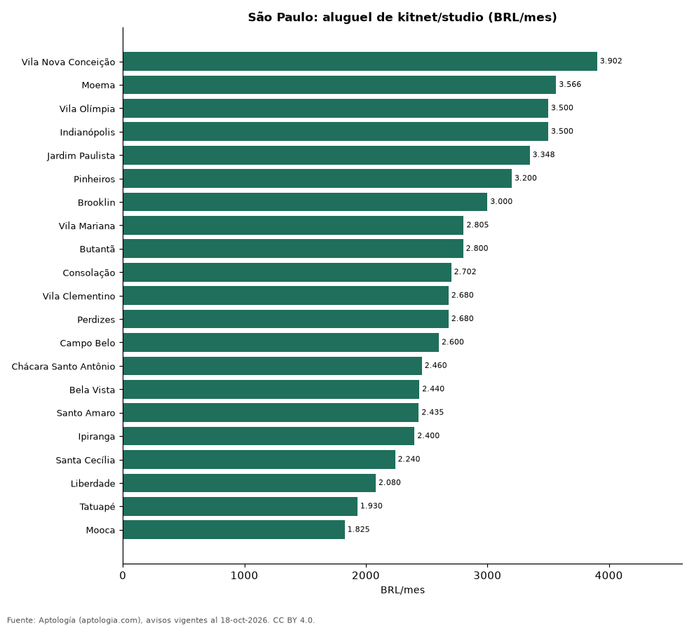

# Aluguel de kitnet e studio em São Paulo por bairro (octubre 2026)

**Alquilar un kitnet o studio en São Paulo cuesta en la mediana 2.650 reales (USD 521) al mes; el bairro más caro de la muestra es Vila Nova Conceição (3.902 reales (USD 767)) y el más barato Mooca (1.825 reales (USD 359)).** El área mediana es 27 m².

*Resumen: analizamos 1.988 anuncios de kitnets y studios en alquiler en 21 bairros con 30 anuncios o más.*

**Actualizado:** 18 de octubre de 2026 (datos del 18 de octubre de 2026) · **Próxima actualización:** mensual.

## Resumen

| Indicador | Valor |
|---|---|
| Mediana de la ciudad | 2.650 reales (USD 521) |
| Más caro | Vila Nova Conceição: 3.902 reales (USD 767) |
| Más barato | Mooca: 1.825 reales (USD 359) |
| Área mediana | 27 m² |

## Kitnet y studio por bairro

| Bairro | Aluguel (mediana) | Aluguel por m² | Anúncios |
|---|---|---|---|
| Vila Nova Conceição | 3.902 reales (USD 767) | — | 30 |
| Moema | 3.566 reales (USD 701) | 121 reales (USD 23,9) | 56 |
| Vila Olímpia | 3.500 reales (USD 688) | 129 reales (USD 25,3) | 65 |
| Indianópolis | 3.500 reales (USD 688) | 118 reales (USD 23,3) | 39 |
| Jardim Paulista | 3.348 reales (USD 658) | 119 reales (USD 23,3) | 48 |
| Pinheiros | 3.200 reales (USD 629) | 118 reales (USD 23,2) | 182 |
| Brooklin | 3.000 reales (USD 590) | 109 reales (USD 21,3) | 86 |
| Vila Mariana | 2.805 reales (USD 551) | 99 reales (USD 19,4) | 109 |
| Butantã | 2.800 reales (USD 550) | 105 reales (USD 20,7) | 46 |
| Consolação | 2.702 reales (USD 531) | 100 reales (USD 19,7) | 96 |
| Vila Clementino | 2.680 reales (USD 527) | 100 reales (USD 19,7) | 70 |
| Perdizes | 2.680 reales (USD 527) | 103 reales (USD 20,2) | 61 |
| Campo Belo | 2.600 reales (USD 511) | 100 reales (USD 19,7) | 33 |
| Chácara Santo Antônio | 2.460 reales (USD 483) | 100 reales (USD 19,7) | 30 |
| Bela Vista | 2.440 reales (USD 480) | 83 reales (USD 16,4) | 71 |
| Santo Amaro | 2.435 reales (USD 479) | 92 reales (USD 18,0) | 38 |
| Ipiranga | 2.400 reales (USD 472) | 79 reales (USD 15,6) | 36 |
| Santa Cecília | 2.240 reales (USD 440) | 88 reales (USD 17,3) | 49 |
| Liberdade | 2.080 reales (USD 409) | 79 reales (USD 15,6) | 36 |
| Tatuapé | 1.930 reales (USD 379) | 68 reales (USD 13,3) | 37 |
| Mooca | 1.825 reales (USD 359) | 66 reales (USD 13,0) | 40 |

Medianas; sin condomínio ni IPTU.

## Preguntas frecuentes

**Quanto custa alugar uma kitnet em São Paulo?**
2.650 reales (USD 521) al mes en la mediana (octubre de 2026).

**Onde é mais barato alugar studio em São Paulo?**
En Mooca, con 1.825 reales (USD 359) al mes, entre los bairros con 30 anuncios o más.

## Metodología

- **Fuente:** exportes nocturnos de la base de datos de Aptología (aptologia.com) del 18 de octubre de 2026: avisos vigentes de vivienda en portales inmobiliarios de 13 países, recogidos por Aptología y vistos en línea entre el 11 y el 18 de octubre de 2026. Corte: 18 de octubre de 2026.
- **Depuración:** se eliminan duplicados exactos (misma ciudad, zona, tipo, precio, moneda, área, habitaciones y baños) y los precios fuera del percentil 1–99 de cada país, operación, moneda y tipo; el precio por m² usa solo avisos con área declarada entre 12 y 2.000 m² y también se recorta al P1–P99.
- **Qué se mide:** precios pedidos (publicados), no precios de cierre. En arriendo, el canon mensual sin administración, gastos comunes ni condominio.
- **Muestra mínima:** cada cifra publicada se apoya en al menos 30 avisos; las celdas con menos se omiten.
- **Monedas:** nunca se mezclan avisos de monedas distintas sin convertirlos. Conversión a dólares con la tasa de mercado de ExchangeRate-API (open.er-api.com, actualización del 18 Oct 2026): 1 USD = 3.182,80 COP, 1 USD = 18,47 M.N, 1 USD = 5,09 BRL, 1 USD = 3,44 PEN, 1 USD = 982,44 CLP, 1 USD = 1.514,57 ARS, 1 USD = 40,20 UYU, 1 USD = 5.705,37 PYG, 1 USD = 61,27 DOP, 1 USD = 0,89 EUR, 1 USD = 11,72 BOB; la UF chilena a 41.178,64 CLP (mindicador,cl. 18-oct-2026). Los avisos publicados en dólares se usan tal cual.
- **Moneda:** reales brasileños (BRL); equivalencias en dólares con la tasa citada.
- **Aluguel:** valor mensual pedido, sin condomínio ni IPTU (salvo que se indique).
- **Limitaciones:** la cobertura depende de los portales que recorre Aptología en cada país y es mayor en las ciudades grandes y en los segmentos medio-alto y alto; el área es la que declara el aviso, sin verificar; los nombres de zona vienen de los portales.
- **Privacidad:** solo se publican agregados; no se publica ningún dato personal, enlace a avisos ni nombre de anunciante.
- **Datos abiertos:** [datos.csv](datos.csv), licencia CC BY 4.0.

## Cómo citar

Pinzón Pineda, D. M. (2026). *Aluguel de kitnet e studio em São Paulo por bairro (octubre 2026)*. Aptología (aptologia.com). https://github.com/elbroker/aptologia-datos/tree/main/estudios/aluguel-de-kitnet-e-studio-sao-paulo-por-bairro-2026. Datos: datos.csv, licencia CC BY 4.0.
