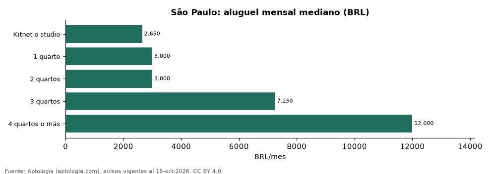

# Aluguel em São Paulo por número de quartos: kitnet, 1, 2, 3 y 4 quartos (octubre 2026)

**En São Paulo un apartamento de 2 quartos se alquila en la mediana por 3.000 reales (USD 590) al mes, igual que uno de 1 quarto, y uno de 3 quartos por 7.250 reales (USD 1.425).** Un kitnet o studio se pide en 2.650 reales (USD 521), y por m² cuesta 96 reales (USD 18,8) frente a 56 reales (USD 11,1) en 2 quartos.

*Resumen: analizamos 12.864 anuncios de alquiler de apartamentos, kitnets y studios en São Paulo.*

**Actualizado:** 18 de octubre de 2026 (datos del 18 de octubre de 2026) · **Próxima actualización:** mensual.

## Resumen

| Indicador | Valor |
|---|---|
| Kitnet o studio | 2.650 reales (USD 521) |
| 1 quarto | 3.000 reales (USD 590) |
| 2 quartos | 3.000 reales (USD 590) |
| 3 quartos | 7.250 reales (USD 1.425) |
| 4 quartos o más | 12.000 reales (USD 2.358) |

## Aluguel, m² y condomínio por número de quartos

| Tipo | Aluguel (mediana) | Aluguel por m² | Área (m²) | Condomínio (mediana) | Anúncios |
|---|---|---|---|---|---|
| Kitnet o studio | 2.650 reales (USD 521) | 96 reales (USD 18,8) | 27 | 570 reales (USD 112) | 1.988 |
| 1 quarto | 3.000 reales (USD 590) | 81 reales (USD 15,9) | 39 | 700 reales (USD 138) | 3.185 |
| 2 quartos | 3.000 reales (USD 590) | 56 reales (USD 11,1) | 57 | 738 reales (USD 145) | 4.869 |
| 3 quartos | 7.250 reales (USD 1.425) | 60 reales (USD 11,8) | 120 | 1.958 reales (USD 385) | 2.303 |
| 4 quartos o más | 12.000 reales (USD 2.358) | 56 reales (USD 11,1) | 217 | 3.954 reales (USD 777) | 519 |

Medianas; el condomínio es la cuota mensual declarada, aparte del alquiler.

## Preguntas frecuentes

**Quanto custa alugar um apartamento de 2 quartos em São Paulo?**
3.000 reales (USD 590) al mes en la mediana (octubre de 2026), sin condomínio ni IPTU.

**Quanto custa uma kitnet em São Paulo?**
2.650 reales (USD 521) al mes en la mediana.

## Metodología

- **Fuente:** exportes nocturnos de la base de datos de Aptología (aptologia.com) del 18 de octubre de 2026: avisos vigentes de vivienda en portales inmobiliarios de 13 países, recogidos por Aptología y vistos en línea entre el 11 y el 18 de octubre de 2026. Corte: 18 de octubre de 2026.
- **Depuración:** se eliminan duplicados exactos (misma ciudad, zona, tipo, precio, moneda, área, habitaciones y baños) y los precios fuera del percentil 1–99 de cada país, operación, moneda y tipo; el precio por m² usa solo avisos con área declarada entre 12 y 2.000 m² y también se recorta al P1–P99.
- **Qué se mide:** precios pedidos (publicados), no precios de cierre. En arriendo, el canon mensual sin administración, gastos comunes ni condominio.
- **Muestra mínima:** cada cifra publicada se apoya en al menos 30 avisos; las celdas con menos se omiten.
- **Monedas:** nunca se mezclan avisos de monedas distintas sin convertirlos. Conversión a dólares con la tasa de mercado de ExchangeRate-API (open.er-api.com, actualización del 18 Oct 2026): 1 USD = 3.182,80 COP, 1 USD = 18,47 M.N, 1 USD = 5,09 BRL, 1 USD = 3,44 PEN, 1 USD = 982,44 CLP, 1 USD = 1.514,57 ARS, 1 USD = 40,20 UYU, 1 USD = 5.705,37 PYG, 1 USD = 61,27 DOP, 1 USD = 0,89 EUR, 1 USD = 11,72 BOB; la UF chilena a 41.178,64 CLP (mindicador,cl. 18-oct-2026). Los avisos publicados en dólares se usan tal cual.
- **Moneda:** reales brasileños (BRL); equivalencias en dólares con la tasa citada.
- **Aluguel:** valor mensual pedido, sin condomínio ni IPTU (salvo que se indique).
- **Limitaciones:** la cobertura depende de los portales que recorre Aptología en cada país y es mayor en las ciudades grandes y en los segmentos medio-alto y alto; el área es la que declara el aviso, sin verificar; los nombres de zona vienen de los portales.
- **Privacidad:** solo se publican agregados; no se publica ningún dato personal, enlace a avisos ni nombre de anunciante.
- **Datos abiertos:** [datos.csv](datos.csv), licencia CC BY 4.0.

## Cómo citar

Pinzón Pineda, D. M. (2026). *Aluguel em São Paulo por número de quartos: kitnet, 1, 2, 3 y 4 quartos (octubre 2026)*. Aptología (aptologia.com). https://github.com/elbroker/aptologia-datos/tree/main/estudios/aluguel-por-numero-de-quartos-sao-paulo-2026. Datos: datos.csv, licencia CC BY 4.0.
