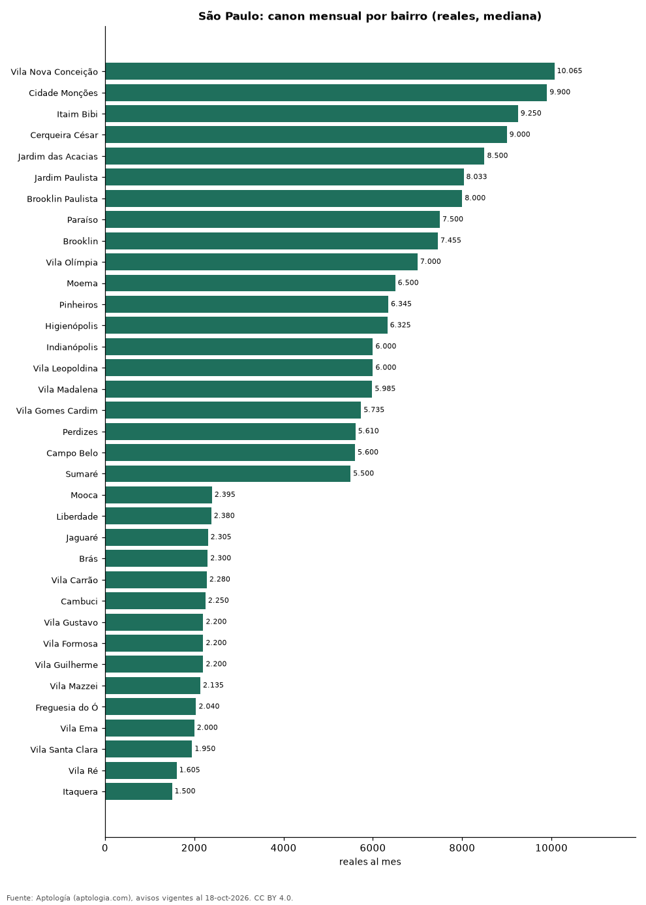

# Precio de la vivienda por bairro en São Paulo: arriendo en 74 bairros (octubre 2026)

**Arrendar un apartamento en São Paulo cuesta más en Vila Nova Conceição, con un canon mediano de 10.065 reales (USD 1.978) al mes, y menos en Itaquera, con 1.500 reales (USD 295).** La mediana de la ciudad es 3.621 reales (USD 712) al mes; por metro cuadrado, el bairro más caro es Vila Nova Conceição (131,6 reales (USD 25,9) por m² al mes).

*Resumen: analizamos 7.628 avisos de apartamentos en 74 bairros de São Paulo con 30 avisos o más.*

**Actualizado:** 18 de octubre de 2026 (datos del 18 de octubre de 2026) · **Próxima actualización:** mensual.

## Resumen

| Indicador | Valor |
|---|---|
| Arriendo más alto | Vila Nova Conceição: 10.065 reales (USD 1.978) |
| Arriendo más bajo | Itaquera: 1.500 reales (USD 295) |
| São Paulo (mediana) | 3.621 reales (USD 712) |
| Bairros | 74 |

## Bairros de São Paulo

| Bairro | Arriendo: reales al mes | Avisos |
|---|---|---|
| Vila Nova Conceição | 10.065 | 186 |
| Cidade Monções | 9.900 | 65 |
| Itaim Bibi | 9.250 | 304 |
| Cerqueira César | 9.000 | 136 |
| Jardim das Acacias | 8.500 | 40 |
| Jardim Paulista | 8.033 | 287 |
| Brooklin Paulista | 8.000 | 41 |
| Paraíso | 7.500 | 148 |
| Brooklin | 7.455 | 316 |
| Vila Olímpia | 7.000 | 416 |
| Moema | 6.500 | 304 |
| Pinheiros | 6.345 | 506 |
| Higienópolis | 6.325 | 64 |
| Indianópolis | 6.000 | 134 |
| Vila Leopoldina | 6.000 | 71 |
| Vila Madalena | 5.985 | 100 |
| Vila Gomes Cardim | 5.735 | 38 |
| Perdizes | 5.610 | 228 |
| Campo Belo | 5.600 | 175 |
| Sumaré | 5.500 | 45 |
| Vila Mariana | 5.035 | 258 |
| Vila Suzana | 5.000 | 57 |
| Chácara Santo Antônio | 4.960 | 69 |
| Vila Romana | 4.845 | 54 |
| Vila Regente Feijó | 4.800 | 34 |
| Sumarezinho | 4.434 | 52 |
| Jardim Anália Franco | 4.300 | 53 |
| Pompéia | 4.300 | 71 |
| Santo Amaro | 4.292 | 140 |
| Vila Mascote | 4.140 | 39 |
| Panamby | 4.020 | 95 |
| Consolação | 4.000 | 142 |
| Vila Clementino | 3.970 | 114 |
| Planalto Paulista | 3.945 | 36 |
| Vila Anastácio | 3.900 | 33 |
| Pompeia | 3.825 | 35 |
| Vila Andrade | 3.530 | 228 |
| Vila da Saúde | 3.515 | 36 |
| Bela Vista | 3.500 | 191 |
| Butantã | 3.500 | 121 |
| Tatuapé | 3.400 | 173 |
| Saúde | 3.335 | 44 |
| Aclimação | 3.300 | 52 |
| Ipiranga | 3.220 | 99 |
| Santa Cecília | 3.150 | 50 |
| Morumbi | 3.110 | 84 |
| Tucuruvi | 3.000 | 51 |
| Santana | 3.000 | 153 |
| Jardim Marajoara | 2.850 | 53 |
| Barra Funda | 2.700 | 115 |
| Casa Verde | 2.700 | 38 |
| Belém | 2.700 | 41 |
| Vila Buarque | 2.690 | 35 |
| Água Branca | 2.600 | 97 |
| Água Fria | 2.600 | 44 |
| Vila Prudente | 2.525 | 56 |
| Jardim Íris | 2.498 | 34 |
| Jabaquara | 2.460 | 38 |
| Belenzinho | 2.445 | 42 |
| Mooca | 2.395 | 192 |
| Liberdade | 2.380 | 44 |
| Jaguaré | 2.305 | 42 |
| Brás | 2.300 | 72 |
| Vila Carrão | 2.280 | 48 |
| Cambuci | 2.250 | 75 |
| Vila Gustavo | 2.200 | 33 |
| Vila Formosa | 2.200 | 69 |
| Vila Guilherme | 2.200 | 40 |
| Vila Mazzei | 2.135 | 38 |
| Freguesia do Ó | 2.040 | 53 |
| Vila Ema | 2.000 | 37 |
| Vila Santa Clara | 1.950 | 33 |
| Vila Ré | 1.605 | 30 |
| Itaquera | 1.500 | 61 |

Medianas de apartamentos; — indica menos de 30 avisos. El canon es el mensual sin gastos comunes, condominio ni administración.

## Preguntas frecuentes

**¿Cuál es el bairro más caro para arrendar en São Paulo?**
Vila Nova Conceição, con 10.065 reales (USD 1.978) al mes en la mediana.

**¿Dónde es más barato arrendar en São Paulo?**
En Itaquera: 1.500 reales (USD 295) al mes.

## Metodología

- **Fuente:** exportes nocturnos de la base de datos de Aptología (aptologia.com) del 18 de octubre de 2026: avisos vigentes de vivienda en portales inmobiliarios de 13 países, recogidos por Aptología y vistos en línea entre el 11 y el 18 de octubre de 2026. Corte: 18 de octubre de 2026.
- **Depuración:** se eliminan duplicados exactos (misma ciudad, zona, tipo, precio, moneda, área, habitaciones y baños) y los precios fuera del percentil 1–99 de cada país, operación, moneda y tipo; el precio por m² usa solo avisos con área declarada entre 12 y 2.000 m² y también se recorta al P1–P99.
- **Qué se mide:** precios pedidos (publicados), no precios de cierre. En arriendo, el canon mensual sin administración, gastos comunes ni condominio.
- **Muestra mínima:** cada cifra publicada se apoya en al menos 30 avisos; las celdas con menos se omiten.
- **Monedas:** nunca se mezclan avisos de monedas distintas sin convertirlos. Conversión a dólares con la tasa de mercado de ExchangeRate-API (open.er-api.com, actualización del 18 Oct 2026): 1 USD = 3.182,80 COP, 1 USD = 18,47 M.N, 1 USD = 5,09 BRL, 1 USD = 3,44 PEN, 1 USD = 982,44 CLP, 1 USD = 1.514,57 ARS, 1 USD = 40,20 UYU, 1 USD = 5.705,37 PYG, 1 USD = 61,27 DOP, 1 USD = 0,89 EUR, 1 USD = 11,72 BOB; la UF chilena a 41.178,64 CLP (mindicador,cl. 18-oct-2026). Los avisos publicados en dólares se usan tal cual.
- **Monedas:** Arriendo en reales; los avisos en otra moneda se excluyen.
- **Limitaciones:** la cobertura depende de los portales que recorre Aptología en cada país y es mayor en las ciudades grandes y en los segmentos medio-alto y alto; el área es la que declara el aviso, sin verificar; los nombres de zona vienen de los portales.
- **Privacidad:** solo se publican agregados; no se publica ningún dato personal, enlace a avisos ni nombre de anunciante.
- **Datos abiertos:** [datos.csv](datos.csv), licencia CC BY 4.0.

## Cómo citar

Pinzón Pineda, D. M. (2026). *Precio de la vivienda por bairro en São Paulo: arriendo en 74 bairros (octubre 2026)*. Aptología (aptologia.com). https://github.com/elbroker/aptologia-datos/tree/main/estudios/aluguel-sao-paulo-por-bairro-2026. Datos: datos.csv, licencia CC BY 4.0.
