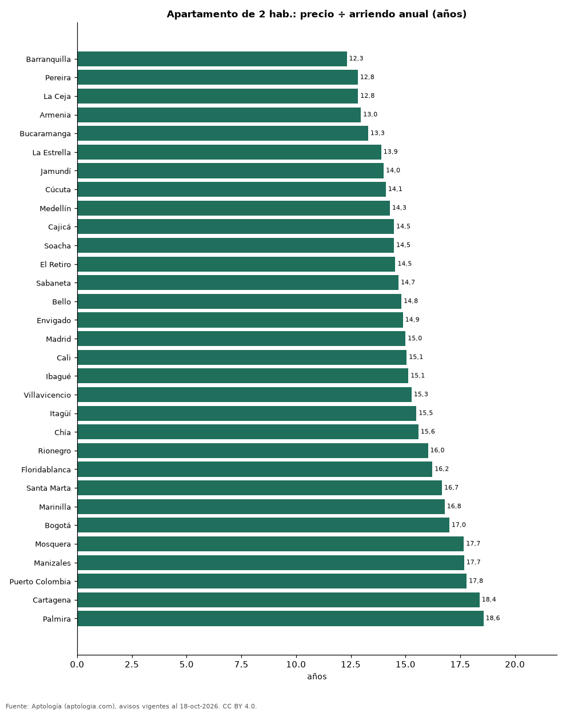

# ¿Comprar o arrendar? Cuántos años de arriendo cuesta un apartamento en 31 ciudades de Colombia (octubre 2026)

**En Barranquilla un apartamento de 2 habitaciones cuesta lo mismo que 12,3 años de su arriendo, la relación más baja de 31 ciudades colombianas; en Palmira cuesta 18,6 años.** En Bogotá son 17,0 años (540 millones de pesos de precio frente a 2,65 millones de pesos al mes). Cuantos menos años, más conviene comprar frente a arrendar, antes de costos y financiación.

*Resumen: comparamos el precio de venta y el canon de 186.841 apartamentos del mismo número de habitaciones en 31 ciudades.*

**Actualizado:** 18 de octubre de 2026 (datos del 18 de octubre de 2026) · **Próxima actualización:** mensual.

## Resumen

| Indicador | Valor |
|---|---|
| Menos años (2 hab.) | Barranquilla: 12,3 |
| Más años (2 hab.) | Palmira: 18,6 |
| Bogotá (2 hab.) | 17,0 años |

## Años de arriendo equivalentes al precio, por habitaciones

| Ciudad | 1 hab. (años) | 2 hab. (años) | 3 o más hab. (años) |
|---|---|---|---|
| Barranquilla | 12,3 | 12,3 | 12,4 |
| Pereira | 15,8 | 12,8 | 12,4 |
| La Ceja | — | 12,8 | 13,7 |
| Armenia | — | 13,0 | 13,3 |
| Bucaramanga | — | 13,3 | 14,6 |
| La Estrella | — | 13,9 | 14,9 |
| Jamundí | — | 14,0 | — |
| Cúcuta | — | 14,1 | 15,4 |
| Medellín | 13,6 | 14,3 | 13,5 |
| Cajicá | — | 14,5 | 13,4 |
| Soacha | — | 14,5 | 15,4 |
| El Retiro | 12,0 | 14,5 | 15,7 |
| Sabaneta | 12,9 | 14,7 | 14,6 |
| Bello | — | 14,8 | 13,3 |
| Envigado | 15,5 | 14,9 | 15,6 |
| Madrid | — | 15,0 | 14,6 |
| Cali | 13,3 | 15,1 | 11,6 |
| Ibagué | — | 15,1 | 20,8 |
| Villavicencio | — | 15,3 | 15,8 |
| Itagüí | — | 15,5 | 14,0 |
| Chía | 14,7 | 15,6 | 13,4 |
| Rionegro | 14,4 | 16,0 | 16,7 |
| Floridablanca | — | 16,2 | 15,0 |
| Santa Marta | 14,4 | 16,7 | 15,2 |
| Marinilla | — | 16,8 | 16,7 |
| Bogotá | 14,3 | 17,0 | 12,6 |
| Mosquera | — | 17,7 | 17,3 |
| Manizales | — | 17,7 | 15,4 |
| Puerto Colombia | — | 17,8 | 14,3 |
| Cartagena | 18,6 | 18,4 | 15,6 |
| Palmira | — | 18,6 | — |

— indica menos de 30 avisos en venta o en arriendo.

## Detalle de los apartamentos de 2 habitaciones

| Ciudad | Precio de venta (mediana) | Arriendo mensual (mediana) | Años |
|---|---|---|---|
| Barranquilla | 340 millones de pesos | 2,30 millones de pesos | 12,3 |
| Pereira | 400 millones de pesos | 2,60 millones de pesos | 12,8 |
| La Ceja | 385 millones de pesos | 2,50 millones de pesos | 12,8 |
| Armenia | 350 millones de pesos | 2,25 millones de pesos | 13,0 |
| Bucaramanga | 319 millones de pesos | 2,00 millones de pesos | 13,3 |
| La Estrella | 400 millones de pesos | 2,40 millones de pesos | 13,9 |
| Jamundí | 205 millones de pesos | 1,22 millones de pesos | 14,0 |
| Cúcuta | 220 millones de pesos | 1,30 millones de pesos | 14,1 |
| Medellín | 720 millones de pesos | 4,20 millones de pesos | 14,3 |
| Cajicá | 330 millones de pesos | 1,90 millones de pesos | 14,5 |
| Soacha | 165 millones de pesos | 0,95 millones de pesos | 14,5 |
| El Retiro | 750 millones de pesos | 4,30 millones de pesos | 14,5 |
| Sabaneta | 511 millones de pesos | 2,90 millones de pesos | 14,7 |
| Bello | 320 millones de pesos | 1,80 millones de pesos | 14,8 |
| Envigado | 750 millones de pesos | 4,20 millones de pesos | 14,9 |
| Madrid | 216 millones de pesos | 1,20 millones de pesos | 15,0 |
| Cali | 280 millones de pesos | 1,55 millones de pesos | 15,1 |
| Ibagué | 245 millones de pesos | 1,35 millones de pesos | 15,1 |
| Villavicencio | 220 millones de pesos | 1,20 millones de pesos | 15,3 |
| Itagüí | 465 millones de pesos | 2,50 millones de pesos | 15,5 |
| Chía | 290 millones de pesos | 1,55 millones de pesos | 15,6 |
| Rionegro | 500 millones de pesos | 2,60 millones de pesos | 16,0 |
| Floridablanca | 370 millones de pesos | 1,90 millones de pesos | 16,2 |
| Santa Marta | 700 millones de pesos | 3,50 millones de pesos | 16,7 |
| Marinilla | 342 millones de pesos | 1,70 millones de pesos | 16,8 |
| Bogotá | 540 millones de pesos | 2,65 millones de pesos | 17,0 |
| Mosquera | 265 millones de pesos | 1,25 millones de pesos | 17,7 |
| Manizales | 350 millones de pesos | 1,65 millones de pesos | 17,7 |
| Puerto Colombia | 427 millones de pesos | 2,00 millones de pesos | 17,8 |
| Cartagena | 750 millones de pesos | 3,40 millones de pesos | 18,4 |
| Palmira | 245 millones de pesos | 1,10 millones de pesos | 18,6 |

## Preguntas frecuentes

**¿Cuántos años de arriendo vale un apartamento en Bogotá?**
Un apartamento de 2 habitaciones equivale a 17,0 años de su canon (octubre de 2026).

**¿Dónde conviene más comprar que arrendar en Colombia?**
Por esta medida, en Barranquilla: 12,3 años de arriendo.

## Metodología

- **Fuente:** exportes nocturnos de la base de datos de Aptología (aptologia.com) del 18 de octubre de 2026: avisos vigentes de vivienda en portales inmobiliarios de 13 países, recogidos por Aptología y vistos en línea entre el 11 y el 18 de octubre de 2026. Corte: 18 de octubre de 2026.
- **Depuración:** se eliminan duplicados exactos (misma ciudad, zona, tipo, precio, moneda, área, habitaciones y baños) y los precios fuera del percentil 1–99 de cada país, operación, moneda y tipo; el precio por m² usa solo avisos con área declarada entre 12 y 2.000 m² y también se recorta al P1–P99.
- **Qué se mide:** precios pedidos (publicados), no precios de cierre. En arriendo, el canon mensual sin administración, gastos comunes ni condominio.
- **Muestra mínima:** cada cifra publicada se apoya en al menos 30 avisos; las celdas con menos se omiten.
- **Colombia:** Precios en pesos colombianos, sin conversión de moneda.
- **Años de arriendo para pagar la vivienda:** precio de venta mediano ÷ (canon mensual mediano × 12), entre avisos del mismo tipo y celda; es la relación precio/arriendo (price-to-rent ratio) y equivale a 100 ÷ rentabilidad bruta. No incluye administración, impuestos, vacancia, financiación ni valorización: es una referencia para comparar comprar con arrendar, no una recomendación de inversión.
- **Limitaciones:** la cobertura depende de los portales que recorre Aptología en cada país y es mayor en las ciudades grandes y en los segmentos medio-alto y alto; el área es la que declara el aviso, sin verificar; los nombres de zona vienen de los portales.
- **Privacidad:** solo se publican agregados; no se publica ningún dato personal, enlace a avisos ni nombre de anunciante.
- **Datos abiertos:** [datos.csv](datos.csv), licencia CC BY 4.0.

## Cómo citar

Pinzón Pineda, D. M. (2026). *¿Comprar o arrendar? Cuántos años de arriendo cuesta un apartamento en 31 ciudades de Colombia (octubre 2026)*. Aptología (aptologia.com). https://github.com/elbroker/aptologia-datos/tree/main/estudios/anos-de-arriendo-para-pagar-un-apartamento-ciudades-colombia-2026. Datos: datos.csv, licencia CC BY 4.0.
