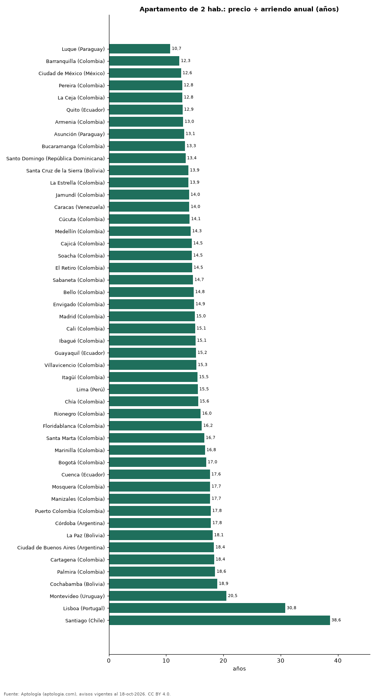

# ¿Comprar o arrendar en Latinoamérica? Cuántos años de arriendo vale un apartamento de 2 habitaciones en 48 ciudades (octubre 2026)

**Luque (Paraguay) es la ciudad de 48 de Latinoamérica y Portugal donde un apartamento de 2 habitaciones cuesta menos años de su propio arriendo: 10,7; en Santiago (Chile) cuesta 38,6 años.** Entre las capitales, la relación va de 12,6 años en Ciudad de México a 38,6 en Santiago; Bogotá está en 17,0.

*Resumen: comparamos precio de venta y canon de 88.710 apartamentos de 2 habitaciones en 48 ciudades de 13 países.*

**Actualizado:** 18 de octubre de 2026 (datos del 18 de octubre de 2026) · **Próxima actualización:** mensual.

## Resumen

| Indicador | Valor |
|---|---|
| Menos años | Luque (Paraguay): 10,7 |
| Más años | Santiago (Chile): 38,6 |
| Bogotá | 17,0 años |
| Ciudades | 48 |

## Años de arriendo que vale un apartamento de 2 habitaciones

| Ciudad | Precio 2 hab. (mediana) | Arriendo 2 hab. al mes | Años de arriendo | Rentabilidad bruta |
|---|---|---|---|---|
| Luque (Paraguay) | USD 79.000 | USD 613 | 10,7 | 9,3 % |
| Barranquilla (Colombia) | USD 106.824 | USD 723 | 12,3 | 8,1 % |
| Ciudad de México (México) | USD 249.486 | USD 1.648 | 12,6 | 7,9 % |
| Pereira (Colombia) | USD 125.675 | USD 817 | 12,8 | 7,8 % |
| La Ceja (Colombia) | USD 120.963 | USD 785 | 12,8 | 7,8 % |
| Quito (Ecuador) | USD 139.000 | USD 900 | 12,9 | 7,8 % |
| Armenia (Colombia) | USD 109.966 | USD 707 | 13,0 | 7,7 % |
| Asunción (Paraguay) | USD 156.200 | USD 990 | 13,1 | 7,6 % |
| Bucaramanga (Colombia) | USD 100.226 | USD 628 | 13,3 | 7,5 % |
| Santo Domingo (República Dominicana) | USD 225.000 | USD 1.400 | 13,4 | 7,5 % |
| Santa Cruz de la Sierra (Bolivia) | USD 105.000 | USD 630 | 13,9 | 7,2 % |
| La Estrella (Colombia) | USD 125.675 | USD 754 | 13,9 | 7,2 % |
| Jamundí (Colombia) | USD 64.409 | USD 383 | 14,0 | 7,1 % |
| Caracas (Venezuela) | USD 160.000 | USD 950 | 14,0 | 7,1 % |
| Cúcuta (Colombia) | USD 69.121 | USD 408 | 14,1 | 7,1 % |
| Medellín (Colombia) | USD 226.216 | USD 1.320 | 14,3 | 7,0 % |
| Cajicá (Colombia) | USD 103.682 | USD 597 | 14,5 | 6,9 % |
| Soacha (Colombia) | USD 51.841 | USD 298 | 14,5 | 6,9 % |
| El Retiro (Colombia) | USD 235.641 | USD 1.351 | 14,5 | 6,9 % |
| Sabaneta (Colombia) | USD 160.550 | USD 911 | 14,7 | 6,8 % |
| Bello (Colombia) | USD 100.540 | USD 566 | 14,8 | 6,8 % |
| Envigado (Colombia) | USD 235.641 | USD 1.320 | 14,9 | 6,7 % |
| Madrid (Colombia) | USD 67.865 | USD 377 | 15,0 | 6,7 % |
| Cali (Colombia) | USD 87.973 | USD 487 | 15,1 | 6,6 % |
| Ibagué (Colombia) | USD 76.976 | USD 424 | 15,1 | 6,6 % |
| Guayaquil (Ecuador) | USD 155.250 | USD 850 | 15,2 | 6,6 % |
| Villavicencio (Colombia) | USD 69.121 | USD 377 | 15,3 | 6,5 % |
| Itagüí (Colombia) | USD 146.098 | USD 785 | 15,5 | 6,5 % |
| Lima (Perú) | USD 156.324 | USD 838 | 15,5 | 6,4 % |
| Chía (Colombia) | USD 91.115 | USD 487 | 15,6 | 6,4 % |
| Rionegro (Colombia) | USD 157.094 | USD 817 | 16,0 | 6,2 % |
| Floridablanca (Colombia) | USD 116.250 | USD 597 | 16,2 | 6,2 % |
| Santa Marta (Colombia) | USD 219.932 | USD 1.100 | 16,7 | 6,0 % |
| Marinilla (Colombia) | USD 107.610 | USD 534 | 16,8 | 6,0 % |
| Bogotá (Colombia) | USD 169.662 | USD 831 | 17,0 | 5,9 % |
| Cuenca (Ecuador) | USD 127.000 | USD 600 | 17,6 | 5,7 % |
| Mosquera (Colombia) | USD 83.260 | USD 393 | 17,7 | 5,7 % |
| Manizales (Colombia) | USD 109.966 | USD 518 | 17,7 | 5,7 % |
| Puerto Colombia (Colombia) | USD 134.158 | USD 628 | 17,8 | 5,6 % |
| Córdoba (Argentina) | USD 120.000 | USD 561 | 17,8 | 5,6 % |
| La Paz (Bolivia) | USD 110.000 | USD 506 | 18,1 | 5,5 % |
| Ciudad de Buenos Aires (Argentina) | USD 160.000 | USD 726 | 18,4 | 5,4 % |
| Cartagena (Colombia) | USD 235.641 | USD 1.068 | 18,4 | 5,4 % |
| Palmira (Colombia) | USD 76.976 | USD 346 | 18,6 | 5,4 % |
| Cochabamba (Bolivia) | USD 79.545 | USD 350 | 18,9 | 5,3 % |
| Montevideo (Uruguay) | USD 203.500 | USD 826 | 20,5 | 4,9 % |
| Lisboa (Portugal) | USD 685.691 | USD 1.855 | 30,8 | 3,2 % |
| Santiago (Chile) | USD 226.340 | USD 489 | 38,6 | 2,6 % |

Medianas convertidas a dólares; el número de años no depende de la tasa cuando venta y arriendo están en la misma moneda.

## Preguntas frecuentes

**¿En qué ciudad de Latinoamérica conviene más comprar que arrendar?**
Por relación precio/arriendo, en Luque (Paraguay): 10,7 años de arriendo.

**¿Dónde es más caro comprar frente a arrendar?**
En Santiago (Chile): 38,6 años.

## Metodología

- **Fuente:** exportes nocturnos de la base de datos de Aptología (aptologia.com) del 18 de octubre de 2026: avisos vigentes de vivienda en portales inmobiliarios de 13 países, recogidos por Aptología y vistos en línea entre el 11 y el 18 de octubre de 2026. Corte: 18 de octubre de 2026.
- **Depuración:** se eliminan duplicados exactos (misma ciudad, zona, tipo, precio, moneda, área, habitaciones y baños) y los precios fuera del percentil 1–99 de cada país, operación, moneda y tipo; el precio por m² usa solo avisos con área declarada entre 12 y 2.000 m² y también se recorta al P1–P99.
- **Qué se mide:** precios pedidos (publicados), no precios de cierre. En arriendo, el canon mensual sin administración, gastos comunes ni condominio.
- **Muestra mínima:** cada cifra publicada se apoya en al menos 30 avisos; las celdas con menos se omiten.
- **Monedas:** nunca se mezclan avisos de monedas distintas sin convertirlos. Conversión a dólares con la tasa de mercado de ExchangeRate-API (open.er-api.com, actualización del 18 Oct 2026): 1 USD = 3.182,80 COP, 1 USD = 18,47 M.N, 1 USD = 5,09 BRL, 1 USD = 3,44 PEN, 1 USD = 982,44 CLP, 1 USD = 1.514,57 ARS, 1 USD = 40,20 UYU, 1 USD = 5.705,37 PYG, 1 USD = 61,27 DOP, 1 USD = 0,89 EUR, 1 USD = 11,72 BOB; la UF chilena a 41.178,64 CLP (mindicador,cl. 18-oct-2026). Los avisos publicados en dólares se usan tal cual.
- **Monedas:** en cada ciudad y operación se usa solo la moneda mayoritaria de los avisos (los avisos en otra moneda se excluyen) y la mediana se convierte a dólares con la tasa citada; nunca se promedian avisos de monedas distintas.
- **Años de arriendo para pagar la vivienda:** precio de venta mediano ÷ (canon mensual mediano × 12), entre avisos del mismo tipo y celda; es la relación precio/arriendo (price-to-rent ratio) y equivale a 100 ÷ rentabilidad bruta. No incluye administración, impuestos, vacancia, financiación ni valorización: es una referencia para comparar comprar con arrendar, no una recomendación de inversión.
- **Destinos de temporada:** Punta del Este, Maldonado y Punta Cana se excluyen de las comparaciones de años de arriendo porque muchos avisos de alquiler son de temporada (precio mensual de verano), lo que infla el canon y daría una relación artificialmente baja.
- **Limitaciones:** la cobertura depende de los portales que recorre Aptología en cada país y es mayor en las ciudades grandes y en los segmentos medio-alto y alto; el área es la que declara el aviso, sin verificar; los nombres de zona vienen de los portales.
- **Privacidad:** solo se publican agregados; no se publica ningún dato personal, enlace a avisos ni nombre de anunciante.
- **Datos abiertos:** [datos.csv](datos.csv), licencia CC BY 4.0.

## Cómo citar

Pinzón Pineda, D. M. (2026). *¿Comprar o arrendar en Latinoamérica? Cuántos años de arriendo vale un apartamento de 2 habitaciones en 48 ciudades (octubre 2026)*. Aptología (aptologia.com). https://github.com/elbroker/aptologia-datos/tree/main/estudios/anos-de-arriendo-para-pagar-un-apartamento-ciudades-latinoamerica-2026. Datos: datos.csv, licencia CC BY 4.0.
