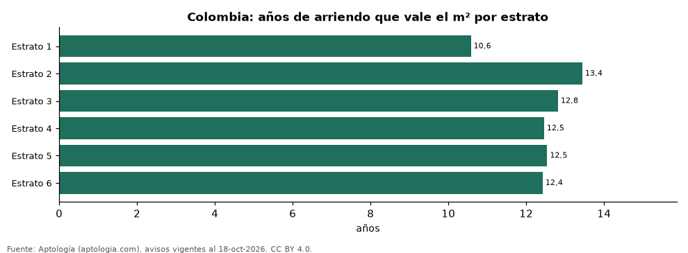

# ¿Comprar o arrendar según el estrato? Años de arriendo que vale el metro cuadrado por estrato y ciudad en Colombia (octubre 2026)

**La combinación de ciudad y estrato donde el metro cuadrado se paga con menos años de arriendo en Colombia es Barranquilla, estrato 5: 10,3 años; la más alta es Manizales, estrato 5, con 17,4 años.** En el promedio nacional los estratos 3 a 6 quedan entre 12,4 y 12,8 años, así que dentro de cada ciudad pesa más el barrio que el estrato. 19 ciudades tienen al menos tres estratos medibles.

*Resumen: cruzamos el precio por m² en venta y en arriendo de 177.376 apartamentos por ciudad y estrato.*

**Actualizado:** 18 de octubre de 2026 (datos del 18 de octubre de 2026) · **Próxima actualización:** mensual.

## Resumen

| Indicador | Valor |
|---|---|
| Estrato 1 | 10,6 años |
| Estrato 2 | 13,4 años |
| Estrato 3 | 12,8 años |
| Estrato 4 | 12,5 años |
| Estrato 5 | 12,5 años |
| Estrato 6 | 12,4 años |

## Colombia por estrato

| Estrato | Venta por m² (millones) | Arriendo por m² al mes | Años de arriendo | Rentabilidad bruta |
|---|---|---|---|---|
| 1 | 5,13 | 40.427 | 10,6 | 9,5 % |
| 2 | 4,25 | 26.349 | 13,4 | 7,4 % |
| 3 | 4,91 | 31.897 | 12,8 | 7,8 % |
| 4 | 5,98 | 40.000 | 12,5 | 8,0 % |
| 5 | 6,94 | 46.154 | 12,5 | 8,0 % |
| 6 | 7,97 | 53.448 | 12,4 | 8,1 % |

## Años de arriendo por ciudad y estrato

| Ciudad | Estrato 1 | Estrato 2 | Estrato 3 | Estrato 4 | Estrato 5 | Estrato 6 |
|---|---|---|---|---|---|---|
| Barranquilla | — | 14,0 | 12,2 | 12,1 | 10,3 | 10,9 |
| Cali | — | — | 13,4 | 13,1 | 11,1 | 12,4 |
| Bogotá | 11,2 | 14,4 | 13,7 | 13,0 | 11,9 | 11,8 |
| Medellín | — | 12,4 | 12,7 | 13,4 | 13,2 | 13,1 |
| Cartagena | — | — | 11,3 | 11,0 | 14,0 | 16,4 |
| Cúcuta | — | — | 13,6 | 12,4 | 14,0 | — |
| Bucaramanga | — | — | 14,5 | 13,2 | 12,5 | 13,1 |
| Chía | — | — | 14,5 | 13,3 | 12,6 | — |
| Sabaneta | — | 12,5 | 13,4 | 14,8 | 13,8 | — |
| Cajicá | — | — | 14,1 | 13,9 | 14,0 | — |
| Itagüí | — | — | 13,3 | 14,7 | 14,3 | — |
| Floridablanca | — | — | 14,2 | 14,3 | 14,3 | — |
| Envigado | — | 14,3 | 13,7 | 14,4 | 14,8 | 14,2 |
| Santa Marta | — | — | 12,1 | 13,1 | 16,0 | 16,2 |
| Pereira | — | — | — | 13,5 | 15,1 | 14,6 |
| Armenia | — | — | 14,1 | 14,3 | 14,7 | 14,4 |
| La Ceja | — | — | 14,7 | 14,2 | 16,6 | — |
| Manizales | — | — | 14,6 | 14,0 | 17,4 | 14,8 |
| Rionegro | — | — | 15,2 | 16,2 | 17,2 | 15,9 |

— indica menos de 30 avisos en venta o arriendo en esa celda.

## Preguntas frecuentes

**¿En qué estrato rinde más comprar para arrendar?**
En el estrato 1: el m² vale 10,6 años de arriendo.

**¿Y en estrato 6?**
12,4 años de arriendo por m².

## Metodología

- **Fuente:** exportes nocturnos de la base de datos de Aptología (aptologia.com) del 18 de octubre de 2026: avisos vigentes de vivienda en portales inmobiliarios de 13 países, recogidos por Aptología y vistos en línea entre el 11 y el 18 de octubre de 2026. Corte: 18 de octubre de 2026.
- **Depuración:** se eliminan duplicados exactos (misma ciudad, zona, tipo, precio, moneda, área, habitaciones y baños) y los precios fuera del percentil 1–99 de cada país, operación, moneda y tipo; el precio por m² usa solo avisos con área declarada entre 12 y 2.000 m² y también se recorta al P1–P99.
- **Qué se mide:** precios pedidos (publicados), no precios de cierre. En arriendo, el canon mensual sin administración, gastos comunes ni condominio.
- **Muestra mínima:** cada cifra publicada se apoya en al menos 30 avisos; las celdas con menos se omiten.
- **Colombia:** Precios en pesos colombianos, sin conversión de moneda.
- **Años de arriendo para pagar la vivienda:** precio de venta mediano ÷ (canon mensual mediano × 12), entre avisos del mismo tipo y celda; es la relación precio/arriendo (price-to-rent ratio) y equivale a 100 ÷ rentabilidad bruta. No incluye administración, impuestos, vacancia, financiación ni valorización: es una referencia para comparar comprar con arrendar, no una recomendación de inversión.
- **Limitaciones:** la cobertura depende de los portales que recorre Aptología en cada país y es mayor en las ciudades grandes y en los segmentos medio-alto y alto; el área es la que declara el aviso, sin verificar; los nombres de zona vienen de los portales.
- **Privacidad:** solo se publican agregados; no se publica ningún dato personal, enlace a avisos ni nombre de anunciante.
- **Datos abiertos:** [datos.csv](datos.csv), licencia CC BY 4.0.

## Cómo citar

Pinzón Pineda, D. M. (2026). *¿Comprar o arrendar según el estrato? Años de arriendo que vale el metro cuadrado por estrato y ciudad en Colombia (octubre 2026)*. Aptología (aptologia.com). https://github.com/elbroker/aptologia-datos/tree/main/estudios/anos-de-arriendo-para-pagar-vivienda-por-estrato-y-ciudad-colombia-2026. Datos: datos.csv, licencia CC BY 4.0.
