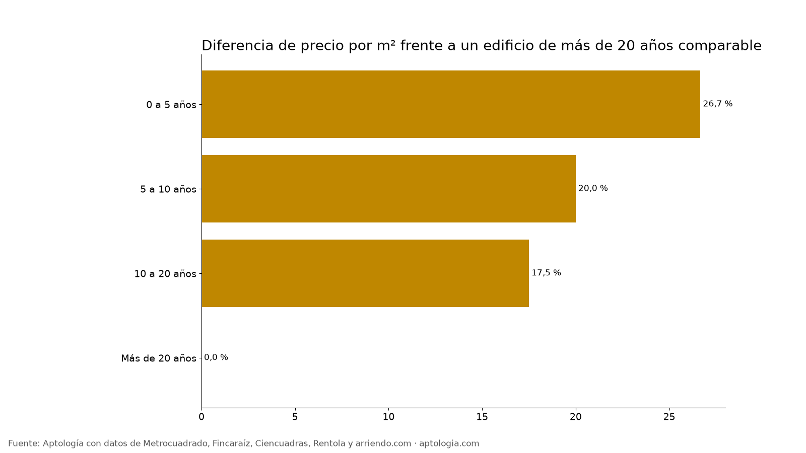

# Edificio nuevo o viejo: cuánto cambia el arriendo según la antigüedad en Bogotá (2026)

**En Bogotá, un apartamento en un edificio de 0 a 5 años arrienda 26,7 % más por metro cuadrado que uno comparable en un edificio de más de 20 años.** Pero los edificios viejos tienen apartamentos más grandes: 104 m² en la mediana frente a 42 m² en los nuevos.

*Resumen: analizamos 15.369 apartamentos en arriendo únicos en Bogotá que publican la antigüedad del inmueble.*

**Actualizado:** 13 de octubre de 2026 · **Próxima actualización:** mensual.

## Por antigüedad

| Antigüedad | Avisos | Canon mediano | Área mediana | Por m² | Diferencia por m² vs. más de 20 años |
|---|---|---|---|---|---|
| 0 a 5 años | 4.154 | $2.000.000 | 42 m² | $53.333/m² | 26,7 % |
| 5 a 10 años | 3.116 | $3.000.000 | 60 m² | $54.823/m² | 20,0 % |
| 10 a 20 años | 3.303 | $4.665.000 | 86 m² | $54.167/m² | 17,5 % |
| Más de 20 años | 4.792 | $4.850.000 | 104 m² | $47.000/m² | 0,0 % |

**Cómo usarlo para decidir:** si buscas espacio por peso, los edificios de más de 20 años rinden más metros. Si priorizas acabados y amenidades, el nuevo cuesta esa prima.

## Preguntas frecuentes

**¿Es más caro arrendar en un edificio nuevo en Bogotá?**
Sí: 26,7 % por m² frente a un edificio de más de 20 años comparable, corte al 13 de octubre de 2026.

**¿Los apartamentos viejos son más grandes?**
Sí: la mediana es 104 m² en edificios de más de 20 años y 42 m² en los de 0 a 5 años.

## Metodología

- **Fuente:** base de ingesta diaria de Aptología, con avisos públicos de Metrocuadrado, Fincaraíz, Ciencuadras, Rentola y arriendo.com. Corte al 13 de octubre de 2026.
- **Filtros:** avisos vivos que pasan el control de calidad, en Bogotá, canon entre $400.000 y $30.000.000. Se excluyen TikTok y Facebook Marketplace.
- **Duplicados:** se deja un aviso por grupo de duplicados (el mismo inmueble en varios portales).
- **Prima emparejada:** se compara el precio por m² de avisos de cada rango de antigüedad frente a más de 20 años dentro de la misma celda de estrato × habitaciones (mínimo 8 avisos por lado) y se reporta la mediana ponderada de las diferencias. Así la prima no se confunde con estrato o tamaño. El atributo se detecta en el texto del aviso, por lo que solo cuentan avisos con descripción. La antigüedad se toma del tope del rango publicado por el portal.
- **Limitaciones:** son precios pedidos, no cerrados. Los barrios y localidades vienen tal como los escribe cada portal.
- **Datos abiertos:** [datos.csv](datos.csv), licencia CC BY 4.0.

## Cómo citar

Pinzón Pineda, D. M. (2026). *Edificio nuevo o viejo: cuánto cambia el arriendo según la antigüedad en Bogotá (2026)*. Aptología. https://www.aptologia.com/estudios/antiguedad-del-edificio-arriendo-bogota. Datos: datos.csv, licencia CC BY 4.0.
