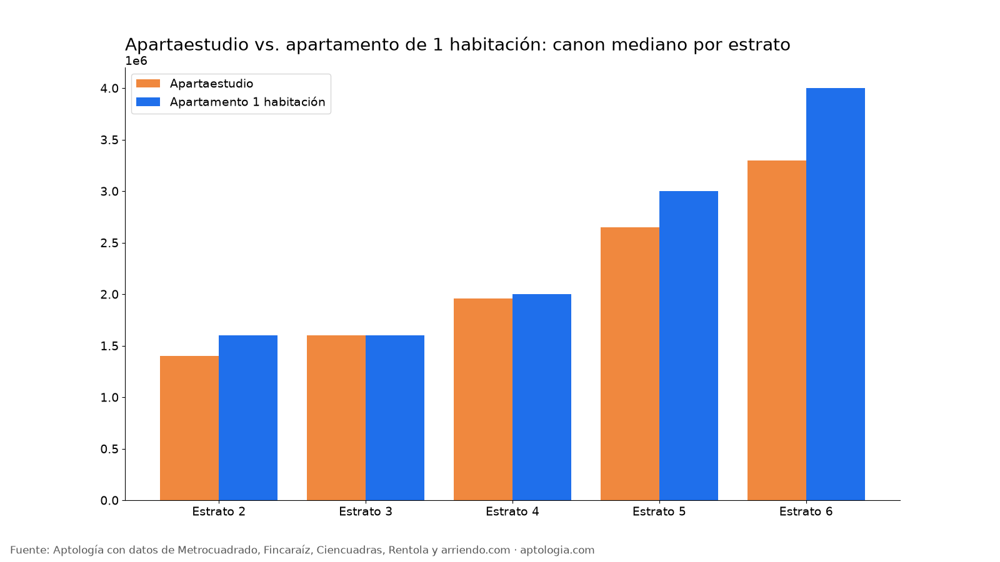

# Apartaestudio o apartamento de 1 habitación en Bogotá: precio, área y m² por estrato (2026)

**En Bogotá, un apartamento de 1 habitación cuesta en la mediana $2.400.000 al mes y un apartaestudio $1.950.000: $450.000 más.** El de 1 habitación tiene 40 m² frente a 31 m² del apartaestudio, y por m² el apartaestudio sale a $63.462 contra $62.500.

*Resumen: comparamos 2.359 apartaestudios y 4.541 apartamentos de 1 habitación en arriendo, únicos, en Bogotá.*

**Actualizado:** 13 de octubre de 2026 · **Próxima actualización:** mensual.

## Por estrato

| Estrato | Tipo | Canon mediano | Área mediana | Por m² | Avisos |
|---|---|---|---|---|---|
| 2 | Apartaestudio | $1.400.000 | 30 m² | $45.000/m² | 65 |
| 2 | Apartamento 1 habitación | $1.600.000 | 36 m² | $42.353/m² | 61 |
| 3 | Apartaestudio | $1.600.000 | 30 m² | $53.846/m² | 745 |
| 3 | Apartamento 1 habitación | $1.600.000 | 31 m² | $52.000/m² | 1.088 |
| 4 | Apartaestudio | $1.960.000 | 31 m² | $63.333/m² | 919 |
| 4 | Apartamento 1 habitación | $2.000.000 | 36 m² | $59.816/m² | 1.531 |
| 5 | Apartaestudio | $2.650.000 | 38 m² | $72.000/m² | 279 |
| 5 | Apartamento 1 habitación | $3.000.000 | 48 m² | $66.000/m² | 683 |
| 6 | Apartaestudio | $3.300.000 | 40 m² | $87.047/m² | 351 |
| 6 | Apartamento 1 habitación | $4.000.000 | 56 m² | $78.571/m² | 1.178 |

**Cómo usarlo para decidir:** si vives solo y tu presupuesto está cerca de $1.950.000, el apartaestudio te ahorra unos $450.000 al mes; si trabajas desde casa, la habitación separada suele valer la diferencia por los 9 m² extra.

## Preguntas frecuentes

**¿Qué es más barato, un apartaestudio o un apartamento de 1 habitación?**
En la mediana, el apartaestudio ($1.950.000) frente a $2.400.000 del apartamento de 1 habitación en Bogotá, corte al 13 de octubre de 2026.

**¿Cuántos metros tiene un apartaestudio en Bogotá?**
La mediana es 31 m²; un apartamento de 1 habitación tiene 40 m².

**¿Cuál sale más caro por metro cuadrado?**
El apartaestudio: $63.462/m² frente a $62.500/m².

## Metodología

- **Fuente:** base de ingesta diaria de Aptología, con avisos públicos de Metrocuadrado, Fincaraíz, Ciencuadras, Rentola y arriendo.com. Corte al 13 de octubre de 2026.
- **Filtros:** avisos vivos que pasan el control de calidad, en Bogotá, canon entre $400.000 y $30.000.000. Se excluyen TikTok y Facebook Marketplace.
- **Duplicados:** se deja un aviso por grupo de duplicados (el mismo inmueble en varios portales).
- **Tipos:** apartaestudio según el portal; apartamento de 1 habitación = tipo apartamento con 1 habitación. Celdas con 15 avisos o más.
- **Limitaciones:** son precios pedidos, no cerrados. Los barrios y localidades vienen tal como los escribe cada portal.
- **Datos abiertos:** [datos.csv](datos.csv), licencia CC BY 4.0.

## Cómo citar

Pinzón Pineda, D. M. (2026). *Apartaestudio o apartamento de 1 habitación en Bogotá: precio, área y m² por estrato (2026)*. Aptología. https://www.aptologia.com/estudios/apartaestudio-vs-apartamento-1-habitacion-bogota. Datos: datos.csv, licencia CC BY 4.0.
