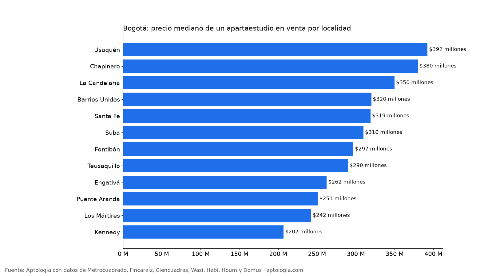
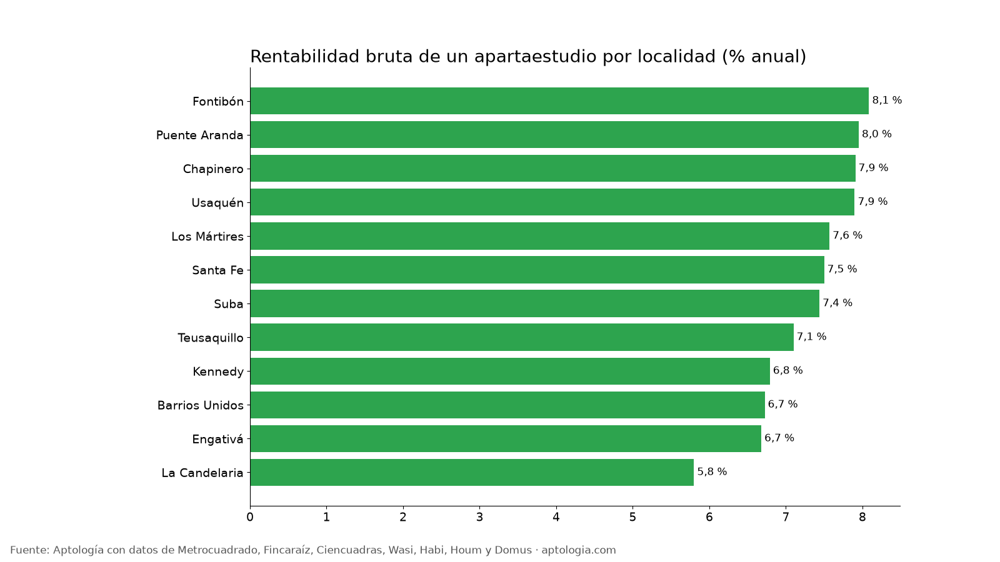

# Apartaestudios en venta en Bogotá: precio, metro cuadrado y rentabilidad por localidad (octubre 2026)

**Un apartaestudio en venta en Bogotá pide en la mediana $326 millones, con 32 m² ($10.068.085 por m²).** Arrendado, uno típico pide $1.900.000 al mes: una rentabilidad bruta de 7,4 % anual, comparando metro cuadrado de arriendo y de venta.

*Resumen: analizamos 2.407 apartaestudios en venta y 3.097 en arriendo, únicos, en Bogotá.*

**Actualizado:** 18 de octubre de 2026 (datos del 18 de octubre de 2026) · **Próxima actualización:** mensual.

## Resumen

| Indicador | Valor |
|---|---|
| Precio mediano de venta | $326 millones |
| Área mediana | 32 m² |
| Precio por m² (apartaestudio) | $10.068.085 |
| Precio por m² (apartamento de 1 habitación) | $9.736.842 |
| Arriendo mediano de un apartaestudio | $1.900.000 |
| Rentabilidad bruta (12 × arriendo por m² ÷ venta por m²) | 7,4 % |
| Apartaestudios en venta analizados | 2.407 |
| Apartaestudios en arriendo analizados | 3.097 |

## Por localidad (20 avisos o más)

| Localidad | Precio mediano | Por m² | Área | Arriendo mediano | Rentabilidad bruta | Avisos venta |
|---|---|---|---|---|---|---|
| Usaquén | $392 millones | $10.000.000 | 37 m² | $2.400.000 | 7,9 % | 620 |
| Chapinero | $380 millones | $11.904.187 | 33 m² | $2.457.500 | 7,9 % | 440 |
| La Candelaria | $350 millones | $10.000.000 | 34 m² | $1.530.000 | 5,8 % | 37 |
| Barrios Unidos | $320 millones | $11.655.172 | 28 m² | $1.800.000 | 6,7 % | 179 |
| Santa Fe | $319 millones | $10.312.500 | 32 m² | $1.900.000 | 7,5 % | 255 |
| Suba | $310 millones | $8.962.264 | 36 m² | $1.850.000 | 7,4 % | 185 |
| Fontibón | $297 millones | $9.384.100 | 30 m² | $1.800.000 | 8,1 % | 100 |
| Teusaquillo | $290 millones | $10.237.500 | 28 m² | $1.650.000 | 7,1 % | 223 |
| Engativá | $262 millones | $7.971.429 | 30 m² | $1.350.000 | 6,7 % | 58 |
| Puente Aranda | $251 millones | $8.048.780 | 30 m² | $1.645.000 | 8,0 % | 43 |
| Los Mártires | $242 millones | $7.926.515 | 32 m² | $1.470.000 | 7,6 % | 88 |
| Kennedy | $207 millones | $6.774.194 | 32 m² | $1.150.000 | 6,8 % | 36 |

**Cómo usarlo para decidir:** el apartaestudio tiene el metro cuadrado más caro, pero el ticket de entrada más bajo y suele arrendarse rápido a estudiantes y profesionales solos. A la rentabilidad bruta réstale administración, predial, vacancia y comisión antes de decidir.

## Preguntas frecuentes

**¿Cuánto cuesta un apartaestudio en Bogotá?**
La mediana del precio pedido es $326 millones, con un área mediana de 32 m² (datos del 18 de octubre de 2026).

**¿Es rentable comprar un apartaestudio para arrendar en Bogotá?**
La rentabilidad bruta típica es 7,4 % anual antes de gastos: arriendo mediano de $1.900.000 frente a $10.068.085 por m² de venta.

**¿El metro cuadrado de un apartaestudio es más caro?**
Sí: $10.068.085 por m², frente a $9.736.842 en apartamentos de 1 habitación.

## Metodología

- **Fuente:** avisos vivos de vivienda recogidos por la ingesta de Aptología en Metrocuadrado, Fincaraíz, Ciencuadras, Wasi, Habi, Houm y Domus, del 11 al 18 de octubre de 2026. Corte: 18 de octubre de 2026.
- **Depuración:** un mismo inmueble publicado varias veces se cuenta una sola vez (agrupación por portal y, entre portales, por precio, área, habitaciones y coordenadas). Se descartan precios y áreas fuera de rango y, en arriendo, se resta la administración cuando el portal la incluye en el canon.
- **Qué se mide:** precios pedidos (publicados), no precios de cierre.
- **Apartaestudio:** inmueble clasificado como apartaestudio por el portal, de hasta 60 m². Rentabilidad bruta = 12 × mediana del arriendo por m² ÷ mediana del precio de venta por m², por localidad con 20 avisos o más de cada uno.
- **Limitaciones:** son precios pedidos en portales, que pueden diferir del valor final de arriendo o venta. La cobertura es mayor en el norte de Bogotá y en estratos 4 a 6, porque ahí se concentra la oferta publicada. Los barrios y la localidad vienen de lo que escribe cada portal; cuando falta la localidad se asigna por los avisos vecinos más cercanos.
- **Datos abiertos:** [datos.csv](datos.csv), licencia CC BY 4.0.

## Cómo citar

Pinzón Pineda, D. M. (2026). *Apartaestudios en venta en Bogotá: precio, metro cuadrado y rentabilidad por localidad (octubre 2026)*. Aptología. https://www.aptologia.com/estudios/apartaestudios-en-venta-bogota-2026. Datos: datos.csv, licencia CC BY 4.0.
