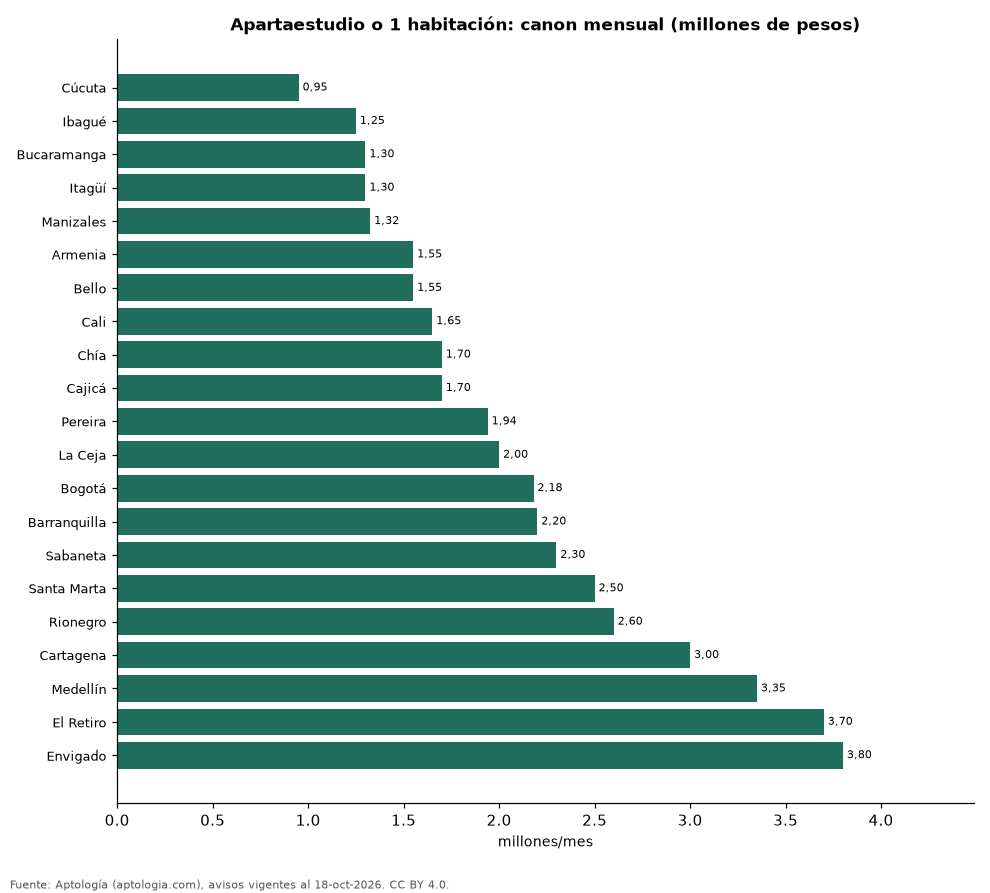

# Apartaestudios y apartamentos de 1 habitación en Colombia: arriendo y precio de venta por ciudad (octubre 2026)

**Arrendar un apartaestudio o apartamento de 1 habitación cuesta en la mediana 950.000 pesos al mes en Cúcuta, la ciudad más barata de la muestra, y 3.800.000 pesos en Envigado, la más cara.** En Bogotá la mediana es 2.180.000 pesos y en Medellín 3.350.000 pesos. Estas unidades son el 20,3 % de la oferta de arriendo de apartamentos.

*Resumen: analizamos 29.169 apartaestudios y apartamentos de 1 habitación en 22 ciudades.*

**Actualizado:** 18 de octubre de 2026 (datos del 18 de octubre de 2026) · **Próxima actualización:** mensual.

## Resumen

| Indicador | Valor |
|---|---|
| Más barata (arriendo) | Cúcuta: 950.000 pesos |
| Más cara (arriendo) | Envigado: 3.800.000 pesos |
| Bogotá | 2.180.000 pesos |
| Parte de la oferta de arriendo | 20,3 % |

## Ciudades (30 avisos o más)

| Ciudad | Arriendo mensual | Precio de venta | Avisos (arriendo / venta) |
|---|---|---|---|
| Cúcuta | 950.000 pesos | — | 47 / — |
| Ibagué | 1.250.000 pesos | 270 millones de pesos | 36 / 55 |
| Bucaramanga | 1.300.000 pesos | 210 millones de pesos | 88 / 119 |
| Itagüí | 1.300.000 pesos | 315 millones de pesos | 49 / 46 |
| Manizales | 1.325.000 pesos | 300 millones de pesos | 140 / 338 |
| Armenia | 1.550.000 pesos | 280 millones de pesos | 132 / 376 |
| Bello | 1.550.000 pesos | 258 millones de pesos | 74 / 58 |
| Cali | 1.650.000 pesos | 330 millones de pesos | 658 / 634 |
| Chía | 1.700.000 pesos | 290 millones de pesos | 200 / 312 |
| Cajicá | 1.700.000 pesos | 285 millones de pesos | 46 / 86 |
| Pereira | 1.940.000 pesos | 350 millones de pesos | 305 / 463 |
| La Ceja | 2.000.000 pesos | 344 millones de pesos | 47 / 38 |
| Bogotá | 2.180.000 pesos | 380 millones de pesos | 6.406 / 5.657 |
| Barranquilla | 2.200.000 pesos | 310 millones de pesos | 763 / 488 |
| Sabaneta | 2.300.000 pesos | 370 millones de pesos | 243 / 241 |
| Santa Marta | 2.500.000 pesos | 430 millones de pesos | 266 / 1.433 |
| Rionegro | 2.600.000 pesos | 512 millones de pesos | 382 / 231 |
| Cartagena | 3.000.000 pesos | 650 millones de pesos | 361 / 1.014 |
| Medellín | 3.350.000 pesos | 570 millones de pesos | 3.904 / 2.037 |
| El Retiro | 3.700.000 pesos | 540 millones de pesos | 155 / 147 |
| Envigado | 3.800.000 pesos | 740 millones de pesos | 444 / 304 |
| Dosquebradas | — | 250 millones de pesos | — / 50 |

Medianas; incluye apartaestudios y apartamentos de 1 habitación.

## Preguntas frecuentes

**¿Cuánto cuesta arrendar un apartaestudio en Bogotá?**
2.180.000 pesos al mes en la mediana (apartaestudios y 1 habitación).

**¿Cuánto cuesta un apartaestudio en Medellín?**
3.350.000 pesos al mes en arriendo.

## Metodología

- **Fuente:** exportes nocturnos de la base de datos de Aptología (aptologia.com) del 18 de octubre de 2026: avisos vigentes de vivienda en portales inmobiliarios de 13 países, recogidos por Aptología y vistos en línea entre el 11 y el 18 de octubre de 2026. Corte: 18 de octubre de 2026.
- **Depuración:** se eliminan duplicados exactos (misma ciudad, zona, tipo, precio, moneda, área, habitaciones y baños) y los precios fuera del percentil 1–99 de cada país, operación, moneda y tipo; el precio por m² usa solo avisos con área declarada entre 12 y 2.000 m² y también se recorta al P1–P99.
- **Qué se mide:** precios pedidos (publicados), no precios de cierre. En arriendo, el canon mensual sin administración, gastos comunes ni condominio.
- **Muestra mínima:** cada cifra publicada se apoya en al menos 30 avisos; las celdas con menos se omiten.
- **Colombia:** Precios en pesos colombianos, sin conversión de moneda.
- **Limitaciones:** la cobertura depende de los portales que recorre Aptología en cada país y es mayor en las ciudades grandes y en los segmentos medio-alto y alto; el área es la que declara el aviso, sin verificar; los nombres de zona vienen de los portales.
- **Privacidad:** solo se publican agregados; no se publica ningún dato personal, enlace a avisos ni nombre de anunciante.
- **Datos abiertos:** [datos.csv](datos.csv), licencia CC BY 4.0.

## Cómo citar

Pinzón Pineda, D. M. (2026). *Apartaestudios y apartamentos de 1 habitación en Colombia: arriendo y precio de venta por ciudad (octubre 2026)*. Aptología (aptologia.com). https://github.com/elbroker/aptologia-datos/tree/main/estudios/apartaestudios-y-apartamentos-de-1-habitacion-colombia-2026. Datos: datos.csv, licencia CC BY 4.0.
