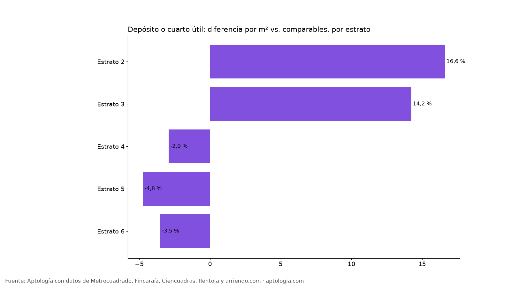
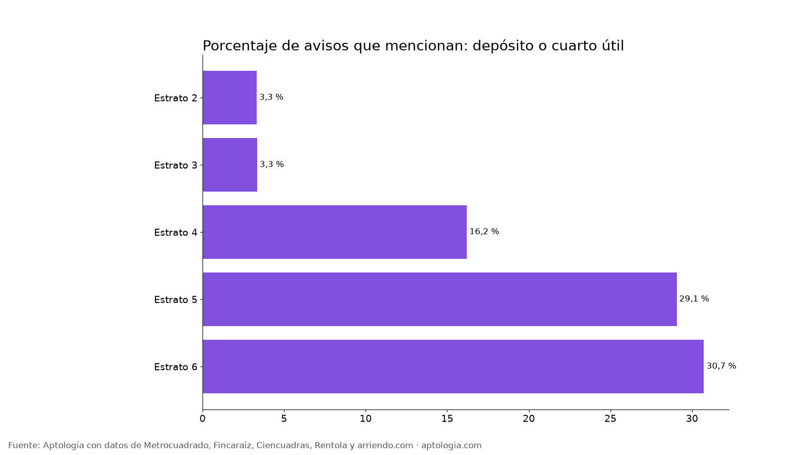

# Apartamentos con depósito o cuarto útil en arriendo en Bogotá: cuántos hay y cuánto más cuestan (2026)

**En Bogotá, un apartamento en arriendo con depósito o cuarto útil cuesta 3,5 % menos por metro cuadrado que uno comparable del mismo estrato y número de habitaciones.** Así se anuncian 3.008 de 18.920 avisos (15,9 %); el canon mediano es $6.000.000 con el atributo y $2.100.000 sin él.

*Resumen: comparamos 18.920 apartamentos en arriendo únicos en Bogotá con descripción, con y sin mención de depósito o cuarto útil.*

**Actualizado:** 13 de octubre de 2026 · **Próxima actualización:** mensual.

## Depósito o cuarto útil por estrato

| Estrato | Avisos | Lo mencionan | % de avisos | Canon mediano con | Canon mediano sin | Diferencia por m² (comparable) |
|---|---|---|---|---|---|---|
| Estrato 2 | 452 | 15 | 3,3 % | $1.800.000 | $1.200.000 | 16,6 % |
| Estrato 3 | 3.048 | 102 | 3,3 % | $2.131.000 | $1.600.000 | 14,2 % |
| Estrato 4 | 3.402 | 551 | 16,2 % | $3.000.000 | $2.399.303 | -2,9 % |
| Estrato 5 | 1.927 | 560 | 29,1 % | $4.500.000 | $4.200.000 | -4,8 % |
| Estrato 6 | 5.724 | 1.759 | 30,7 % | $9.000.000 | $8.800.000 | -3,5 % |

**Cómo usarlo para decidir:** el depósito no encarece el m² frente a apartamentos comparables, así que si tienes bicicleta, maletas o cosas de temporada, filtra por depósito: te evita pagar un minibodegaje aparte.

## Preguntas frecuentes

**¿Cuánto cambia el arriendo de un apartamento con depósito o cuarto útil en Bogotá?**
-3,5 % por m² frente a apartamentos comparables del mismo estrato y habitaciones, corte al 13 de octubre de 2026.

**¿Cuántos apartamentos en arriendo mencionan depósito o cuarto útil?**
3.008 de 18.920 avisos con descripción (15,9 %).

## Metodología

- **Fuente:** base de ingesta diaria de Aptología, con avisos públicos de Metrocuadrado, Fincaraíz, Ciencuadras, Rentola y arriendo.com. Corte al 13 de octubre de 2026.
- **Filtros:** avisos vivos que pasan el control de calidad, en Bogotá, canon entre $400.000 y $30.000.000. Se excluyen TikTok y Facebook Marketplace.
- **Duplicados:** se deja un aviso por grupo de duplicados (el mismo inmueble en varios portales).
- **Prima emparejada:** se compara el precio por m² de avisos con y sin el atributo dentro de la misma celda de estrato × habitaciones (mínimo 8 avisos por lado) y se reporta la mediana ponderada de las diferencias. Así la prima no se confunde con estrato o tamaño. El atributo se detecta en el texto del aviso, por lo que solo cuentan avisos con descripción.
- **Limitaciones:** son precios pedidos, no cerrados. Los barrios y localidades vienen tal como los escribe cada portal.
- **Datos abiertos:** [datos.csv](data/apartamento_con_deposito_arriendo_bogota_datos.csv), licencia CC BY 4.0.

## Cómo citar

Pinzón Pineda, D. M. (2026). *Apartamentos con depósito o cuarto útil en arriendo en Bogotá: cuántos hay y cuánto más cuestan (2026)*. Aptología. https://www.aptologia.com/estudios/apartamento-con-deposito-arriendo-bogota. Datos: datos.csv, licencia CC BY 4.0.
