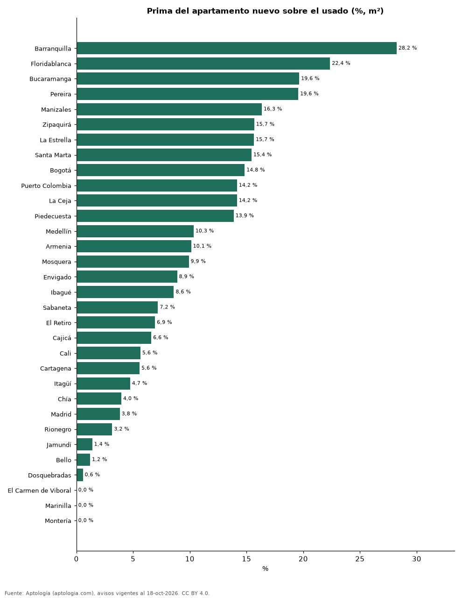

# Apartamento nuevo o usado: diferencia de precio por m² en las ciudades de Colombia (octubre 2026)

**Un apartamento nuevo (0 a 1 año) se pide en Barranquilla un 28,2 % más por m² que uno usado, la mayor diferencia entre 32 ciudades; en Montería, la diferencia es -8,5 %.** En Bogotá el nuevo cuesta +14,8 % por m². En Colombia, +13,8 %.

*Resumen: comparamos 118.387 apartamentos en venta con antigüedad y área declaradas en 32 ciudades.*

**Actualizado:** 18 de octubre de 2026 (datos del 18 de octubre de 2026) · **Próxima actualización:** mensual.

## Resumen

| Indicador | Valor |
|---|---|
| Mayor prima del nuevo | Barranquilla: +28,2 % |
| Colombia | +13,8 % |
| Ciudades | 32 |

## Ciudades

| Ciudad | Nuevo vs. usado (m²) | Nuevo (millones/m²) | Usado (millones/m²) | Avisos (nuevo / usado) |
|---|---|---|---|---|
| Barranquilla | +28,2 % | 5,71 | 4,46 | 430 / 6.794 |
| Floridablanca | +22,4 % | 6,12 | 5,00 | 109 / 774 |
| Bucaramanga | +19,6 % | 5,48 | 4,58 | 253 / 2.128 |
| Pereira | +19,6 % | 6,44 | 5,38 | 382 / 3.849 |
| Manizales | +16,3 % | 6,38 | 5,49 | 543 / 2.156 |
| Zipaquirá | +15,7 % | 4,87 | 4,21 | 63 / 696 |
| La Estrella | +15,7 % | 7,33 | 6,34 | 132 / 421 |
| Santa Marta | +15,4 % | 9,75 | 8,44 | 284 / 3.295 |
| Bogotá | +14,8 % | 8,29 | 7,22 | 880 / 28.513 |
| Puerto Colombia | +14,2 % | 6,34 | 5,56 | 44 / 95 |
| La Ceja | +14,2 % | 6,53 | 5,72 | 117 / 190 |
| Piedecuesta | +13,9 % | 4,09 | 3,59 | 30 / 210 |
| Medellín | +10,3 % | 8,12 | 7,36 | 3.294 / 16.796 |
| Armenia | +10,1 % | 5,81 | 5,27 | 137 / 2.015 |
| Mosquera | +9,9 % | 5,37 | 4,88 | 39 / 743 |
| Envigado | +8,9 % | 9,02 | 8,28 | 1.188 / 4.461 |
| Ibagué | +8,6 % | 4,58 | 4,21 | 59 / 1.111 |
| Sabaneta | +7,2 % | 7,57 | 7,06 | 504 / 3.797 |
| El Retiro | +6,9 % | 9,79 | 9,16 | 222 / 388 |
| Cajicá | +6,6 % | 6,01 | 5,63 | 112 / 1.350 |
| Cali | +5,6 % | 4,86 | 4,60 | 901 / 8.178 |
| Cartagena | +5,6 % | 8,28 | 7,85 | 450 / 5.062 |
| Itagüí | +4,7 % | 7,06 | 6,74 | 246 / 1.750 |
| Chía | +4,0 % | 5,72 | 5,50 | 112 / 1.348 |
| Madrid | +3,8 % | 3,74 | 3,60 | 30 / 430 |
| Rionegro | +3,2 % | 7,64 | 7,40 | 632 / 2.369 |
| Jamundí | +1,4 % | 3,62 | 3,57 | 96 / 351 |
| Bello | +1,2 % | 5,52 | 5,45 | 224 / 2.059 |
| Dosquebradas | +0,6 % | 4,65 | 4,62 | 107 / 473 |
| El Carmen de Viboral | -4,2 % | 4,32 | 4,51 | 40 / 50 |
| Marinilla | -4,2 % | 5,59 | 5,83 | 81 / 83 |
| Montería | -8,5 % | 3,45 | 3,77 | 52 / 206 |

Nuevo = antigüedad declarada de 0 a 1 año; usado = 2 años o más. Sin emparejar por estrato: los proyectos nuevos se concentran en ciertas zonas.

## Preguntas frecuentes

**¿Cuánto más cuesta un apartamento nuevo que uno usado en Colombia?**
En la mediana nacional, +13,8 % por m²; en Barranquilla, +28,2 %.

## Metodología

- **Fuente:** exportes nocturnos de la base de datos de Aptología (aptologia.com) del 18 de octubre de 2026: avisos vigentes de vivienda en portales inmobiliarios de 13 países, recogidos por Aptología y vistos en línea entre el 11 y el 18 de octubre de 2026. Corte: 18 de octubre de 2026.
- **Depuración:** se eliminan duplicados exactos (misma ciudad, zona, tipo, precio, moneda, área, habitaciones y baños) y los precios fuera del percentil 1–99 de cada país, operación, moneda y tipo; el precio por m² usa solo avisos con área declarada entre 12 y 2.000 m² y también se recorta al P1–P99.
- **Qué se mide:** precios pedidos (publicados), no precios de cierre. En arriendo, el canon mensual sin administración, gastos comunes ni condominio.
- **Muestra mínima:** cada cifra publicada se apoya en al menos 30 avisos; las celdas con menos se omiten.
- **Colombia:** Precios en pesos colombianos, sin conversión de moneda.
- **Antigüedad:** campo `antig` (solo venta), informado en rangos por los portales.
- **Limitaciones:** la cobertura depende de los portales que recorre Aptología en cada país y es mayor en las ciudades grandes y en los segmentos medio-alto y alto; el área es la que declara el aviso, sin verificar; los nombres de zona vienen de los portales.
- **Privacidad:** solo se publican agregados; no se publica ningún dato personal, enlace a avisos ni nombre de anunciante.
- **Datos abiertos:** [datos.csv](datos.csv), licencia CC BY 4.0.

## Cómo citar

Pinzón Pineda, D. M. (2026). *Apartamento nuevo o usado: diferencia de precio por m² en las ciudades de Colombia (octubre 2026)*. Aptología (aptologia.com). https://github.com/elbroker/aptologia-datos/tree/main/estudios/apartamento-nuevo-vs-usado-precio-ciudades-colombia-2026. Datos: datos.csv, licencia CC BY 4.0.
