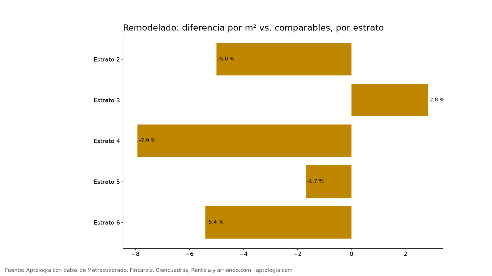
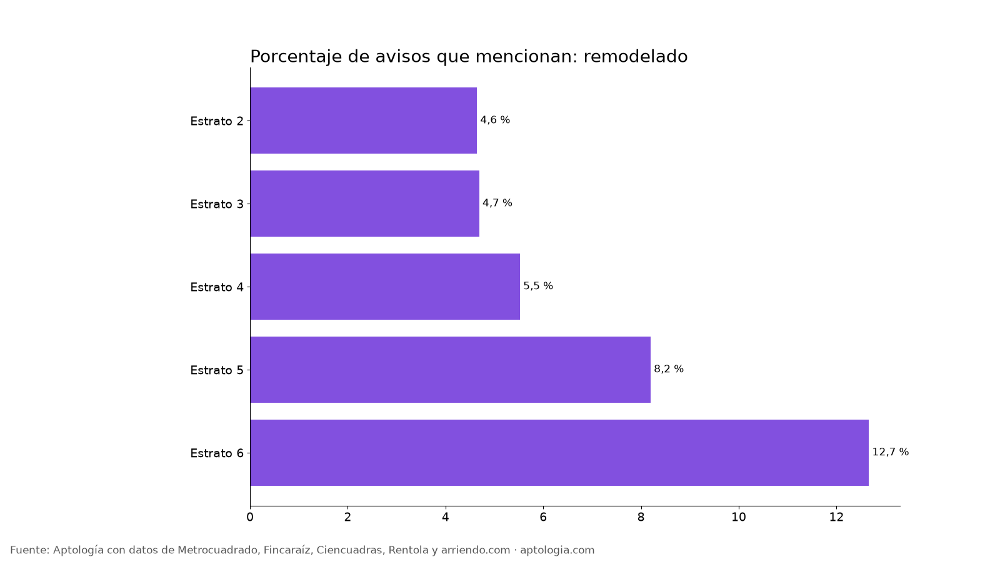

# Apartamento remodelado en arriendo en Bogotá: cuánto más se paga (2026)

**En Bogotá, un apartamento en arriendo anunciado como remodelado cuesta 5,4 % menos por metro cuadrado que uno comparable del mismo estrato y número de habitaciones.** Así se anuncian 1.246 de 18.920 avisos (6,6 %); el canon mediano es $6.400.000 con el atributo y $2.305.500 sin él.

*Resumen: comparamos 18.920 apartamentos en arriendo únicos en Bogotá con descripción, con y sin mención de remodelado.*

**Actualizado:** 13 de octubre de 2026 · **Próxima actualización:** mensual.

## Remodelado por estrato

| Estrato | Avisos | Lo mencionan | % de avisos | Canon mediano con | Canon mediano sin | Diferencia por m² (comparable) |
|---|---|---|---|---|---|---|
| Estrato 2 | 452 | 21 | 4,6 % | $1.600.000 | $1.200.000 | -5,0 % |
| Estrato 3 | 3.048 | 143 | 4,7 % | $1.800.000 | $1.600.000 | 2,8 % |
| Estrato 4 | 3.402 | 188 | 5,5 % | $2.500.000 | $2.500.000 | -7,9 % |
| Estrato 5 | 1.927 | 158 | 8,2 % | $5.500.000 | $4.250.000 | -1,7 % |
| Estrato 6 | 5.724 | 725 | 12,7 % | $9.300.000 | $8.800.000 | -5,4 % |

**Cómo usarlo para decidir:** la palabra "remodelado" no garantiza un precio más alto: muchos remodelados son edificios viejos con más área. Compara el precio por m² y visita el apartamento; si el remodelado cuesta lo mismo por m², es la mejor opción.

## Preguntas frecuentes

**¿Cuánto cambia el arriendo de un apartamento anunciado como remodelado en Bogotá?**
-5,4 % por m² frente a apartamentos comparables del mismo estrato y habitaciones, corte al 13 de octubre de 2026.

**¿Cuántos apartamentos en arriendo mencionan remodelado?**
1.246 de 18.920 avisos con descripción (6,6 %).

## Metodología

- **Fuente:** base de ingesta diaria de Aptología, con avisos públicos de Metrocuadrado, Fincaraíz, Ciencuadras, Rentola y arriendo.com. Corte al 13 de octubre de 2026.
- **Filtros:** avisos vivos que pasan el control de calidad, en Bogotá, canon entre $400.000 y $30.000.000. Se excluyen TikTok y Facebook Marketplace.
- **Duplicados:** se deja un aviso por grupo de duplicados (el mismo inmueble en varios portales).
- **Prima emparejada:** se compara el precio por m² de avisos con y sin el atributo dentro de la misma celda de estrato × habitaciones (mínimo 8 avisos por lado) y se reporta la mediana ponderada de las diferencias. Así la prima no se confunde con estrato o tamaño. El atributo se detecta en el texto del aviso, por lo que solo cuentan avisos con descripción.
- **Limitaciones:** son precios pedidos, no cerrados. Los barrios y localidades vienen tal como los escribe cada portal.
- **Datos abiertos:** [datos.csv](data/apartamento_remodelado_arriendo_bogota_datos.csv), licencia CC BY 4.0.

## Cómo citar

Pinzón Pineda, D. M. (2026). *Apartamento remodelado en arriendo en Bogotá: cuánto más se paga (2026)*. Aptología. https://www.aptologia.com/estudios/apartamento-remodelado-arriendo-bogota. Datos: datos.csv, licencia CC BY 4.0.
