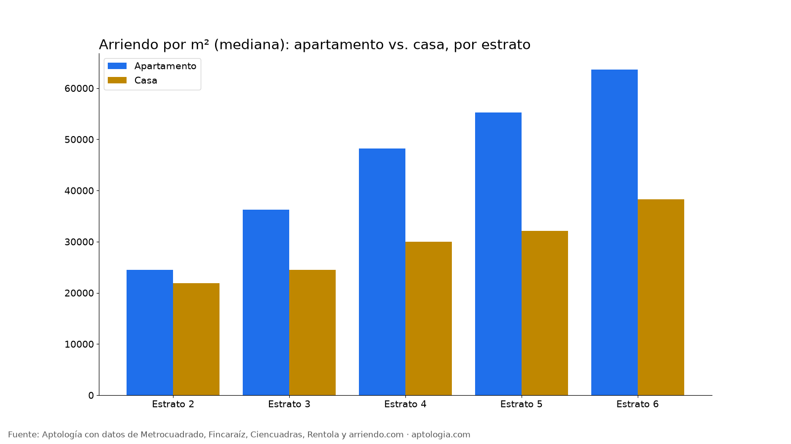
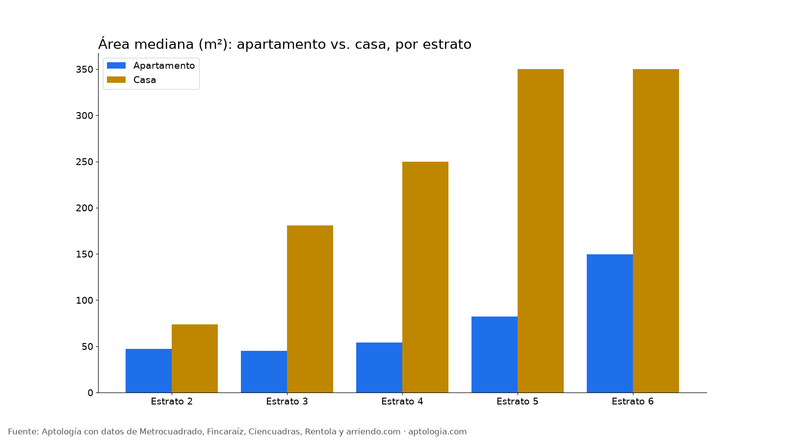

# Arrendar casa o apartamento en Bogotá: precio, área y m² por estrato (2026)

**En Bogotá, una casa en arriendo cuesta 26,1 % menos por metro cuadrado que un apartamento comparable del mismo estrato y número de habitaciones.** Pero es mucho más grande: 300 m² en la mediana frente a 68 m², así que el canon mediano es $10.000.000 contra $3.400.000.

*Resumen: comparamos 16.450 apartamentos y 2.027 casas en arriendo únicos en Bogotá, estratos 2 a 6.*

**Actualizado:** 13 de octubre de 2026 · **Próxima actualización:** mensual.

## Por estrato

| Estrato | Tipo | Avisos | Canon mediano | Área mediana | Por m² | Diferencia por m² casa vs. apto (comparable) |
|---|---|---|---|---|---|---|
| Estrato 2 | Apartamento | 556 | $1.200.000 | 47 m² | $24.468/m² |  |
| Estrato 2 | Casa | 47 | $1.850.000 | 73 m² | $21.863/m² | -16,7 % |
| Estrato 3 | Apartamento | 3.668 | $1.600.000 | 45 m² | $36.250/m² |  |
| Estrato 3 | Casa | 274 | $4.500.000 | 181 m² | $24.479/m² | -4,8 % |
| Estrato 4 | Apartamento | 3.941 | $2.500.000 | 54 m² | $48.182/m² |  |
| Estrato 4 | Casa | 553 | $7.500.000 | 250 m² | $30.000/m² | -14,3 % |
| Estrato 5 | Apartamento | 2.169 | $4.300.000 | 82 m² | $55.271/m² |  |
| Estrato 5 | Casa | 559 | $11.000.000 | 350 m² | $32.146/m² | -28,4 % |
| Estrato 6 | Apartamento | 6.116 | $9.000.000 | 149 m² | $63.636/m² |  |
| Estrato 6 | Casa | 594 | $14.000.000 | 350 m² | $38.316/m² | -26,1 % |

**Cómo usarlo para decidir:** si necesitas espacio (familia grande, teletrabajo, mascotas), la casa da más metros por peso. El apartamento gana en seguridad, administración que cubre mantenimiento y ubicación: hay muchas más opciones en los barrios centrales.

## Preguntas frecuentes

**¿Es más barato arrendar casa o apartamento en Bogotá?**
Por m², la casa cuesta -26,1 % frente a un apartamento comparable; por canon total, la casa es más cara porque es más grande ($10.000.000 vs. $3.400.000), corte al 13 de octubre de 2026.

**¿Cuántas casas hay en arriendo en Bogotá?**
2.027 casas frente a 16.450 apartamentos en estratos 2 a 6 en nuestra muestra.

## Metodología

- **Fuente:** base de ingesta diaria de Aptología, con avisos públicos de Metrocuadrado, Fincaraíz, Ciencuadras, Rentola y arriendo.com. Corte al 13 de octubre de 2026.
- **Filtros:** avisos vivos que pasan el control de calidad, en Bogotá, canon entre $400.000 y $30.000.000. Se excluyen TikTok y Facebook Marketplace.
- **Duplicados:** se deja un aviso por grupo de duplicados (el mismo inmueble en varios portales).
- **Prima emparejada:** se compara el precio por m² de avisos de casas frente a apartamentos dentro de la misma celda de estrato × habitaciones (mínimo 8 avisos por lado) y se reporta la mediana ponderada de las diferencias. Así la prima no se confunde con estrato o tamaño. El atributo se detecta en el texto del aviso, por lo que solo cuentan avisos con descripción. Para este estudio se exigen 5 avisos por lado.
- **Limitaciones:** son precios pedidos, no cerrados. Los barrios y localidades vienen tal como los escribe cada portal.
- **Datos abiertos:** [datos.csv](data/apartamento_vs_casa_arriendo_bogota_datos.csv), licencia CC BY 4.0.

## Cómo citar

Pinzón Pineda, D. M. (2026). *Arrendar casa o apartamento en Bogotá: precio, área y m² por estrato (2026)*. Aptología. https://www.aptologia.com/estudios/apartamento-vs-casa-arriendo-bogota. Datos: datos.csv, licencia CC BY 4.0.
