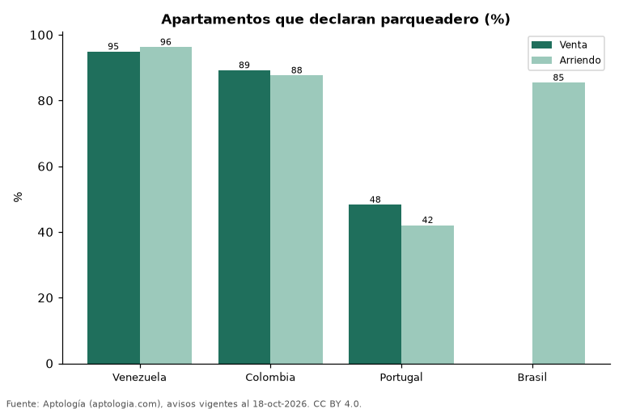

# Cuántos apartamentos traen parqueadero en Latinoamérica: porcentaje por país en venta y arriendo (octubre 2026)

**El 94,9 % de los apartamentos en venta en Venezuela declara parqueadero o cochera; en Colombia, el 89,2 % en venta y el 87,6 % en arriendo.**

*Resumen: contamos 184.402 apartamentos que informan el número de parqueaderos en 4 países.*

**Actualizado:** 18 de octubre de 2026 (datos del 18 de octubre de 2026) · **Próxima actualización:** mensual.

## Resumen

| Indicador | Valor |
|---|---|
| Mayor proporción (venta) | Venezuela: 94,9 % |
| Colombia (venta) | 89,2 % |
| Colombia (arriendo) | 87,6 % |

## Por país

| País | Venta: con parqueadero | Arriendo: con parqueadero | Avisos con el dato |
|---|---|---|---|
| Venezuela | 94,9 % | 96,3 % | 1.943 |
| Colombia | 89,2 % | 87,6 % | 170.521 |
| Portugal | 48,3 % | 42,1 % | 2.840 |
| Brasil | s. d. % | 85,4 % | 9.098 |

Solo países cuyos portales informan el dato también cuando es cero (Argentina, Ecuador y México no lo publican, y en algunos países el portal solo lo marca cuando existe, por lo que se excluyen).

## Preguntas frecuentes

**¿Qué porcentaje de apartamentos en Colombia tiene parqueadero?**
El 89,2 % de los apartamentos en venta y el 87,6 % de los que se arriendan declaran al menos uno.

## Metodología

- **Fuente:** exportes nocturnos de la base de datos de Aptología (aptologia.com) del 18 de octubre de 2026: avisos vigentes de vivienda en portales inmobiliarios de 13 países, recogidos por Aptología y vistos en línea entre el 11 y el 18 de octubre de 2026. Corte: 18 de octubre de 2026.
- **Depuración:** se eliminan duplicados exactos (misma ciudad, zona, tipo, precio, moneda, área, habitaciones y baños) y los precios fuera del percentil 1–99 de cada país, operación, moneda y tipo; el precio por m² usa solo avisos con área declarada entre 12 y 2.000 m² y también se recorta al P1–P99.
- **Qué se mide:** precios pedidos (publicados), no precios de cierre. En arriendo, el canon mensual sin administración, gastos comunes ni condominio.
- **Muestra mínima:** cada cifra publicada se apoya en al menos 30 avisos; las celdas con menos se omiten.
- **Limitaciones:** la cobertura depende de los portales que recorre Aptología en cada país y es mayor en las ciudades grandes y en los segmentos medio-alto y alto; el área es la que declara el aviso, sin verificar; los nombres de zona vienen de los portales.
- **Privacidad:** solo se publican agregados; no se publica ningún dato personal, enlace a avisos ni nombre de anunciante.
- **Datos abiertos:** [datos.csv](datos.csv), licencia CC BY 4.0.

## Cómo citar

Pinzón Pineda, D. M. (2026). *Cuántos apartamentos traen parqueadero en Latinoamérica: porcentaje por país en venta y arriendo (octubre 2026)*. Aptología (aptologia.com). https://github.com/elbroker/aptologia-datos/tree/main/estudios/apartamentos-con-parqueadero-por-pais-latinoamerica-2026. Datos: datos.csv, licencia CC BY 4.0.
