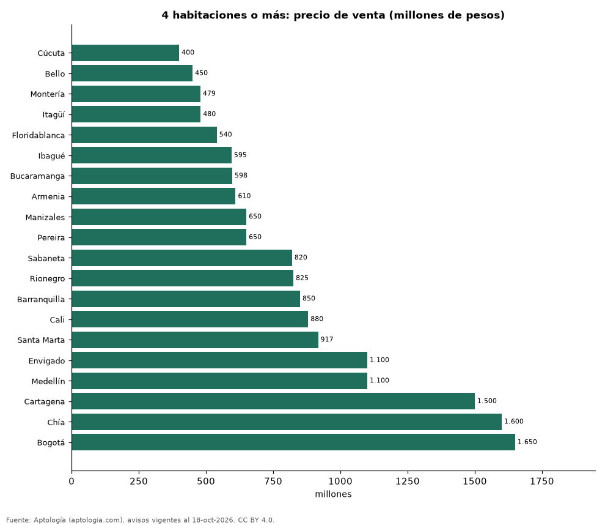

# Apartamentos de 4 habitaciones o más en Colombia: precio y arriendo por ciudad (octubre 2026)

**Un apartamento de 4 habitaciones o más se pide en la mediana en 400 millones de pesos en Cúcuta, la ciudad más barata de 20, y en 1.650 millones de pesos en Bogotá, la más cara.** En Medellín cuesta 1.100 millones de pesos. Estas unidades son solo el 10,0 % de los apartamentos en venta del país.

*Resumen: analizamos 15.533 apartamentos de 4 habitaciones o más en venta y arriendo.*

**Actualizado:** 18 de octubre de 2026 (datos del 18 de octubre de 2026) · **Próxima actualización:** mensual.

## Resumen

| Indicador | Valor |
|---|---|
| Más barata | Cúcuta: 400 millones de pesos |
| Más cara | Bogotá: 1.650 millones de pesos |
| Bogotá | 1.650 millones de pesos |
| Parte de la oferta en venta | 10,0 % |

## Ciudades (30 avisos o más)

| Ciudad | Precio de venta | Arriendo mensual | Avisos (venta / arriendo) |
|---|---|---|---|
| Cúcuta | 400 millones de pesos | 2.100.000 pesos | 67 / 30 |
| Bello | 450 millones de pesos | — | 96 / — |
| Montería | 479 millones de pesos | — | 56 / — |
| Itagüí | 480 millones de pesos | — | 67 / — |
| Floridablanca | 540 millones de pesos | — | 87 / — |
| Ibagué | 595 millones de pesos | — | 76 / — |
| Bucaramanga | 598 millones de pesos | 3.800.000 pesos | 592 / 47 |
| Armenia | 610 millones de pesos | — | 138 / — |
| Manizales | 650 millones de pesos | — | 302 / — |
| Pereira | 650 millones de pesos | 4.500.000 pesos | 450 / 61 |
| Sabaneta | 820 millones de pesos | 4.350.000 pesos | 147 / 43 |
| Rionegro | 825 millones de pesos | — | 49 / — |
| Barranquilla | 850 millones de pesos | 6.000.000 pesos | 653 / 113 |
| Cali | 880 millones de pesos | 7.750.000 pesos | 1.063 / 124 |
| Santa Marta | 917 millones de pesos | — | 248 / — |
| Envigado | 1.100 millones de pesos | 5.150.000 pesos | 502 / 263 |
| Medellín | 1.100 millones de pesos | 6.800.000 pesos | 3.329 / 1.579 |
| Cartagena | 1.500 millones de pesos | 5.950.000 pesos | 329 / 63 |
| Chía | 1.600 millones de pesos | — | 31 / — |
| Bogotá | 1.650 millones de pesos | 12.000.000 pesos | 3.878 / 750 |

Medianas del precio pedido; arriendo sin administración.

## Preguntas frecuentes

**¿Cuánto cuesta un apartamento de 4 habitaciones en Bogotá?**
1.650 millones de pesos en la mediana de la oferta en venta.

**¿Son comunes los apartamentos de 4 habitaciones en Colombia?**
No: son el 10,0 % de los apartamentos en venta.

## Metodología

- **Fuente:** exportes nocturnos de la base de datos de Aptología (aptologia.com) del 18 de octubre de 2026: avisos vigentes de vivienda en portales inmobiliarios de 13 países, recogidos por Aptología y vistos en línea entre el 11 y el 18 de octubre de 2026. Corte: 18 de octubre de 2026.
- **Depuración:** se eliminan duplicados exactos (misma ciudad, zona, tipo, precio, moneda, área, habitaciones y baños) y los precios fuera del percentil 1–99 de cada país, operación, moneda y tipo; el precio por m² usa solo avisos con área declarada entre 12 y 2.000 m² y también se recorta al P1–P99.
- **Qué se mide:** precios pedidos (publicados), no precios de cierre. En arriendo, el canon mensual sin administración, gastos comunes ni condominio.
- **Muestra mínima:** cada cifra publicada se apoya en al menos 30 avisos; las celdas con menos se omiten.
- **Colombia:** Precios en pesos colombianos, sin conversión de moneda.
- **Limitaciones:** la cobertura depende de los portales que recorre Aptología en cada país y es mayor en las ciudades grandes y en los segmentos medio-alto y alto; el área es la que declara el aviso, sin verificar; los nombres de zona vienen de los portales.
- **Privacidad:** solo se publican agregados; no se publica ningún dato personal, enlace a avisos ni nombre de anunciante.
- **Datos abiertos:** [datos.csv](datos.csv), licencia CC BY 4.0.

## Cómo citar

Pinzón Pineda, D. M. (2026). *Apartamentos de 4 habitaciones o más en Colombia: precio y arriendo por ciudad (octubre 2026)*. Aptología (aptologia.com). https://github.com/elbroker/aptologia-datos/tree/main/estudios/apartamentos-de-4-habitaciones-o-mas-ciudades-colombia-2026. Datos: datos.csv, licencia CC BY 4.0.
