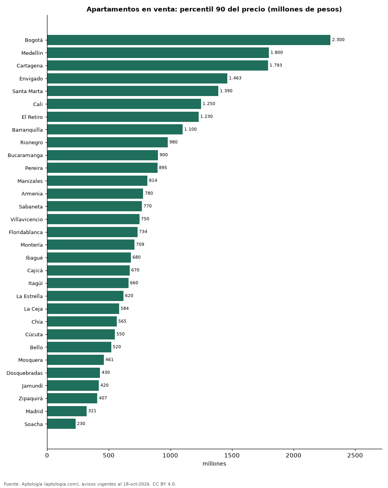

# Desde cuánto un apartamento es de lujo en cada ciudad de Colombia: el 10 % más caro de la oferta (octubre 2026)

**Para estar en el 10 % más caro de la oferta, un apartamento en venta tiene que pedir al menos 2.300 millones de pesos en Bogotá, el umbral más alto de 31 ciudades; en Soacha basta con 230 millones de pesos.** En Bogotá el 36,6 % de los avisos pide 1.000 millones de pesos o más; en todo el país, el 22,5 %.

*Resumen: calculamos el percentil 90 del precio de 123.110 apartamentos en venta en 31 ciudades con 300 avisos o más.*

**Actualizado:** 18 de octubre de 2026 (datos del 18 de octubre de 2026) · **Próxima actualización:** mensual.

## Resumen

| Indicador | Valor |
|---|---|
| Umbral más alto | Bogotá: 2.300 millones de pesos |
| Bogotá | 2.300 millones de pesos |
| Colombia | 1.580 millones de pesos |
| Avisos de 1.000 millones o más (país) | 22,5 % |

## Umbral del 10 % más caro por ciudad

| Ciudad | Umbral del 10 % más caro (P90) | Mediana | Avisos de 1.000 millones o más | Avisos |
|---|---|---|---|---|
| Bogotá | 2.300 millones de pesos | 750 millones de pesos | 36,6 % | 31.911 |
| Medellín | 1.800 millones de pesos | 840 millones de pesos | 36,9 % | 20.940 |
| Cartagena | 1.793 millones de pesos | 800 millones de pesos | 33,8 % | 6.126 |
| Envigado | 1.463 millones de pesos | 820 millones de pesos | 30,3 % | 5.788 |
| Santa Marta | 1.390 millones de pesos | 600 millones de pesos | 19,3 % | 3.920 |
| Cali | 1.250 millones de pesos | 430 millones de pesos | 14,1 % | 9.505 |
| El Retiro | 1.230 millones de pesos | 730 millones de pesos | 18,0 % | 621 |
| Barranquilla | 1.100 millones de pesos | 450 millones de pesos | 11,6 % | 7.903 |
| Rionegro | 980 millones de pesos | 520 millones de pesos | 9,7 % | 3.052 |
| Bucaramanga | 900 millones de pesos | 430 millones de pesos | 7,9 % | 2.509 |
| Pereira | 895 millones de pesos | 435 millones de pesos | 6,7 % | 4.450 |
| Manizales | 814 millones de pesos | 450 millones de pesos | 4,7 % | 2.824 |
| Armenia | 780 millones de pesos | 380 millones de pesos | 3,8 % | 2.320 |
| Sabaneta | 770 millones de pesos | 550 millones de pesos | 2,8 % | 4.393 |
| Villavicencio | 750 millones de pesos | 280 millones de pesos | 4,4 % | 364 |
| Floridablanca | 734 millones de pesos | 440 millones de pesos | 1,8 % | 939 |
| Montería | 709 millones de pesos | 390 millones de pesos | 2,4 % | 332 |
| Ibagué | 680 millones de pesos | 330 millones de pesos | 1,8 % | 1.260 |
| Cajicá | 670 millones de pesos | 390 millones de pesos | 0,7 % | 1.526 |
| Itagüí | 660 millones de pesos | 470 millones de pesos | 1,0 % | 2.019 |
| La Estrella | 620 millones de pesos | 450 millones de pesos | 0,2 % | 565 |
| La Ceja | 584 millones de pesos | 420 millones de pesos | 0,6 % | 314 |
| Chía | 565 millones de pesos | 335 millones de pesos | 2,9 % | 1.512 |
| Cúcuta | 550 millones de pesos | 280 millones de pesos | 0,8 % | 666 |
| Bello | 520 millones de pesos | 340 millones de pesos | 0,2 % | 2.347 |
| Mosquera | 461 millones de pesos | 320 millones de pesos | 0,1 % | 819 |
| Dosquebradas | 430 millones de pesos | 260 millones de pesos | 0,3 % | 614 |
| Jamundí | 420 millones de pesos | 210 millones de pesos | 0,4 % | 476 |
| Zipaquirá | 407 millones de pesos | 275 millones de pesos | 1,7 % | 825 |
| Madrid | 321 millones de pesos | 210 millones de pesos | 0,0 % | 480 |
| Soacha | 230 millones de pesos | 170 millones de pesos | 0,0 % | 572 |

P90 = precio pedido que solo supera el 10 % de los avisos de apartamentos de cada ciudad.

## Preguntas frecuentes

**¿Desde qué precio un apartamento es de lujo en Bogotá?**
El 10 % más caro de la oferta pide 2.300 millones de pesos o más.

**¿Cuántos apartamentos cuestan más de 1.000 millones en Colombia?**
El 22,5 % de los avisos en venta.

## Metodología

- **Fuente:** exportes nocturnos de la base de datos de Aptología (aptologia.com) del 18 de octubre de 2026: avisos vigentes de vivienda en portales inmobiliarios de 13 países, recogidos por Aptología y vistos en línea entre el 11 y el 18 de octubre de 2026. Corte: 18 de octubre de 2026.
- **Depuración:** se eliminan duplicados exactos (misma ciudad, zona, tipo, precio, moneda, área, habitaciones y baños) y los precios fuera del percentil 1–99 de cada país, operación, moneda y tipo; el precio por m² usa solo avisos con área declarada entre 12 y 2.000 m² y también se recorta al P1–P99.
- **Qué se mide:** precios pedidos (publicados), no precios de cierre. En arriendo, el canon mensual sin administración, gastos comunes ni condominio.
- **Muestra mínima:** cada cifra publicada se apoya en al menos 30 avisos; las celdas con menos se omiten.
- **Colombia:** Precios en pesos colombianos, sin conversión de moneda.
- **Limitaciones:** la cobertura depende de los portales que recorre Aptología en cada país y es mayor en las ciudades grandes y en los segmentos medio-alto y alto; el área es la que declara el aviso, sin verificar; los nombres de zona vienen de los portales.
- **Privacidad:** solo se publican agregados; no se publica ningún dato personal, enlace a avisos ni nombre de anunciante.
- **Datos abiertos:** [datos.csv](datos.csv), licencia CC BY 4.0.

## Cómo citar

Pinzón Pineda, D. M. (2026). *Desde cuánto un apartamento es de lujo en cada ciudad de Colombia: el 10 % más caro de la oferta (octubre 2026)*. Aptología (aptologia.com). https://github.com/elbroker/aptologia-datos/tree/main/estudios/apartamentos-de-lujo-precio-ciudades-colombia-2026. Datos: datos.csv, licencia CC BY 4.0.
