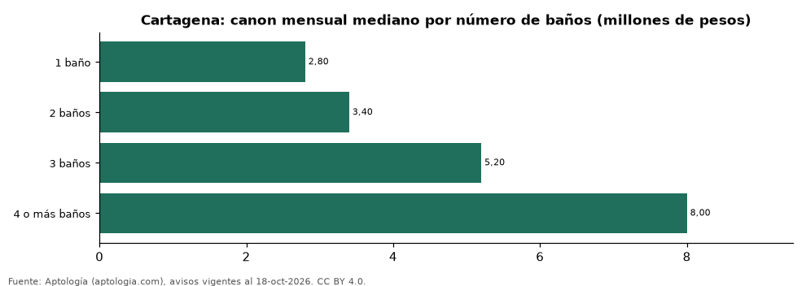

# Apartamentos en arriendo en Cartagena según número de baños: precio y m² de cada grupo (octubre 2026)

**En Cartagena, un apartamento en arriendo del grupo «1 baño» se pide en 2.800.000 pesos al mes en la mediana y uno del grupo «4 o más baños» en 8.000.000 pesos al mes (+185,7 %).** Por metro cuadrado, el más barato es «2 baños» (43.103 pesos/m² al mes) y el más caro «4 o más baños» (51.020 pesos/m² al mes).

*Resumen: analizamos 2.033 apartamentos en arriendo en Cartagena con número de baños declarado.*

**Actualizado:** 18 de octubre de 2026 (datos del 18 de octubre de 2026) · **Próxima actualización:** mensual.

## Resumen

| Indicador | Valor |
|---|---|
| 1 baño | 2.800.000 pesos |
| 2 baños | 3.400.000 pesos |
| 3 baños | 5.200.000 pesos |
| 4 o más baños | 8.000.000 pesos |
| Avisos | 2.033 |

## Canon mensual y m² por número de baños

| Número de baños | Canon mensual (mediana) | Rango típico (P25–P75) | Por m² (mediana) | Área mediana (m²) | Avisos |
|---|---|---|---|---|---|
| 1 baño | 2.800.000 pesos | 2.070.000 pesos – 3.750.000 pesos | 47.577 pesos | 55 | 241 |
| 2 baños | 3.400.000 pesos | 2.500.000 pesos – 4.500.000 pesos | 43.103 pesos | 78 | 1.280 |
| 3 baños | 5.200.000 pesos | 4.000.000 pesos – 7.000.000 pesos | 44.571 pesos | 117 | 390 |
| 4 o más baños | 8.000.000 pesos | 5.925.000 pesos – 12.000.000 pesos | 51.020 pesos | 176 | 122 |

Medianas del canon pedido, sin administración ni gastos comunes; grupos con menos de 30 avisos se omiten.

## Preguntas frecuentes

**¿Cuánto cuesta arrendar un apartamento con cuántos baños en Cartagena?**
1 baño: 2.800.000 pesos al mes; 2 baños: 3.400.000 pesos al mes; 3 baños: 5.200.000 pesos al mes; 4 o más baños: 8.000.000 pesos al mes (medianas de octubre de 2026).

**¿Qué grupo sale más barato por m²?**
Por metro cuadrado, el más barato es «2 baños» (43.103 pesos/m² al mes) y el más caro «4 o más baños» (51.020 pesos/m² al mes).

## Metodología

- **Fuente:** exportes nocturnos de la base de datos de Aptología (aptologia.com) del 18 de octubre de 2026: avisos vigentes de vivienda en portales inmobiliarios de 13 países, recogidos por Aptología y vistos en línea entre el 11 y el 18 de octubre de 2026. Corte: 18 de octubre de 2026.
- **Depuración:** se eliminan duplicados exactos (misma ciudad, zona, tipo, precio, moneda, área, habitaciones y baños) y los precios fuera del percentil 1–99 de cada país, operación, moneda y tipo; el precio por m² usa solo avisos con área declarada entre 12 y 2.000 m² y también se recorta al P1–P99.
- **Qué se mide:** precios pedidos (publicados), no precios de cierre. En arriendo, el canon mensual sin administración, gastos comunes ni condominio.
- **Muestra mínima:** cada cifra publicada se apoya en al menos 30 avisos; las celdas con menos se omiten.
- **Colombia:** Precios en pesos colombianos, sin conversión de moneda.
- **Cordura:** solo se publica si la mediana crece con número de baños.
- **Limitaciones:** la cobertura depende de los portales que recorre Aptología en cada país y es mayor en las ciudades grandes y en los segmentos medio-alto y alto; el área es la que declara el aviso, sin verificar; los nombres de zona vienen de los portales.
- **Privacidad:** solo se publican agregados; no se publica ningún dato personal, enlace a avisos ni nombre de anunciante.
- **Datos abiertos:** [datos.csv](datos.csv), licencia CC BY 4.0.

## Cómo citar

Pinzón Pineda, D. M. (2026). *Apartamentos en arriendo en Cartagena según número de baños: precio y m² de cada grupo (octubre 2026)*. Aptología (aptologia.com). https://github.com/elbroker/aptologia-datos/tree/main/estudios/apartamentos-en-arriendo-por-numero-de-banos-cartagena-2026. Datos: datos.csv, licencia CC BY 4.0.
