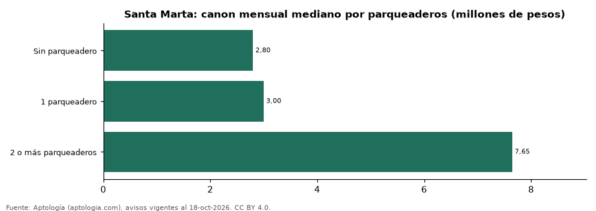

# Apartamentos en arriendo en Santa Marta según parqueaderos: precio y m² de cada grupo (octubre 2026)

**En Santa Marta, un apartamento en arriendo del grupo «Sin parqueadero» se pide en 2.800.000 pesos al mes en la mediana y uno del grupo «2 o más parqueaderos» en 7.650.000 pesos al mes (+173,2 %).** Por metro cuadrado, el más barato es «2 o más parqueaderos» (39.683 pesos/m² al mes) y el más caro «Sin parqueadero» (53.125 pesos/m² al mes).

*Resumen: analizamos 593 apartamentos en arriendo en Santa Marta con parqueaderos declarado.*

**Actualizado:** 18 de octubre de 2026 (datos del 18 de octubre de 2026) · **Próxima actualización:** mensual.

## Resumen

| Indicador | Valor |
|---|---|
| Sin parqueadero | 2.800.000 pesos |
| 1 parqueadero | 3.000.000 pesos |
| 2 o más parqueaderos | 7.650.000 pesos |
| Avisos | 593 |

## Canon mensual y m² por parqueaderos

| Parqueaderos | Canon mensual (mediana) | Rango típico (P25–P75) | Por m² (mediana) | Área mediana (m²) | Avisos |
|---|---|---|---|---|---|
| Sin parqueadero | 2.800.000 pesos | 2.000.000 pesos – 4.000.000 pesos | 53.125 pesos | 54 | 77 |
| 1 parqueadero | 3.000.000 pesos | 2.300.000 pesos – 4.437.500 pesos | 44.103 pesos | 74 | 466 |
| 2 o más parqueaderos | 7.650.000 pesos | 6.200.000 pesos – 10.000.000 pesos | 39.683 pesos | 200 | 50 |

Medianas del canon pedido, sin administración ni gastos comunes; grupos con menos de 30 avisos se omiten.

## Preguntas frecuentes

**¿Cuánto cuesta arrendar un apartamento con cuántos parqueaderos en Santa Marta?**
Sin parqueadero: 2.800.000 pesos al mes; 1 parqueadero: 3.000.000 pesos al mes; 2 o más parqueaderos: 7.650.000 pesos al mes (medianas de octubre de 2026).

**¿Qué grupo sale más barato por m²?**
Por metro cuadrado, el más barato es «2 o más parqueaderos» (39.683 pesos/m² al mes) y el más caro «Sin parqueadero» (53.125 pesos/m² al mes).

## Metodología

- **Fuente:** exportes nocturnos de la base de datos de Aptología (aptologia.com) del 18 de octubre de 2026: avisos vigentes de vivienda en portales inmobiliarios de 13 países, recogidos por Aptología y vistos en línea entre el 11 y el 18 de octubre de 2026. Corte: 18 de octubre de 2026.
- **Depuración:** se eliminan duplicados exactos (misma ciudad, zona, tipo, precio, moneda, área, habitaciones y baños) y los precios fuera del percentil 1–99 de cada país, operación, moneda y tipo; el precio por m² usa solo avisos con área declarada entre 12 y 2.000 m² y también se recorta al P1–P99.
- **Qué se mide:** precios pedidos (publicados), no precios de cierre. En arriendo, el canon mensual sin administración, gastos comunes ni condominio.
- **Muestra mínima:** cada cifra publicada se apoya en al menos 30 avisos; las celdas con menos se omiten.
- **Colombia:** Precios en pesos colombianos, sin conversión de moneda.
- **Cordura:** solo se publica si la mediana crece con parqueaderos.
- **Limitaciones:** la cobertura depende de los portales que recorre Aptología en cada país y es mayor en las ciudades grandes y en los segmentos medio-alto y alto; el área es la que declara el aviso, sin verificar; los nombres de zona vienen de los portales.
- **Privacidad:** solo se publican agregados; no se publica ningún dato personal, enlace a avisos ni nombre de anunciante.
- **Datos abiertos:** [datos.csv](datos.csv), licencia CC BY 4.0.

## Cómo citar

Pinzón Pineda, D. M. (2026). *Apartamentos en arriendo en Santa Marta según parqueaderos: precio y m² de cada grupo (octubre 2026)*. Aptología (aptologia.com). https://github.com/elbroker/aptologia-datos/tree/main/estudios/apartamentos-en-arriendo-por-parqueaderos-santa-marta-2026. Datos: datos.csv, licencia CC BY 4.0.
