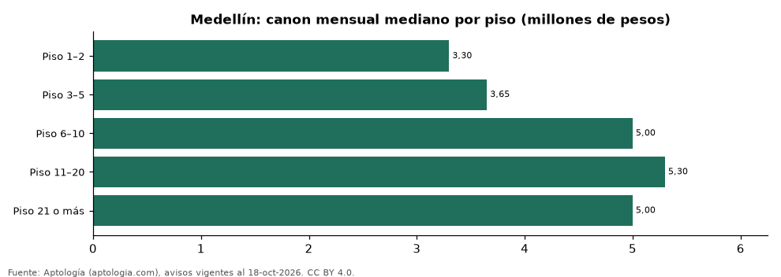

# Apartamentos en arriendo en Medellín según piso: precio y m² de cada grupo (octubre 2026)

**En Medellín, un apartamento en arriendo del grupo «Piso 1–2» se pide en 3.300.000 pesos al mes en la mediana y uno del grupo «Piso 21 o más» en 5.000.000 pesos al mes (+51,5 %).** Por metro cuadrado, el más barato es «Piso 1–2» (40.000 pesos/m² al mes) y el más caro «Piso 21 o más» (57.692 pesos/m² al mes).

*Resumen: analizamos 7.826 apartamentos en arriendo en Medellín con piso declarado.*

**Actualizado:** 18 de octubre de 2026 (datos del 18 de octubre de 2026) · **Próxima actualización:** mensual.

## Resumen

| Indicador | Valor |
|---|---|
| Piso 1–2 | 3.300.000 pesos |
| Piso 3–5 | 3.650.000 pesos |
| Piso 6–10 | 5.000.000 pesos |
| Piso 11–20 | 5.300.000 pesos |
| Piso 21 o más | 5.000.000 pesos |
| Avisos | 7.826 |

## Canon mensual y m² por piso

| Piso | Canon mensual (mediana) | Rango típico (P25–P75) | Por m² (mediana) | Área mediana (m²) | Avisos |
|---|---|---|---|---|---|
| Piso 1–2 | 3.300.000 pesos | 2.200.000 pesos – 5.200.000 pesos | 40.000 pesos | 80 | 1.828 |
| Piso 3–5 | 3.650.000 pesos | 2.500.000 pesos – 5.800.000 pesos | 41.250 pesos | 90 | 1.983 |
| Piso 6–10 | 5.000.000 pesos | 3.600.000 pesos – 6.800.000 pesos | 50.000 pesos | 90 | 1.664 |
| Piso 11–20 | 5.300.000 pesos | 3.700.000 pesos – 7.900.000 pesos | 54.001 pesos | 90 | 1.984 |
| Piso 21 o más | 5.000.000 pesos | 3.800.000 pesos – 7.000.000 pesos | 57.692 pesos | 84 | 367 |

Medianas del canon pedido, sin administración ni gastos comunes; grupos con menos de 30 avisos se omiten.

## Preguntas frecuentes

**¿Cuánto cuesta arrendar un apartamento en qué piso en Medellín?**
Piso 1–2: 3.300.000 pesos al mes; Piso 3–5: 3.650.000 pesos al mes; Piso 6–10: 5.000.000 pesos al mes; Piso 11–20: 5.300.000 pesos al mes; Piso 21 o más: 5.000.000 pesos al mes (medianas de octubre de 2026).

**¿Qué grupo sale más barato por m²?**
Por metro cuadrado, el más barato es «Piso 1–2» (40.000 pesos/m² al mes) y el más caro «Piso 21 o más» (57.692 pesos/m² al mes).

## Metodología

- **Fuente:** exportes nocturnos de la base de datos de Aptología (aptologia.com) del 18 de octubre de 2026: avisos vigentes de vivienda en portales inmobiliarios de 13 países, recogidos por Aptología y vistos en línea entre el 11 y el 18 de octubre de 2026. Corte: 18 de octubre de 2026.
- **Depuración:** se eliminan duplicados exactos (misma ciudad, zona, tipo, precio, moneda, área, habitaciones y baños) y los precios fuera del percentil 1–99 de cada país, operación, moneda y tipo; el precio por m² usa solo avisos con área declarada entre 12 y 2.000 m² y también se recorta al P1–P99.
- **Qué se mide:** precios pedidos (publicados), no precios de cierre. En arriendo, el canon mensual sin administración, gastos comunes ni condominio.
- **Muestra mínima:** cada cifra publicada se apoya en al menos 30 avisos; las celdas con menos se omiten.
- **Colombia:** Precios en pesos colombianos, sin conversión de moneda.
- **Limitaciones:** la cobertura depende de los portales que recorre Aptología en cada país y es mayor en las ciudades grandes y en los segmentos medio-alto y alto; el área es la que declara el aviso, sin verificar; los nombres de zona vienen de los portales.
- **Privacidad:** solo se publican agregados; no se publica ningún dato personal, enlace a avisos ni nombre de anunciante.
- **Datos abiertos:** [datos.csv](datos.csv), licencia CC BY 4.0.

## Cómo citar

Pinzón Pineda, D. M. (2026). *Apartamentos en arriendo en Medellín según piso: precio y m² de cada grupo (octubre 2026)*. Aptología (aptologia.com). https://github.com/elbroker/aptologia-datos/tree/main/estudios/apartamentos-en-arriendo-por-piso-medellin-2026. Datos: datos.csv, licencia CC BY 4.0.
