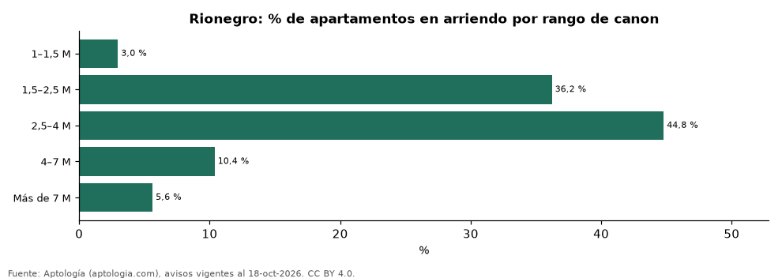

# Qué apartamento se arrienda en Rionegro en cada rango de canon: tamaño, m² y oferta (octubre 2026)

**En Rionegro, el rango de canon con más oferta de apartamentos en arriendo es 2,5–4 M de pesos al mes (44,8 % de los avisos), con un área mediana de 74 m². El 3,0 % de la oferta se pide en menos de 1,5 millones.**

*Resumen: clasificamos 3.197 apartamentos en arriendo en Rionegro en seis rangos de canon mensual.*

**Actualizado:** 18 de octubre de 2026 (datos del 18 de octubre de 2026) · **Próxima actualización:** mensual.

## Resumen

| Indicador | Valor |
|---|---|
| Rango con más oferta | 2,5–4 M (44,8 %) |
| Menos de 1,5 millones | 3,0 % |
| Avisos | 3.197 |

## Oferta, tamaño y m² por rango de canon

| Rango de canon mensual | % de la oferta | Área mediana (m²) | Canon por m² (mediana) | Habitaciones más comunes | Avisos |
|---|---|---|---|---|---|
| 1–1,5 M | 3,0 % | 52 | 26.364 pesos | 2 hab. | 95 |
| 1,5–2,5 M | 36,2 % | 57 | 32.292 pesos | 2 hab. | 1.158 |
| 2,5–4 M | 44,8 % | 74 | 39.744 pesos | 2 hab. | 1.432 |
| 4–7 M | 10,4 % | 100 | 56.522 pesos | 2 hab. | 332 |
| Más de 7 M | 5,6 % | 137 | 65.625 pesos | 2 hab. | 180 |

Canon mensual pedido sin administración; rangos con menos de 30 avisos se omiten.

## Preguntas frecuentes

**¿Qué apartamento se arrienda con 2 millones en Rionegro?**
Ver la fila 1,5–2,5 M: área mediana y habitaciones más comunes de esa franja.

**¿Cuál es el canon más común en Rionegro?**
2,5–4 M de pesos al mes, con el 44,8 % de la oferta.

## Metodología

- **Fuente:** exportes nocturnos de la base de datos de Aptología (aptologia.com) del 18 de octubre de 2026: avisos vigentes de vivienda en portales inmobiliarios de 13 países, recogidos por Aptología y vistos en línea entre el 11 y el 18 de octubre de 2026. Corte: 18 de octubre de 2026.
- **Depuración:** se eliminan duplicados exactos (misma ciudad, zona, tipo, precio, moneda, área, habitaciones y baños) y los precios fuera del percentil 1–99 de cada país, operación, moneda y tipo; el precio por m² usa solo avisos con área declarada entre 12 y 2.000 m² y también se recorta al P1–P99.
- **Qué se mide:** precios pedidos (publicados), no precios de cierre. En arriendo, el canon mensual sin administración, gastos comunes ni condominio.
- **Muestra mínima:** cada cifra publicada se apoya en al menos 30 avisos; las celdas con menos se omiten.
- **Colombia:** Precios en pesos colombianos, sin conversión de moneda.
- **Limitaciones:** la cobertura depende de los portales que recorre Aptología en cada país y es mayor en las ciudades grandes y en los segmentos medio-alto y alto; el área es la que declara el aviso, sin verificar; los nombres de zona vienen de los portales.
- **Privacidad:** solo se publican agregados; no se publica ningún dato personal, enlace a avisos ni nombre de anunciante.
- **Datos abiertos:** [datos.csv](datos.csv), licencia CC BY 4.0.

## Cómo citar

Pinzón Pineda, D. M. (2026). *Qué apartamento se arrienda en Rionegro en cada rango de canon: tamaño, m² y oferta (octubre 2026)*. Aptología (aptologia.com). https://github.com/elbroker/aptologia-datos/tree/main/estudios/apartamentos-en-arriendo-por-rango-de-canon-rionegro-2026. Datos: datos.csv, licencia CC BY 4.0.
