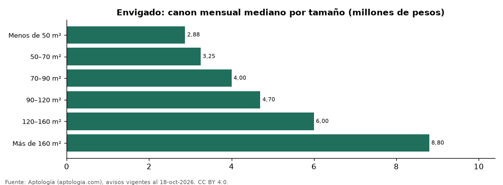

# Apartamentos en arriendo en Envigado según tamaño: precio y m² de cada grupo (octubre 2026)

**En Envigado, un apartamento en arriendo del grupo «Menos de 50 m²» se pide en 2.875.000 pesos al mes en la mediana y uno del grupo «Más de 160 m²» en 8.800.000 pesos al mes (+206,1 %).** Por metro cuadrado, el más barato es «120–160 m²» (44.870 pesos/m² al mes) y el más caro «Menos de 50 m²» (72.917 pesos/m² al mes).

*Resumen: analizamos 7.343 apartamentos en arriendo en Envigado con tamaño declarado.*

**Actualizado:** 18 de octubre de 2026 (datos del 18 de octubre de 2026) · **Próxima actualización:** mensual.

## Resumen

| Indicador | Valor |
|---|---|
| Menos de 50 m² | 2.875.000 pesos |
| 50–70 m² | 3.250.000 pesos |
| 70–90 m² | 4.000.000 pesos |
| 90–120 m² | 4.700.000 pesos |
| 120–160 m² | 6.000.000 pesos |
| Más de 160 m² | 8.800.000 pesos |
| Avisos | 7.343 |

## Canon mensual y m² por tamaño

| Tamaño | Canon mensual (mediana) | Rango típico (P25–P75) | Por m² (mediana) | Área mediana (m²) | Avisos |
|---|---|---|---|---|---|
| Menos de 50 m² | 2.875.000 pesos | 1.700.000 pesos – 3.825.000 pesos | 72.917 pesos | 40 | 52 |
| 50–70 m² | 3.250.000 pesos | 2.800.000 pesos – 3.750.000 pesos | 50.763 pesos | 65 | 867 |
| 70–90 m² | 4.000.000 pesos | 3.600.000 pesos – 4.500.000 pesos | 50.588 pesos | 80 | 2.647 |
| 90–120 m² | 4.700.000 pesos | 4.200.000 pesos – 5.500.000 pesos | 47.778 pesos | 100 | 2.369 |
| 120–160 m² | 6.000.000 pesos | 5.000.000 pesos – 7.000.000 pesos | 44.870 pesos | 132 | 938 |
| Más de 160 m² | 8.800.000 pesos | 7.000.000 pesos – 10.000.000 pesos | 45.324 pesos | 186 | 470 |

Medianas del canon pedido, sin administración ni gastos comunes; grupos con menos de 30 avisos se omiten.

## Preguntas frecuentes

**¿Cuánto cuesta arrendar un apartamento de qué tamaño en Envigado?**
Menos de 50 m²: 2.875.000 pesos al mes; 50–70 m²: 3.250.000 pesos al mes; 70–90 m²: 4.000.000 pesos al mes; 90–120 m²: 4.700.000 pesos al mes; 120–160 m²: 6.000.000 pesos al mes; Más de 160 m²: 8.800.000 pesos al mes (medianas de octubre de 2026).

**¿Qué grupo sale más barato por m²?**
Por metro cuadrado, el más barato es «120–160 m²» (44.870 pesos/m² al mes) y el más caro «Menos de 50 m²» (72.917 pesos/m² al mes).

## Metodología

- **Fuente:** exportes nocturnos de la base de datos de Aptología (aptologia.com) del 18 de octubre de 2026: avisos vigentes de vivienda en portales inmobiliarios de 13 países, recogidos por Aptología y vistos en línea entre el 11 y el 18 de octubre de 2026. Corte: 18 de octubre de 2026.
- **Depuración:** se eliminan duplicados exactos (misma ciudad, zona, tipo, precio, moneda, área, habitaciones y baños) y los precios fuera del percentil 1–99 de cada país, operación, moneda y tipo; el precio por m² usa solo avisos con área declarada entre 12 y 2.000 m² y también se recorta al P1–P99.
- **Qué se mide:** precios pedidos (publicados), no precios de cierre. En arriendo, el canon mensual sin administración, gastos comunes ni condominio.
- **Muestra mínima:** cada cifra publicada se apoya en al menos 30 avisos; las celdas con menos se omiten.
- **Colombia:** Precios en pesos colombianos, sin conversión de moneda.
- **Cordura:** solo se publica si la mediana crece con tamaño.
- **Limitaciones:** la cobertura depende de los portales que recorre Aptología en cada país y es mayor en las ciudades grandes y en los segmentos medio-alto y alto; el área es la que declara el aviso, sin verificar; los nombres de zona vienen de los portales.
- **Privacidad:** solo se publican agregados; no se publica ningún dato personal, enlace a avisos ni nombre de anunciante.
- **Datos abiertos:** [datos.csv](datos.csv), licencia CC BY 4.0.

## Cómo citar

Pinzón Pineda, D. M. (2026). *Apartamentos en arriendo en Envigado según tamaño: precio y m² de cada grupo (octubre 2026)*. Aptología (aptologia.com). https://github.com/elbroker/aptologia-datos/tree/main/estudios/apartamentos-en-arriendo-por-tamano-envigado-2026. Datos: datos.csv, licencia CC BY 4.0.
