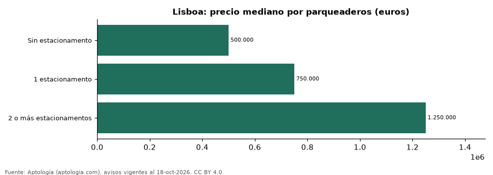

# Apartamentos en venta en Lisboa según parqueaderos: precio y m² de cada grupo (octubre 2026)

**En Lisboa, un apartamento en venta del grupo «Sin estacionamento» se pide en 500.000 euros (USD 562.042) en la mediana y uno del grupo «2 o más estacionamentos» en 1.250.000 euros (USD 1.405.104) (+150,0 %).** Por metro cuadrado, el más barato es «Sin estacionamento» (6.802 euros (USD 7.646)/m²) y el más caro «1 estacionamento» (8.194 euros (USD 9.210)/m²).

*Resumen: analizamos 1.583 apartamentos en venta en Lisboa con parqueaderos declarado.*

**Actualizado:** 18 de octubre de 2026 (datos del 18 de octubre de 2026) · **Próxima actualización:** mensual.

## Resumen

| Indicador | Valor |
|---|---|
| Sin estacionamento | 500.000 euros (USD 562.042) |
| 1 estacionamento | 750.000 euros (USD 843.062) |
| 2 o más estacionamentos | 1.250.000 euros (USD 1.405.104) |
| Avisos | 1.583 |

## Precio y m² por parqueaderos

| Parqueaderos | Precio (mediana) | Rango típico (P25–P75) | Por m² (mediana) | Área mediana (m²) | Avisos |
|---|---|---|---|---|---|
| Sin estacionamento | 500.000 euros (USD 562.042) | 375.000 euros (USD 421.531) – 720.000 euros (USD 809.340) | 6.802 euros (USD 7.646) | 75 | 941 |
| 1 estacionamento | 750.000 euros (USD 843.062) | 597.875 euros (USD 672.061) – 949.000 euros (USD 1.066.755) | 8.194 euros (USD 9.210) | 92 | 362 |
| 2 o más estacionamentos | 1.250.000 euros (USD 1.405.104) | 950.000 euros (USD 1.067.879) – 1.700.000 euros (USD 1.910.941) | 8.110 euros (USD 9.116) | 150 | 280 |

Medianas del precio pedido; grupos con menos de 30 avisos se omiten.

## Preguntas frecuentes

**¿Cuánto cuesta comprar un apartamento con cuántos parqueaderos en Lisboa?**
Sin estacionamento: 500.000 euros (USD 562.042); 1 estacionamento: 750.000 euros (USD 843.062); 2 o más estacionamentos: 1.250.000 euros (USD 1.405.104) (medianas de octubre de 2026).

**¿Qué grupo sale más barato por m²?**
Por metro cuadrado, el más barato es «Sin estacionamento» (6.802 euros (USD 7.646)/m²) y el más caro «1 estacionamento» (8.194 euros (USD 9.210)/m²).

## Metodología

- **Fuente:** exportes nocturnos de la base de datos de Aptología (aptologia.com) del 18 de octubre de 2026: avisos vigentes de vivienda en portales inmobiliarios de 13 países, recogidos por Aptología y vistos en línea entre el 11 y el 18 de octubre de 2026. Corte: 18 de octubre de 2026.
- **Depuración:** se eliminan duplicados exactos (misma ciudad, zona, tipo, precio, moneda, área, habitaciones y baños) y los precios fuera del percentil 1–99 de cada país, operación, moneda y tipo; el precio por m² usa solo avisos con área declarada entre 12 y 2.000 m² y también se recorta al P1–P99.
- **Qué se mide:** precios pedidos (publicados), no precios de cierre. En arriendo, el canon mensual sin administración, gastos comunes ni condominio.
- **Muestra mínima:** cada cifra publicada se apoya en al menos 30 avisos; las celdas con menos se omiten.
- **Monedas:** nunca se mezclan avisos de monedas distintas sin convertirlos. Conversión a dólares con la tasa de mercado de ExchangeRate-API (open.er-api.com, actualización del 18 Oct 2026): 1 USD = 3.182,80 COP, 1 USD = 18,47 M.N, 1 USD = 5,09 BRL, 1 USD = 3,44 PEN, 1 USD = 982,44 CLP, 1 USD = 1.514,57 ARS, 1 USD = 40,20 UYU, 1 USD = 5.705,37 PYG, 1 USD = 61,27 DOP, 1 USD = 0,89 EUR, 1 USD = 11,72 BOB; la UF chilena a 41.178,64 CLP (mindicador,cl. 18-oct-2026). Los avisos publicados en dólares se usan tal cual.
- **Monedas:** en cada ciudad y operación se usa solo la moneda mayoritaria de los avisos (los avisos en otra moneda se excluyen) y la mediana se convierte a dólares con la tasa citada; nunca se promedian avisos de monedas distintas.
- **Cordura:** solo se publica si la mediana crece con parqueaderos.
- **Limitaciones:** la cobertura depende de los portales que recorre Aptología en cada país y es mayor en las ciudades grandes y en los segmentos medio-alto y alto; el área es la que declara el aviso, sin verificar; los nombres de zona vienen de los portales.
- **Privacidad:** solo se publican agregados; no se publica ningún dato personal, enlace a avisos ni nombre de anunciante.
- **Datos abiertos:** [datos.csv](datos.csv), licencia CC BY 4.0.

## Cómo citar

Pinzón Pineda, D. M. (2026). *Apartamentos en venta en Lisboa según parqueaderos: precio y m² de cada grupo (octubre 2026)*. Aptología (aptologia.com). https://github.com/elbroker/aptologia-datos/tree/main/estudios/apartamentos-en-venta-por-parqueaderos-lisboa-2026. Datos: datos.csv, licencia CC BY 4.0.
