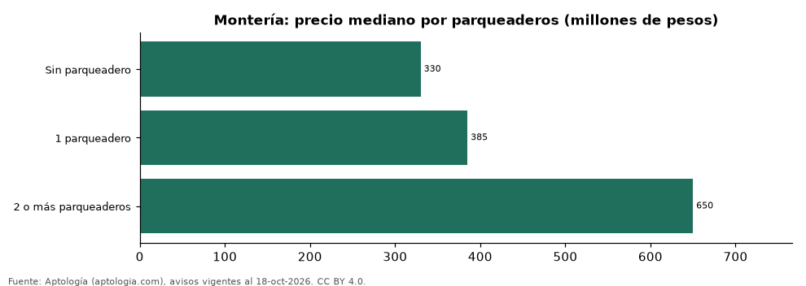

# Apartamentos en venta en Montería según parqueaderos: precio y m² de cada grupo (octubre 2026)

**En Montería, un apartamento en venta del grupo «Sin parqueadero» se pide en 330 millones de pesos en la mediana y uno del grupo «2 o más parqueaderos» en 650 millones de pesos (+97,0 %).** Por metro cuadrado, el más barato es «1 parqueadero» (3,68 millones de pesos/m²) y el más caro «Sin parqueadero» (3,86 millones de pesos/m²).

*Resumen: analizamos 272 apartamentos en venta en Montería con parqueaderos declarado.*

**Actualizado:** 18 de octubre de 2026 (datos del 18 de octubre de 2026) · **Próxima actualización:** mensual.

## Resumen

| Indicador | Valor |
|---|---|
| Sin parqueadero | 330 millones de pesos |
| 1 parqueadero | 385 millones de pesos |
| 2 o más parqueaderos | 650 millones de pesos |
| Avisos | 272 |

## Precio y m² por parqueaderos

| Parqueaderos | Precio (mediana) | Rango típico (P25–P75) | Por m² (mediana) | Área mediana (m²) | Avisos |
|---|---|---|---|---|---|
| Sin parqueadero | 330 millones de pesos | 260 millones de pesos – 420 millones de pesos | 3,86 millones de pesos | 106 | 49 |
| 1 parqueadero | 385 millones de pesos | 300 millones de pesos – 450 millones de pesos | 3,68 millones de pesos | 111 | 181 |
| 2 o más parqueaderos | 650 millones de pesos | 500 millones de pesos – 835 millones de pesos | 3,82 millones de pesos | 160 | 42 |

Medianas del precio pedido; grupos con menos de 30 avisos se omiten.

## Preguntas frecuentes

**¿Cuánto cuesta comprar un apartamento con cuántos parqueaderos en Montería?**
Sin parqueadero: 330 millones de pesos; 1 parqueadero: 385 millones de pesos; 2 o más parqueaderos: 650 millones de pesos (medianas de octubre de 2026).

**¿Qué grupo sale más barato por m²?**
Por metro cuadrado, el más barato es «1 parqueadero» (3,68 millones de pesos/m²) y el más caro «Sin parqueadero» (3,86 millones de pesos/m²).

## Metodología

- **Fuente:** exportes nocturnos de la base de datos de Aptología (aptologia.com) del 18 de octubre de 2026: avisos vigentes de vivienda en portales inmobiliarios de 13 países, recogidos por Aptología y vistos en línea entre el 11 y el 18 de octubre de 2026. Corte: 18 de octubre de 2026.
- **Depuración:** se eliminan duplicados exactos (misma ciudad, zona, tipo, precio, moneda, área, habitaciones y baños) y los precios fuera del percentil 1–99 de cada país, operación, moneda y tipo; el precio por m² usa solo avisos con área declarada entre 12 y 2.000 m² y también se recorta al P1–P99.
- **Qué se mide:** precios pedidos (publicados), no precios de cierre. En arriendo, el canon mensual sin administración, gastos comunes ni condominio.
- **Muestra mínima:** cada cifra publicada se apoya en al menos 30 avisos; las celdas con menos se omiten.
- **Colombia:** Precios en pesos colombianos, sin conversión de moneda.
- **Cordura:** solo se publica si la mediana crece con parqueaderos.
- **Limitaciones:** la cobertura depende de los portales que recorre Aptología en cada país y es mayor en las ciudades grandes y en los segmentos medio-alto y alto; el área es la que declara el aviso, sin verificar; los nombres de zona vienen de los portales.
- **Privacidad:** solo se publican agregados; no se publica ningún dato personal, enlace a avisos ni nombre de anunciante.
- **Datos abiertos:** [datos.csv](datos.csv), licencia CC BY 4.0.

## Cómo citar

Pinzón Pineda, D. M. (2026). *Apartamentos en venta en Montería según parqueaderos: precio y m² de cada grupo (octubre 2026)*. Aptología (aptologia.com). https://github.com/elbroker/aptologia-datos/tree/main/estudios/apartamentos-en-venta-por-parqueaderos-monteria-2026. Datos: datos.csv, licencia CC BY 4.0.
