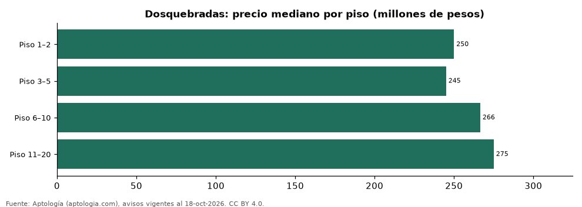

# Apartamentos en venta en Dosquebradas según piso: precio y m² de cada grupo (octubre 2026)

**En Dosquebradas, un apartamento en venta del grupo «Piso 1–2» se pide en 250 millones de pesos en la mediana y uno del grupo «Piso 11–20» en 275 millones de pesos (+10,0 %).** Por metro cuadrado, el más barato es «Piso 3–5» (4,44 millones de pesos/m²) y el más caro «Piso 6–10» (4,81 millones de pesos/m²).

*Resumen: analizamos 499 apartamentos en venta en Dosquebradas con piso declarado.*

**Actualizado:** 18 de octubre de 2026 (datos del 18 de octubre de 2026) · **Próxima actualización:** mensual.

## Resumen

| Indicador | Valor |
|---|---|
| Piso 1–2 | 250 millones de pesos |
| Piso 3–5 | 245 millones de pesos |
| Piso 6–10 | 266 millones de pesos |
| Piso 11–20 | 275 millones de pesos |
| Avisos | 499 |

## Precio y m² por piso

| Piso | Precio (mediana) | Rango típico (P25–P75) | Por m² (mediana) | Área mediana (m²) | Avisos |
|---|---|---|---|---|---|
| Piso 1–2 | 250 millones de pesos | 220 millones de pesos – 300 millones de pesos | 4,45 millones de pesos | 57 | 121 |
| Piso 3–5 | 245 millones de pesos | 210 millones de pesos – 320 millones de pesos | 4,44 millones de pesos | 56 | 135 |
| Piso 6–10 | 266 millones de pesos | 223 millones de pesos – 356 millones de pesos | 4,81 millones de pesos | 56 | 156 |
| Piso 11–20 | 275 millones de pesos | 210 millones de pesos – 396 millones de pesos | 4,80 millones de pesos | 58 | 87 |

Medianas del precio pedido; grupos con menos de 30 avisos se omiten.

## Preguntas frecuentes

**¿Cuánto cuesta comprar un apartamento en qué piso en Dosquebradas?**
Piso 1–2: 250 millones de pesos; Piso 3–5: 245 millones de pesos; Piso 6–10: 266 millones de pesos; Piso 11–20: 275 millones de pesos (medianas de octubre de 2026).

**¿Qué grupo sale más barato por m²?**
Por metro cuadrado, el más barato es «Piso 3–5» (4,44 millones de pesos/m²) y el más caro «Piso 6–10» (4,81 millones de pesos/m²).

## Metodología

- **Fuente:** exportes nocturnos de la base de datos de Aptología (aptologia.com) del 18 de octubre de 2026: avisos vigentes de vivienda en portales inmobiliarios de 13 países, recogidos por Aptología y vistos en línea entre el 11 y el 18 de octubre de 2026. Corte: 18 de octubre de 2026.
- **Depuración:** se eliminan duplicados exactos (misma ciudad, zona, tipo, precio, moneda, área, habitaciones y baños) y los precios fuera del percentil 1–99 de cada país, operación, moneda y tipo; el precio por m² usa solo avisos con área declarada entre 12 y 2.000 m² y también se recorta al P1–P99.
- **Qué se mide:** precios pedidos (publicados), no precios de cierre. En arriendo, el canon mensual sin administración, gastos comunes ni condominio.
- **Muestra mínima:** cada cifra publicada se apoya en al menos 30 avisos; las celdas con menos se omiten.
- **Colombia:** Precios en pesos colombianos, sin conversión de moneda.
- **Limitaciones:** la cobertura depende de los portales que recorre Aptología en cada país y es mayor en las ciudades grandes y en los segmentos medio-alto y alto; el área es la que declara el aviso, sin verificar; los nombres de zona vienen de los portales.
- **Privacidad:** solo se publican agregados; no se publica ningún dato personal, enlace a avisos ni nombre de anunciante.
- **Datos abiertos:** [datos.csv](datos.csv), licencia CC BY 4.0.

## Cómo citar

Pinzón Pineda, D. M. (2026). *Apartamentos en venta en Dosquebradas según piso: precio y m² de cada grupo (octubre 2026)*. Aptología (aptologia.com). https://github.com/elbroker/aptologia-datos/tree/main/estudios/apartamentos-en-venta-por-piso-dosquebradas-2026. Datos: datos.csv, licencia CC BY 4.0.
