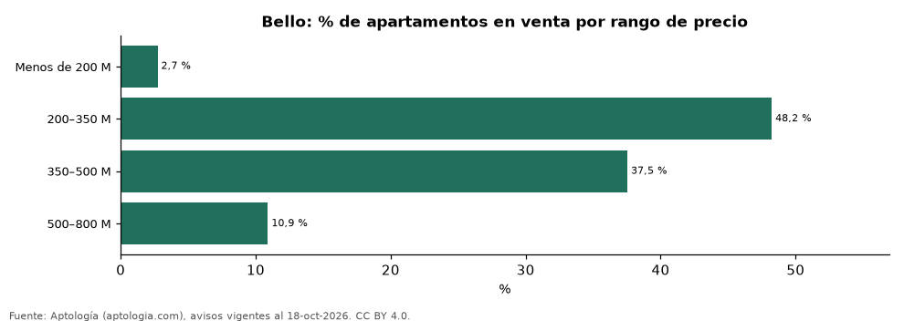

# Qué apartamento se compra en Bello en cada rango de precio: tamaño, m² y oferta (octubre 2026)

**En Bello, el rango de precio con más oferta de apartamentos en venta es 200–350 M de pesos (48,2 % de los avisos), con un área mediana de 56 m². El 51,0 % de la oferta cuesta menos de 350 millones.**

*Resumen: clasificamos 2.347 apartamentos en venta en Bello en seis rangos de precio pedido.*

**Actualizado:** 18 de octubre de 2026 (datos del 18 de octubre de 2026) · **Próxima actualización:** mensual.

## Resumen

| Indicador | Valor |
|---|---|
| Rango con más oferta | 200–350 M (48,2 %) |
| Menos de 350 millones | 51,0 % |
| Avisos | 2.347 |

## Oferta por rango de precio (millones de pesos)

| Rango de precio | % de la oferta | Área mediana (m²) | Precio por m² (mediana) | Habitaciones más comunes | Avisos |
|---|---|---|---|---|---|
| Menos de 200 M | 2,7 % | 45 | 3,96 millones de pesos | 2 hab. | 64 |
| 200–350 M | 48,2 % | 56 | 4,96 millones de pesos | 3 o más hab. | 1.132 |
| 350–500 M | 37,5 % | 67 | 6,14 millones de pesos | 3 o más hab. | 881 |
| 500–800 M | 10,9 % | 84 | 6,96 millones de pesos | 3 o más hab. | 256 |

Solo rangos con 30 avisos o más; el área y el m² son medianas dentro de cada rango.

## Preguntas frecuentes

**¿Cuántos apartamentos de menos de 350 millones hay en Bello?**
El 51,0 % de la oferta en venta (octubre de 2026); ver el área mediana de cada rango en la tabla.

**¿Cuál es el rango de precio más común en Bello?**
200–350 M de pesos, con el 48,2 % de los avisos.

## Metodología

- **Fuente:** exportes nocturnos de la base de datos de Aptología (aptologia.com) del 18 de octubre de 2026: avisos vigentes de vivienda en portales inmobiliarios de 13 países, recogidos por Aptología y vistos en línea entre el 11 y el 18 de octubre de 2026. Corte: 18 de octubre de 2026.
- **Depuración:** se eliminan duplicados exactos (misma ciudad, zona, tipo, precio, moneda, área, habitaciones y baños) y los precios fuera del percentil 1–99 de cada país, operación, moneda y tipo; el precio por m² usa solo avisos con área declarada entre 12 y 2.000 m² y también se recorta al P1–P99.
- **Qué se mide:** precios pedidos (publicados), no precios de cierre. En arriendo, el canon mensual sin administración, gastos comunes ni condominio.
- **Muestra mínima:** cada cifra publicada se apoya en al menos 30 avisos; las celdas con menos se omiten.
- **Colombia:** Precios en pesos colombianos, sin conversión de moneda.
- **Limitaciones:** la cobertura depende de los portales que recorre Aptología en cada país y es mayor en las ciudades grandes y en los segmentos medio-alto y alto; el área es la que declara el aviso, sin verificar; los nombres de zona vienen de los portales.
- **Privacidad:** solo se publican agregados; no se publica ningún dato personal, enlace a avisos ni nombre de anunciante.
- **Datos abiertos:** [datos.csv](datos.csv), licencia CC BY 4.0.

## Cómo citar

Pinzón Pineda, D. M. (2026). *Qué apartamento se compra en Bello en cada rango de precio: tamaño, m² y oferta (octubre 2026)*. Aptología (aptologia.com). https://github.com/elbroker/aptologia-datos/tree/main/estudios/apartamentos-en-venta-por-rango-de-precio-bello-2026. Datos: datos.csv, licencia CC BY 4.0.
