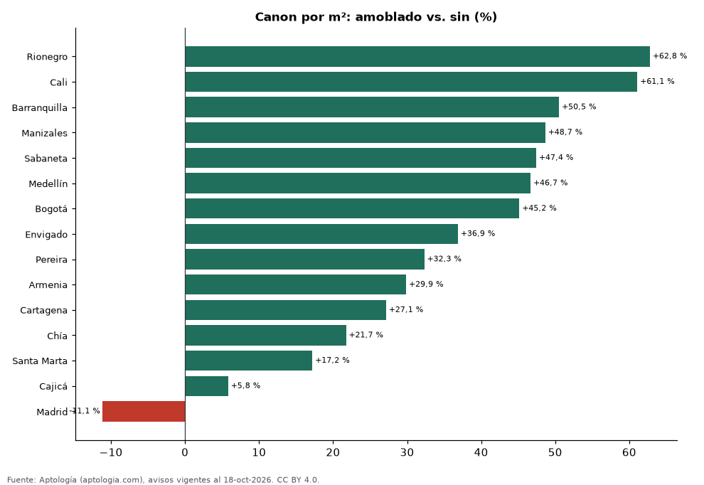

# Cuánto más cuesta arrendar un apartamento amoblado en Colombia: diferencia por ciudad (octubre 2026)

**Un apartamento en arriendo amoblado se pide en Colombia un 37,4 % más por metro cuadrado que uno comparable sin esa característica (misma ciudad y número de habitaciones).** El 13,5 % de los apartamentos en arriendo lo declara. En Bogotá la diferencia es 45,2 % (16,4 % de la oferta).

*Resumen: comparamos 64.543 apartamentos en arriendo con área declarada, emparejando por ciudad y habitaciones (29 celdas con 30 avisos o más en cada grupo).*

**Actualizado:** 18 de octubre de 2026 (datos del 18 de octubre de 2026) · **Próxima actualización:** mensual.

## Resumen

| Indicador | Valor |
|---|---|
| Diferencia por m² (emparejada) | +37,4 % |
| Parte de la oferta | 13,5 % |
| Ciudades con muestra suficiente | 15 |
| Avisos analizados | 64.543 |

## Diferencia por ciudad

| Ciudad | Diferencia por m² | Con amoblado (pesos/m²) | Sin amoblado (pesos/m²) | Parte de la oferta | Avisos (con / sin) |
|---|---|---|---|---|---|
| Rionegro | +62,8 % | 60.465 | 37.143 | 6,3 % | 201 / 2.978 |
| Cali | +61,1 % | 45.644 | 28.333 | 14,1 % | 212 / 1.287 |
| Barranquilla | +50,5 % | 46.552 | 30.928 | 20,7 % | 765 / 2.929 |
| Manizales | +48,7 % | 45.027 | 30.289 | 12,1 % | 34 / 248 |
| Sabaneta | +47,4 % | 60.000 | 40.698 | 6,1 % | 237 / 3.631 |
| Medellín | +46,7 % | 68.750 | 46.875 | 15,5 % | 3.107 / 16.961 |
| Bogotá | +45,2 % | 66.176 | 45.588 | 16,4 % | 2.121 / 10.833 |
| Envigado | +36,9 % | 66.221 | 48.387 | 7,0 % | 508 / 6.795 |
| Pereira | +32,3 % | 43.000 | 32.500 | 10,0 % | 153 / 1.377 |
| Armenia | +29,9 % | 40.000 | 30.801 | 11,0 % | 37 / 300 |
| Cartagena | +27,1 % | 51.462 | 40.474 | 32,4 % | 650 / 1.358 |
| Chía | +21,7 % | 39.800 | 32.692 | 14,7 % | 72 / 417 |
| Santa Marta | +17,2 % | 48.548 | 41.422 | 43,9 % | 296 / 378 |
| Cajicá | +5,8 % | 35.714 | 33.750 | 8,8 % | 34 / 351 |
| Madrid | -11,1 % | 18.837 | 21.192 | 13,5 % | 35 / 224 |

Mediana del canon por m² con y sin la característica en cada ciudad (30 avisos o más en cada grupo). La cifra nacional promedia las diferencias dentro de cada combinación de ciudad y número de habitaciones, ponderadas por el número de avisos con la característica.

## Preguntas frecuentes

**¿Cuánto más cuesta arrendar un apartamento amoblado en Colombia?**
En la oferta de octubre de 2026, un 37,4 % más por metro cuadrado que uno comparable.

**¿Qué porcentaje de los arriendos en Colombia es amoblado?**
El 13,5 % de los apartamentos en arriendo con el dato informado.

## Metodología

- **Fuente:** exportes nocturnos de la base de datos de Aptología (aptologia.com) del 18 de octubre de 2026: avisos vigentes de vivienda en portales inmobiliarios de 13 países, recogidos por Aptología y vistos en línea entre el 11 y el 18 de octubre de 2026. Corte: 18 de octubre de 2026.
- **Depuración:** se eliminan duplicados exactos (misma ciudad, zona, tipo, precio, moneda, área, habitaciones y baños) y los precios fuera del percentil 1–99 de cada país, operación, moneda y tipo; el precio por m² usa solo avisos con área declarada entre 12 y 2.000 m² y también se recorta al P1–P99.
- **Qué se mide:** precios pedidos (publicados), no precios de cierre. En arriendo, el canon mensual sin administración, gastos comunes ni condominio.
- **Muestra mínima:** cada cifra publicada se apoya en al menos 30 avisos; las celdas con menos se omiten.
- **Colombia:** Precios en pesos colombianos, sin conversión de moneda. Los indicadores de amoblado, mascotas, conjunto cerrado, balcón y aviso directo del dueño solo existen en arriendo y vienen de los portales.
- **Limitaciones:** la cobertura depende de los portales que recorre Aptología en cada país y es mayor en las ciudades grandes y en los segmentos medio-alto y alto; el área es la que declara el aviso, sin verificar; los nombres de zona vienen de los portales.
- **Privacidad:** solo se publican agregados; no se publica ningún dato personal, enlace a avisos ni nombre de anunciante.
- **Datos abiertos:** [datos.csv](datos.csv), licencia CC BY 4.0.

## Cómo citar

Pinzón Pineda, D. M. (2026). *Cuánto más cuesta arrendar un apartamento amoblado en Colombia: diferencia por ciudad (octubre 2026)*. Aptología (aptologia.com). https://github.com/elbroker/aptologia-datos/tree/main/estudios/arriendo-amoblado-vs-sin-amoblar-colombia-2026. Datos: datos.csv, licencia CC BY 4.0.
