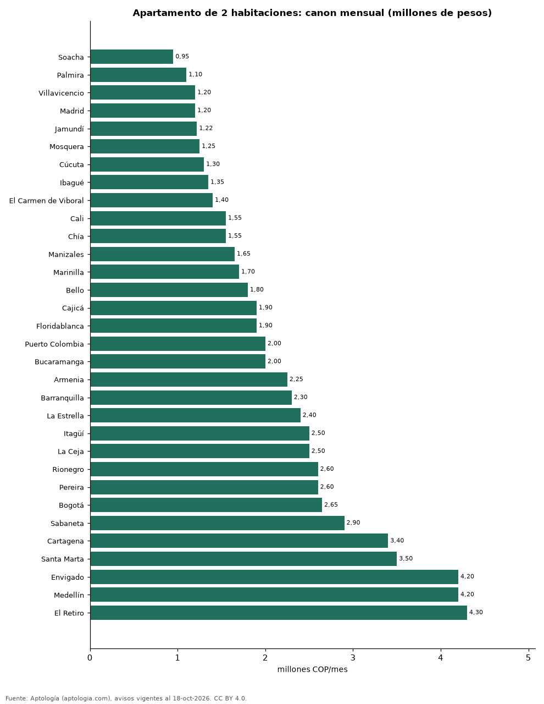

# Cuánto cuesta arrendar un apartamento de 2 habitaciones en 32 ciudades de Colombia (octubre 2026)

**Arrendar un apartamento de 2 habitaciones cuesta en la mediana 950.000 pesos al mes en Soacha, la más barata de la muestra, y 4.300.000 pesos en El Retiro, la más cara.** En Bogotá la mediana es 2.646.500 pesos y en Medellín 4.200.000 pesos, sin administración.

*Resumen: comparamos 23.499 apartamentos de 2 habitaciones en arriendo en 32 ciudades.*

**Actualizado:** 18 de octubre de 2026 (datos del 18 de octubre de 2026) · **Próxima actualización:** mensual.

## Resumen

| Indicador | Valor |
|---|---|
| Más barata | Soacha: 950.000 pesos |
| Más cara | El Retiro: 4.300.000 pesos |
| Bogotá | 2.646.500 pesos |
| Medellín | 4.200.000 pesos |

## Ciudades de menor a mayor (30 avisos o más)

| Ciudad | Canon mensual (mediana) | Avisos |
|---|---|---|
| Soacha | 950.000 pesos | 73 |
| Palmira | 1.100.000 pesos | 31 |
| Villavicencio | 1.200.000 pesos | 36 |
| Madrid | 1.200.000 pesos | 60 |
| Jamundí | 1.220.000 pesos | 96 |
| Mosquera | 1.250.000 pesos | 43 |
| Cúcuta | 1.300.000 pesos | 108 |
| Ibagué | 1.349.350 pesos | 68 |
| El Carmen de Viboral | 1.400.000 pesos | 51 |
| Cali | 1.550.000 pesos | 633 |
| Chía | 1.550.000 pesos | 233 |
| Manizales | 1.650.000 pesos | 126 |
| Marinilla | 1.700.000 pesos | 56 |
| Bello | 1.800.000 pesos | 306 |
| Cajicá | 1.900.000 pesos | 206 |
| Floridablanca | 1.900.000 pesos | 62 |
| Puerto Colombia | 2.000.000 pesos | 58 |
| Bucaramanga | 2.000.000 pesos | 113 |
| Armenia | 2.250.000 pesos | 149 |
| Barranquilla | 2.300.000 pesos | 1.442 |
| La Estrella | 2.400.000 pesos | 252 |
| Itagüí | 2.500.000 pesos | 295 |
| La Ceja | 2.500.000 pesos | 159 |
| Rionegro | 2.600.000 pesos | 1.750 |
| Pereira | 2.600.000 pesos | 535 |
| Bogotá | 2.646.500 pesos | 4.530 |
| Sabaneta | 2.900.000 pesos | 1.301 |
| Cartagena | 3.400.000 pesos | 983 |
| Santa Marta | 3.500.000 pesos | 268 |
| Envigado | 4.200.000 pesos | 2.529 |
| Medellín | 4.200.000 pesos | 6.601 |
| El Retiro | 4.300.000 pesos | 346 |

Canon mensual pedido, sin administración.

## Preguntas frecuentes

**¿Cuánto cuesta arrendar un apartamento de 2 habitaciones en Bogotá?**
2.646.500 pesos al mes en la mediana, sin administración.

**¿Cuánto cuesta arrendar un apartamento de 2 habitaciones en Medellín?**
4.200.000 pesos al mes en la mediana.

**¿Cuál es la ciudad más barata para arrendar en Colombia?**
Entre las ciudades con 30 avisos o más de 2 habitaciones, Soacha: 950.000 pesos al mes.

## Metodología

- **Fuente:** exportes nocturnos de la base de datos de Aptología (aptologia.com) del 18 de octubre de 2026: avisos vigentes de vivienda en portales inmobiliarios de 13 países, recogidos por Aptología y vistos en línea entre el 11 y el 18 de octubre de 2026. Corte: 18 de octubre de 2026.
- **Depuración:** se eliminan duplicados exactos (misma ciudad, zona, tipo, precio, moneda, área, habitaciones y baños) y los precios fuera del percentil 1–99 de cada país, operación, moneda y tipo; el precio por m² usa solo avisos con área declarada entre 12 y 2.000 m² y también se recorta al P1–P99.
- **Qué se mide:** precios pedidos (publicados), no precios de cierre. En arriendo, el canon mensual sin administración, gastos comunes ni condominio.
- **Muestra mínima:** cada cifra publicada se apoya en al menos 30 avisos; las celdas con menos se omiten.
- **Colombia:** Precios en pesos colombianos, sin conversión de moneda. Los indicadores de amoblado, mascotas, conjunto cerrado, balcón y aviso directo del dueño solo existen en arriendo y vienen de los portales.
- **Mezcla de estratos:** la oferta de cada ciudad tiene una composición distinta; por ejemplo, en Medellín el 46,9 % de los apartamentos de 2 habitaciones en arriendo son estrato 6, frente al 27,1 % en Bogotá, lo que eleva la mediana de Medellín.
- **Limitaciones:** la cobertura depende de los portales que recorre Aptología en cada país y es mayor en las ciudades grandes y en los segmentos medio-alto y alto; el área es la que declara el aviso, sin verificar; los nombres de zona vienen de los portales.
- **Privacidad:** solo se publican agregados; no se publica ningún dato personal, enlace a avisos ni nombre de anunciante.
- **Datos abiertos:** [datos.csv](datos.csv), licencia CC BY 4.0.

## Cómo citar

Pinzón Pineda, D. M. (2026). *Cuánto cuesta arrendar un apartamento de 2 habitaciones en 32 ciudades de Colombia (octubre 2026)*. Aptología (aptologia.com). https://github.com/elbroker/aptologia-datos/tree/main/estudios/arriendo-apartamento-2-habitaciones-ciudades-colombia-2026. Datos: datos.csv, licencia CC BY 4.0.
