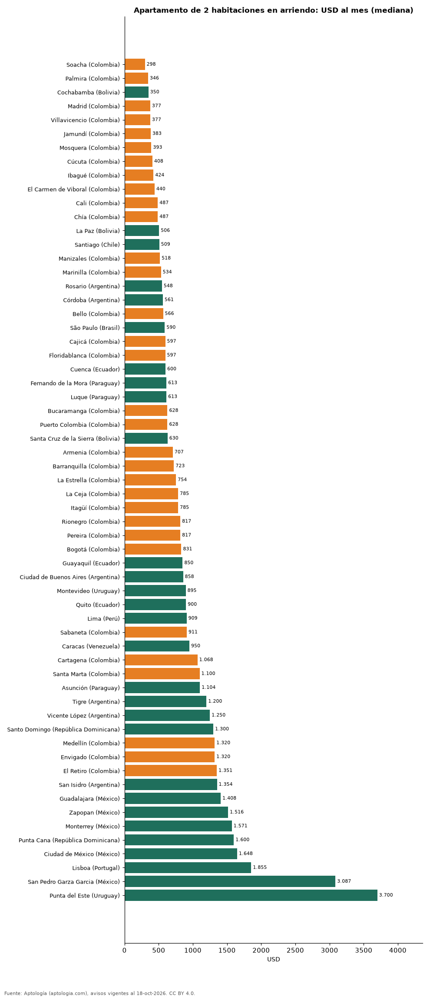

# Cuánto cuesta arrendar un apartamento de 2 habitaciones en 61 ciudades de Latinoamérica y Portugal (octubre 2026)

**Arrendar un apartamento de 2 habitaciones es más barato en Soacha (Colombia), con una mediana de USD 298 al mes, y más caro en Punta del Este (Uruguay), con USD 3.700 al mes.** En Bogotá la mediana es USD 831 al mes (2.646.500 pesos), puesto 36 de 61 de menor a mayor.

*Resumen: comparamos 47.465 apartamentos de 2 habitaciones en arriendo en 61 ciudades.*

**Actualizado:** 18 de octubre de 2026 (datos del 18 de octubre de 2026) · **Próxima actualización:** mensual.

## Resumen

| Indicador | Valor |
|---|---|
| Más barata | Soacha: USD 298 |
| Más cara | Punta del Este: USD 3.700 |
| Bogotá | USD 831 |
| Ciudades | 61 |

## Ciudades de menor a mayor (30 avisos o más)

| País | Ciudad | Arriendo USD/mes | Avisos |
|---|---|---|---|
| Colombia | Soacha | 298 | 73 |
| Colombia | Palmira | 346 | 31 |
| Bolivia | Cochabamba | 350 | 34 |
| Colombia | Madrid | 377 | 60 |
| Colombia | Villavicencio | 377 | 36 |
| Colombia | Jamundí | 383 | 96 |
| Colombia | Mosquera | 393 | 43 |
| Colombia | Cúcuta | 408 | 108 |
| Colombia | Ibagué | 424 | 68 |
| Colombia | El Carmen de Viboral | 440 | 51 |
| Colombia | Cali | 487 | 633 |
| Colombia | Chía | 487 | 233 |
| Bolivia | La Paz | 506 | 100 |
| Chile | Santiago | 509 | 3.879 |
| Colombia | Manizales | 518 | 126 |
| Colombia | Marinilla | 534 | 56 |
| Argentina | Rosario | 548 | 35 |
| Argentina | Córdoba | 561 | 62 |
| Colombia | Bello | 566 | 306 |
| Brasil | São Paulo | 590 | 4.869 |
| Colombia | Cajicá | 597 | 206 |
| Colombia | Floridablanca | 597 | 62 |
| Ecuador | Cuenca | 600 | 127 |
| Paraguay | Fernando de la Mora | 613 | 39 |
| Paraguay | Luque | 613 | 52 |
| Colombia | Bucaramanga | 628 | 113 |
| Colombia | Puerto Colombia | 628 | 58 |
| Bolivia | Santa Cruz de la Sierra | 630 | 396 |
| Colombia | Armenia | 707 | 149 |
| Colombia | Barranquilla | 723 | 1.442 |
| Colombia | La Estrella | 754 | 252 |
| Colombia | La Ceja | 785 | 159 |
| Colombia | Itagüí | 785 | 295 |
| Colombia | Rionegro | 817 | 1.750 |
| Colombia | Pereira | 817 | 535 |
| Colombia | Bogotá | 831 | 4.530 |
| Ecuador | Guayaquil | 850 | 599 |
| Argentina | Ciudad de Buenos Aires | 858 | 1.353 |
| Uruguay | Montevideo | 895 | 1.419 |
| Ecuador | Quito | 900 | 512 |
| Perú | Lima | 909 | 1.369 |
| Colombia | Sabaneta | 911 | 1.301 |
| Venezuela | Caracas | 950 | 80 |
| Colombia | Cartagena | 1.068 | 983 |
| Colombia | Santa Marta | 1.100 | 268 |
| Paraguay | Asunción | 1.104 | 2.005 |
| Argentina | Tigre | 1.200 | 53 |
| Argentina | Vicente López | 1.250 | 50 |
| República Dominicana | Santo Domingo | 1.300 | 1.263 |
| Colombia | Medellín | 1.320 | 6.601 |
| Colombia | Envigado | 1.320 | 2.529 |
| Colombia | El Retiro | 1.351 | 346 |
| Argentina | San Isidro | 1.354 | 48 |
| México | Guadalajara | 1.408 | 390 |
| México | Zapopan | 1.516 | 479 |
| México | Monterrey | 1.571 | 959 |
| República Dominicana | Punta Cana | 1.600 | 63 |
| México | Ciudad de México | 1.648 | 2.276 |
| Portugal | Lisboa | 1.855 | 190 |
| México | San Pedro Garza Garcia | 3.087 | 288 |
| Uruguay | Punta del Este | 3.700 | 977 |

## Preguntas frecuentes

**¿Dónde es más barato arrendar un apartamento de 2 habitaciones en Latinoamérica?**
En Soacha (Colombia): USD 298 al mes en la mediana.

**¿Cuánto cuesta arrendar un apartamento de 2 habitaciones en Bogotá?**
USD 831 al mes, es decir 2.646.500 pesos.

## Metodología

- **Fuente:** exportes nocturnos de la base de datos de Aptología (aptologia.com) del 18 de octubre de 2026: avisos vigentes de vivienda en portales inmobiliarios de 13 países, recogidos por Aptología y vistos en línea entre el 11 y el 18 de octubre de 2026. Corte: 18 de octubre de 2026.
- **Depuración:** se eliminan duplicados exactos (misma ciudad, zona, tipo, precio, moneda, área, habitaciones y baños) y los precios fuera del percentil 1–99 de cada país, operación, moneda y tipo; el precio por m² usa solo avisos con área declarada entre 12 y 2.000 m² y también se recorta al P1–P99.
- **Qué se mide:** precios pedidos (publicados), no precios de cierre. En arriendo, el canon mensual sin administración, gastos comunes ni condominio.
- **Muestra mínima:** cada cifra publicada se apoya en al menos 30 avisos; las celdas con menos se omiten.
- **Monedas:** nunca se mezclan avisos de monedas distintas sin convertirlos. Conversión a dólares con la tasa de mercado de ExchangeRate-API (open.er-api.com, actualización del 18 Oct 2026): 1 USD = 3.182,80 COP, 1 USD = 18,47 M.N, 1 USD = 5,09 BRL, 1 USD = 3,44 PEN, 1 USD = 982,44 CLP, 1 USD = 1.514,57 ARS, 1 USD = 40,20 UYU, 1 USD = 5.705,37 PYG, 1 USD = 61,27 DOP, 1 USD = 0,89 EUR, 1 USD = 11,72 BOB; la UF chilena a 41.178,64 CLP (mindicador,cl. 18-oct-2026). Los avisos publicados en dólares se usan tal cual.
- **Limitaciones:** la cobertura depende de los portales que recorre Aptología en cada país y es mayor en las ciudades grandes y en los segmentos medio-alto y alto; el área es la que declara el aviso, sin verificar; los nombres de zona vienen de los portales.
- **Privacidad:** solo se publican agregados; no se publica ningún dato personal, enlace a avisos ni nombre de anunciante.
- **Datos abiertos:** [datos.csv](datos.csv), licencia CC BY 4.0.

## Cómo citar

Pinzón Pineda, D. M. (2026). *Cuánto cuesta arrendar un apartamento de 2 habitaciones en 61 ciudades de Latinoamérica y Portugal (octubre 2026)*. Aptología (aptologia.com). https://github.com/elbroker/aptologia-datos/tree/main/estudios/arriendo-apartamento-2-habitaciones-ciudades-latinoamerica-2026. Datos: datos.csv, licencia CC BY 4.0.
